# Kubernetes Lab - Ubuntu Server 24.04 LTS

Projet de laboratoire pour déployer un cluster Kubernetes (1 Control Plane, 2 Workers) sur trois machines virtuelles Ubuntu Server 24.04.1 LTS sous VMware Workstation avec le réseau NAT (`VMnet8`), puis intégrer Rancher pour l'administration du cluster. Les VM ont ensuite été mises à niveau vers Ubuntu Server 26.04.1 LTS (voir la section 2).

> [!NOTE]
> Les blocs **« Pour aller plus loin »** ne sont pas nécessaires pour réaliser le laboratoire. Ils conservent les méthodes alternatives, les diagnostics détaillés et les explications destinés aux prochains intervenants qui voudront approfondir.

---

## 1. Illustrations du projet

### Google Cloud Platform
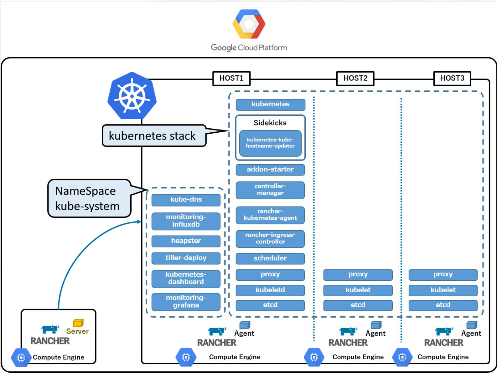

### Kubernetes
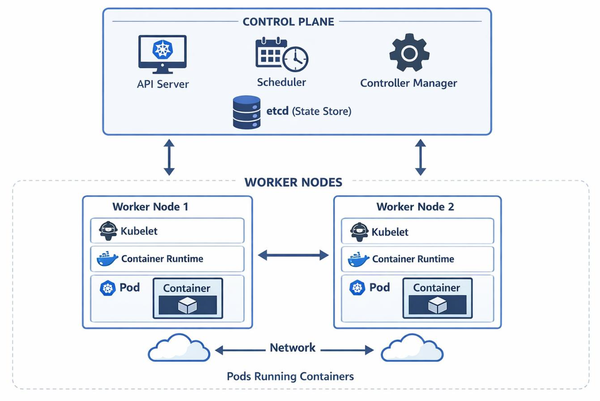

### Cluster Kubernetes
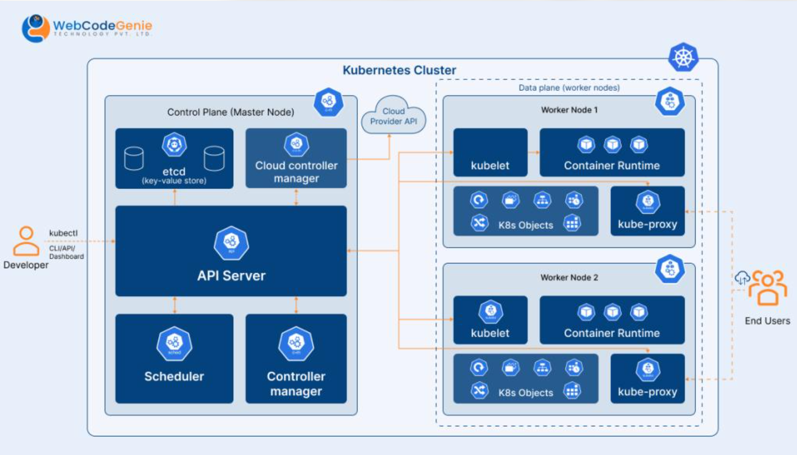
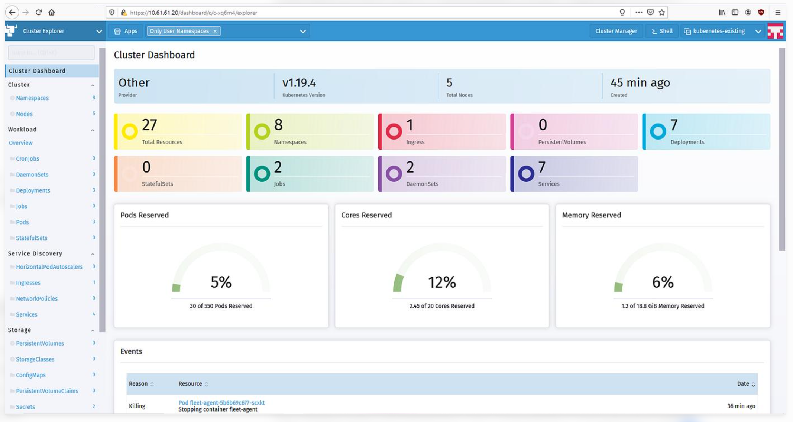

### Rancher
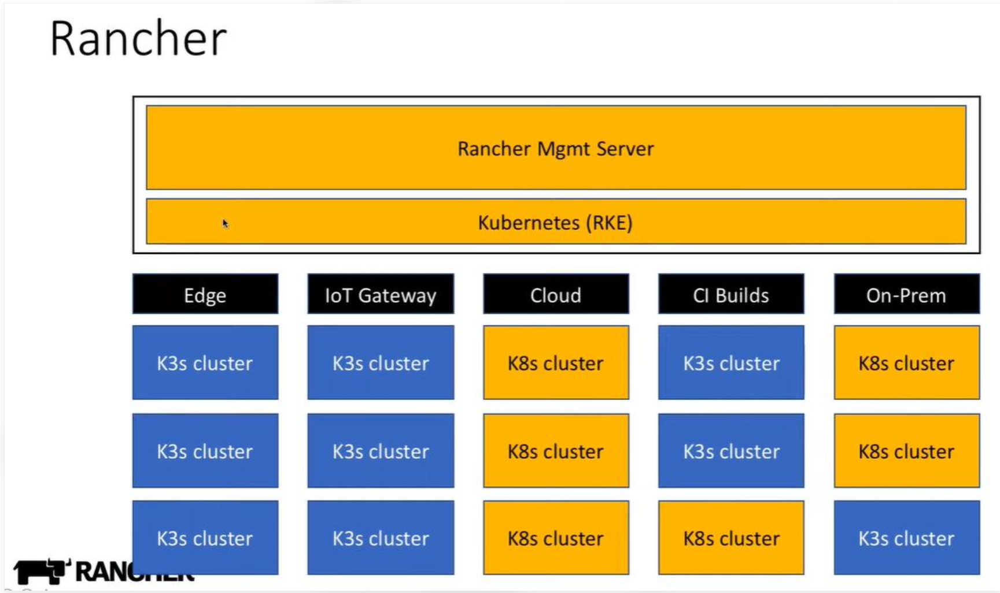

### Workflow Rancher
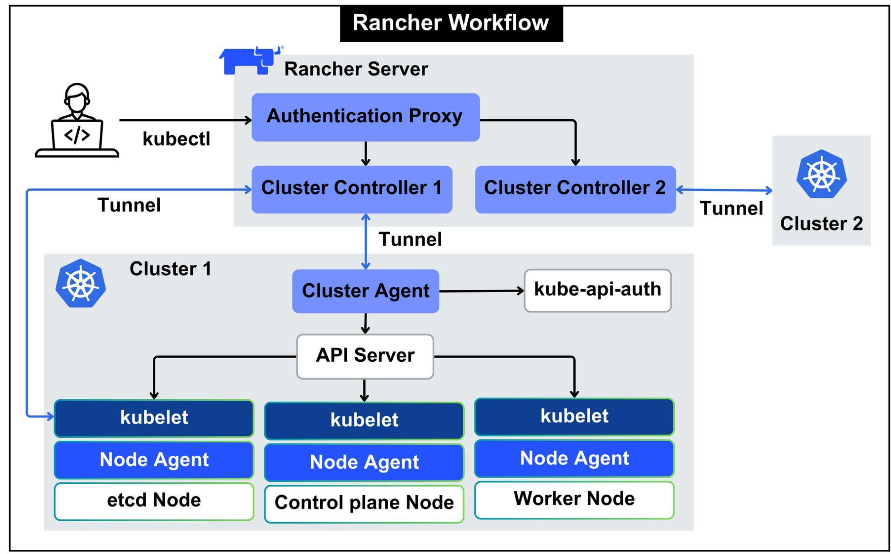

---

## 2. Architecture cible et plan d'adressage choisi

| Machine virtuelle (VMware) | Rôle | Nom d'hôte (`hostname`) | Interface | Adresse IP statique | Passerelle | DNS |
|---|---|---|---|---|---|---|
| `Ubuntu-server-01` | **Control Plane** | `k8s-control-plane` | `ens33` | `192.168.189.10/24` | `192.168.189.2` | `1.1.1.1`, `8.8.8.8` |
| `Ubuntu-worker-01` | **Worker 01** | `k8s-worker-01` | `ens33` | `192.168.189.11/24` | `192.168.189.2` | `1.1.1.1`, `8.8.8.8` |
| `Ubuntu-worker-03` | **Worker 02** | `k8s-worker-02` | `ens33` | `192.168.189.12/24` | `192.168.189.2` | `1.1.1.1`, `8.8.8.8` |

### Spécifications de l'environnement

- **Hyperviseur :** VMware Workstation (réseau NAT `VMnet8`)
- **Système d'exploitation :** Ubuntu Server `24.04` installé à l'origine depuis l'ISO, puis mis à niveau vers `26.04.1 LTS` (`resolute`) : version actuelle sur les trois VM, avec les noyaux `7.0.0-42-generic` (Control Plane) et `7.0.0-38-generic` (Workers). Sans interface graphique (vérifier la version exacte avec `lsb_release -a`).
- **Sous-réseau NAT :** `192.168.189.0/24` (plage DHCP VMware : `192.168.189.128` à `192.168.189.254`)
- **Adresse de l'hôte Windows sur VMnet8 :** `192.168.189.1`
- **Passerelle NAT :** `192.168.189.2`
- **Plage réservée aux adresses statiques :** `.3` à `.127` (les adresses `.10`, `.11` et `.12` sont hors de la plage DHCP, ce qui évite tout conflit)
- **Gestionnaire réseau :** Netplan (`/etc/netplan/50-cloud-init.yaml`)
- **Runtime de conteneurs :** `containerd` (avec `SystemdCgroup = true`)
- **Outils Kubernetes :** `kubeadm`, `kubelet`, `kubectl` (v1.30.14 dans ce laboratoire, voir l'étape 5)
- **Réseau des pods (CNI) :** Flannel, `10.244.0.0/16`

> [!IMPORTANT]
> Le réseau des pods (`10.244.0.0/16`) ne doit jamais chevaucher le réseau des VM (`192.168.189.0/24`).

### Versions installées

| Composant | Version | Source |
|---|---|---|
| Ubuntu Server | Installé en `24.04`, mis à niveau vers `26.04.1 LTS`, noyaux `7.0.0-42-generic` (CP) / `7.0.0-38-generic` (Workers) | ISO officielle puis mise à niveau |
| Kubernetes (`kubeadm`, `kubelet`, `kubectl`) | `v1.30.14` | `pkgs.k8s.io/core:/stable:/v1.30/deb` |
| `containerd` | `2.2.2-0ubuntu1.2` | Dépôt Ubuntu |
| `runc` | `1.4.0-0ubuntu1` | Dépôt Ubuntu |
| Flannel | Dernière version publiée au moment de l'installation | GitHub `flannel-io/flannel` |

> [!NOTE]
> `kubeadm init` affiche `remote version is much newer: v1.37.2; falling back to: stable-1.30`. Ce message est informatif : le dépôt `v1.30` est épinglé et l'installation reste en `v1.30.14`. Cette branche n'est cependant plus maintenue (la `v1.30.14` date de juin 2025) : pour une nouvelle installation, choisir une branche encore supportée.

<details>
<summary><strong>Pour aller plus loin - Rôle du Control Plane et des Workers</strong></summary>

**Control Plane** : il gère le cluster. Il regroupe quatre composants principaux :

- **API Server** : point d'entrée du cluster, toutes les commandes `kubectl` passent par lui ;
- **Scheduler** : choisit le nœud sur lequel chaque pod sera exécuté ;
- **Controller Manager** : surveille l'état du cluster et le ramène à l'état voulu ;
- **etcd** : base de données qui conserve l'état du cluster.

**Workers** : ils exécutent les applications conteneurisées sous forme de pods, et reçoivent leurs instructions du Control Plane.

Chaque nœud doit posséder une adresse IP unique et stable, un nom d'hôte unique et une connectivité réseau fonctionnelle vers les autres nœuds.

</details>

---

## 3. Objectifs du projet

1. Créer trois VM Ubuntu Server sous VMware Workstation en mode NAT (`VMnet8`).
2. Configurer un nom d'hôte unique sur chaque machine (`hostnamectl`).
3. Configurer les adresses IP statiques via Netplan avec la passerelle `192.168.189.2`.
4. Configurer la résolution des noms locale (`/etc/hosts`).
5. Vérifier la connectivité entre les nœuds et vers Internet.
6. Préparer les prérequis système (swap, modules noyau `overlay` et `br_netfilter`, paramètres `sysctl`).
7. Installer et configurer `containerd` avec `SystemdCgroup = true`.
8. Installer les outils Kubernetes (`kubeadm`, `kubelet`, `kubectl`).
9. Initialiser le Control Plane, installer le CNI et joindre les Workers.
10. Valider le cluster avec `kubectl get nodes -o wide`.
11. Installer et configurer Rancher pour l'administration.
12. Documenter les commandes, les résultats, les erreurs et les corrections.
13. Déployer et exposer des applications avec Pods, Labels, Services, Deployments et ReplicaSets.

---

## 4. Prérequis

- Trois VM Ubuntu Server avec un accès administrateur `sudo` sur chacune.
- Réseau virtuel permettant la communication entre les nœuds.
- Connectivité Internet pour télécharger les paquets et les images.
- Ressources CPU, mémoire et stockage adaptées (voir la note ci-dessous).
- VMware Workstation, un terminal Windows et un client SSH (par exemple MobaXterm) sur le poste d'administration.
- Swap désactivé sur les trois VM, sauf configuration explicitement compatible.
- Modules noyau et paramètres réseau nécessaires au runtime et au plugin CNI.
- État du pare-feu UFW identifié, avec les règles nécessaires entre les nœuds.
- Compatibilité vérifiée entre les versions de Kubernetes, containerd, du plugin CNI et de Rancher.
- Helm si Rancher est installé sur Kubernetes avec son chart.

> [!IMPORTANT]
> Kubernetes et Rancher peuvent demander davantage de ressources selon les composants installés. Une configuration minimale ne garantit pas de bonnes performances.

---

## 5. Structure de la documentation

```text
kubernetes-lab/
├── README-kubernetes-lab.md
├── LICENSE
├── .gitignore
└── docs/
    ├── 01-vm-setup.md
    ├── 02-network-dns.md
    ├── 03-container-runtime.md
    ├── 04-kubernetes.md
    ├── 05-rancher.md
    ├── 06-validation.md
    ├── 07-troubleshooting.md
    ├── 08-applications-services.md
    ├── rancher-vagrant-virtualBox.md
    ├── kubernetes/
    │   └── kubernetes-installation-guide.jpg
    ├── mobaxterm/
    │   ├── ssh/
    │   └── k8s-control-plane/
    └── images/
        ├── Google-Cloud-Platform-01.png
        ├── Kubernetes-01.png
        ├── Kubernetes-Cluster-01.png
        ├── Cluster-Manager-01.png
        ├── Rancher-01.png
        ├── Rancher-workflow-01.png
        ├── favicon/
        ├── creation-de-vm/
        ├── choix-de-l-iso/
        ├── rancher/
        │   └── rancher-logo/
        │       └── rancher-logo.png
        ├── Services-gestion/
        │   ├── architecture-infrastructure-kubernetes.png
        │   ├── flux-requete-http-pod-service-endpoints.png
        │   ├── relation-deployment-replicaset-pods-service.png
        │   ├── repartition-pods-workers.png
        │   └── bilan-tests-kubernetes.png
        └── network-dns/
            ├── preparer-les-VM/
            ├── vm-settings/
            └── virtual-network-editor/
```

Créer les fichiers référencés avant de considérer la documentation comme complète.

---

## 6. Parcours d'installation et procédures

### Étape 1 - Créer et configurer les VM

Trois machines virtuelles personnalisées (Custom) sous VMware Workstation, avec l'ISO Ubuntu Server et le mode réseau **NAT (`VMnet8`)**.

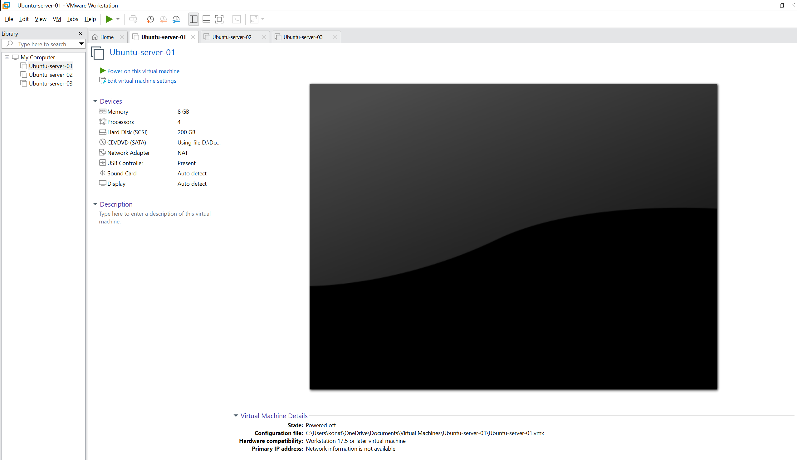

#### 1.1 - Choisir le type de machine virtuelle

- **Typical** : création rapide en quelques étapes, sans entrer dans la configuration avancée (système, emplacement, taille du disque).
- **Custom** : configuration personnalisée et précise (matériel, contrôleurs…). C'est l'option retenue pour ce laboratoire.

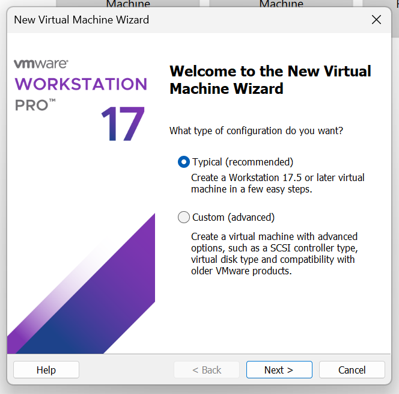

#### 1.2 - Configuration de l'assistant

Choisir **I will install the operating system later** pour garder la maîtrise de l'installation de l'ISO.

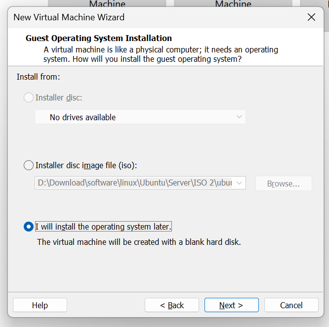

Sélectionner **Linux** et la version correspondante pour Ubuntu.

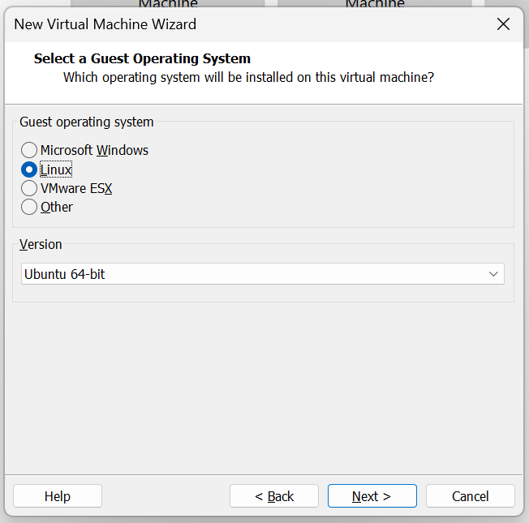

Donner un nom à la machine virtuelle.

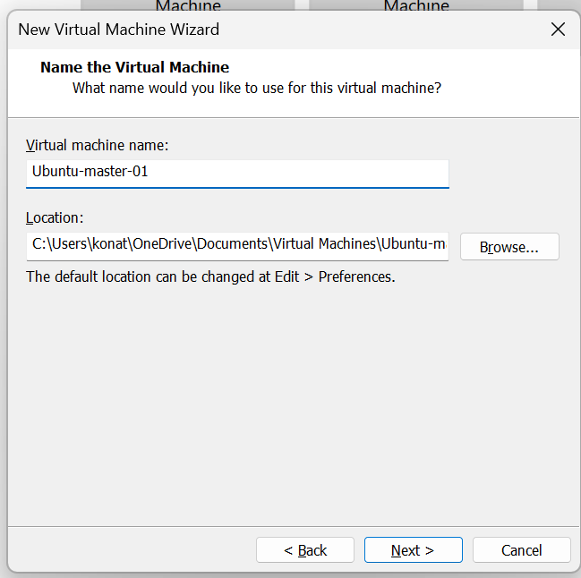

Attribuer les ressources processeur, la mémoire et la taille du disque.

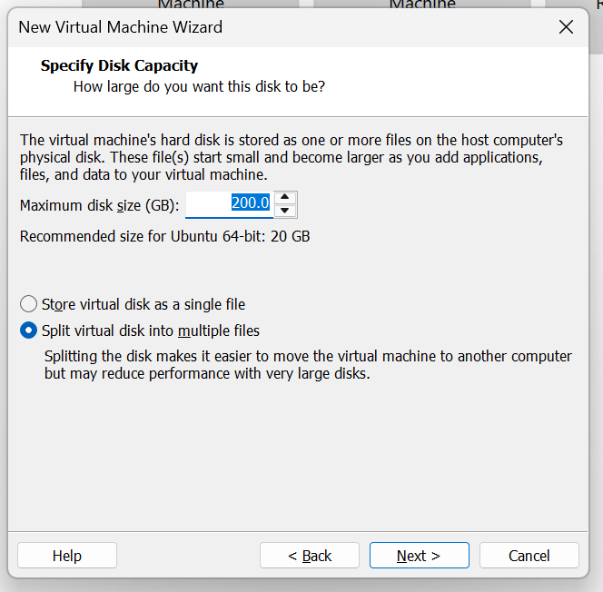

Finaliser la création, puis choisir l'ISO.

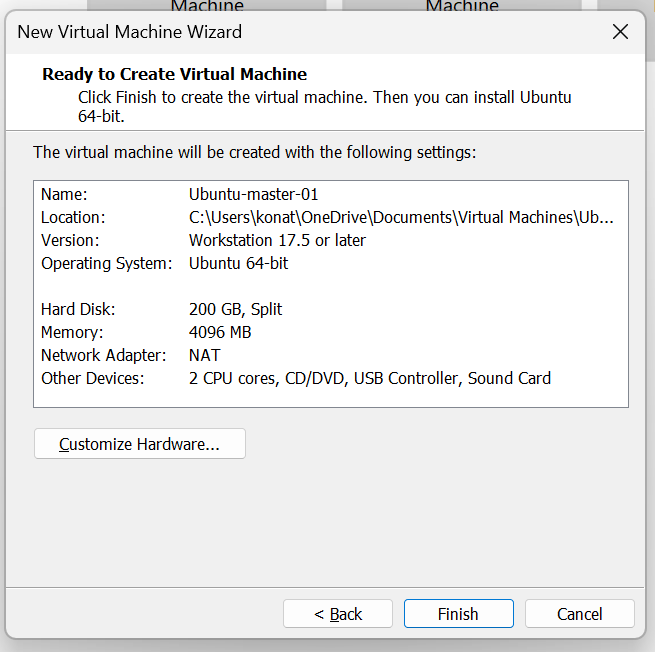

#### 1.3 - Associer l'image ISO Ubuntu Server

Clic droit sur la machine virtuelle, puis **Settings**.

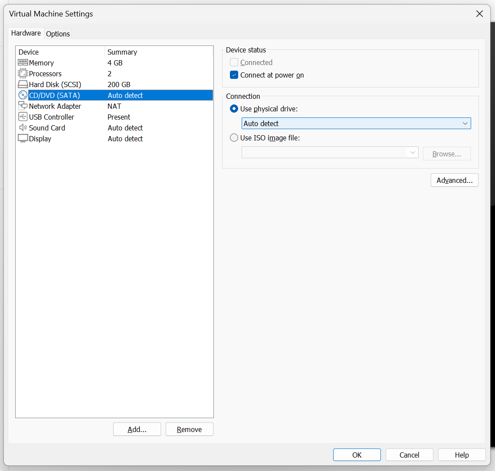

Sélectionner **CD/DVD (SATA)**, cocher **Connect at power on**, puis **Use ISO image file** et **Browse** pour choisir le fichier ISO. Le chemin utilisé ici est `D:\Download\software\linux\Ubuntu\Server\ISO`, il sera différent selon la machine.

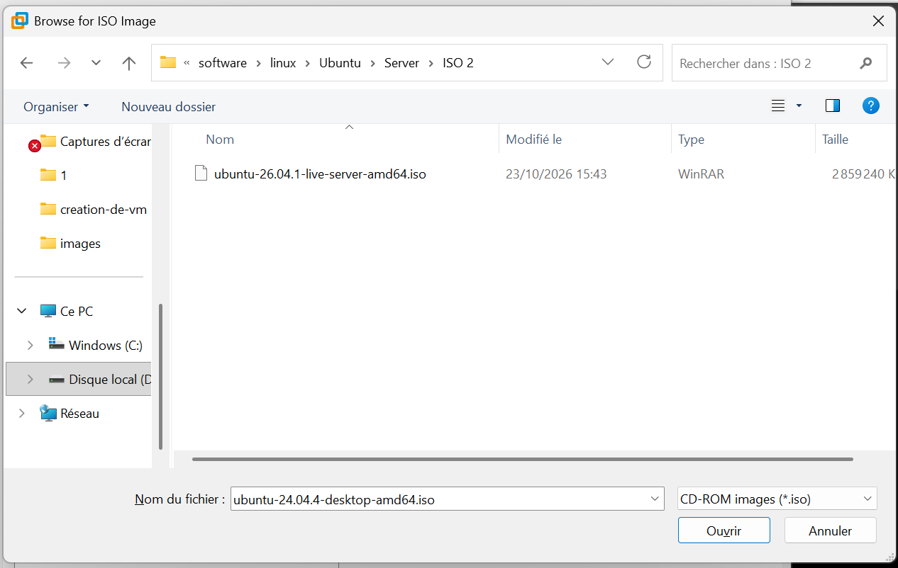

Valider avec **OK**.

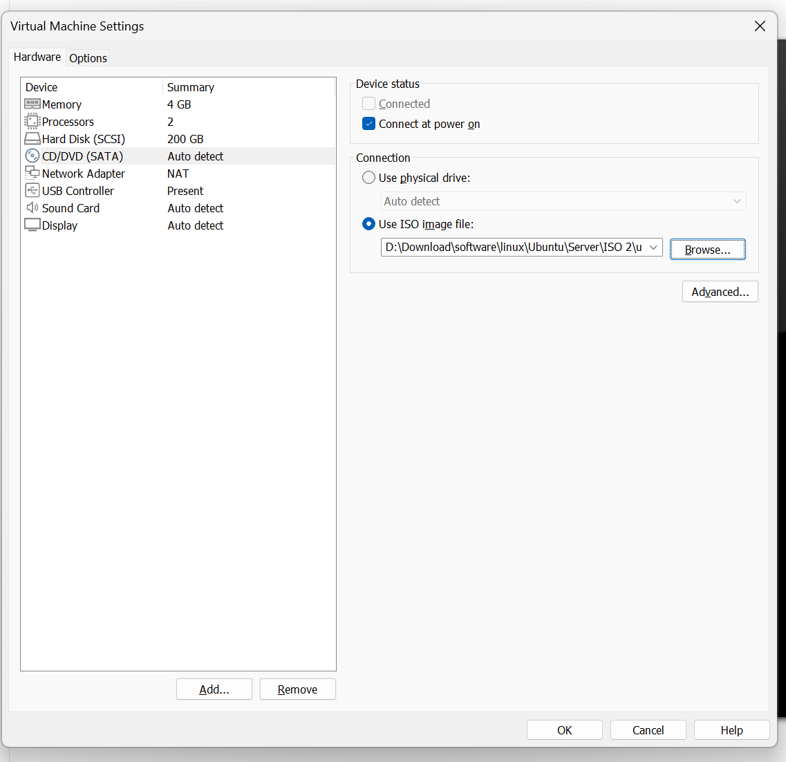

> [!NOTE]
> Si l'ISO n'a pas été choisi à la création, il suffit d'éteindre la VM, de refaire ces réglages, puis de rallumer : la VM démarre sur l'ISO car son disque est vide.

#### 1.4 - Carte réseau en NAT

Dans **Settings > Network Adapter**, choisir **NAT: Used to share the host's IP address** (équivalent à *Custom: VMnet8*). Cocher **Connect at power on**.

> [!WARNING]
> Une carte en **Bridged** place la VM sur le réseau de la box (`192.168.1.x`) : elle ne voit alors ni `VMnet8`, ni la passerelle `192.168.189.2`. C'est la cause d'un `Destination Host Unreachable` vers `.2` (voir la section 6, étape 10).

#### 1.5 - Questions de l'installateur Ubuntu

- **Clavier** : choisir la disposition **French** (un mot de passe correct refusé au login vient presque toujours d'un clavier QWERTY).
- **Réseau** : laisser le DHCP, l'IP statique sera définie après l'installation dans Netplan.
- **Proxy** : laisser vide.
- **Nom du serveur** : un nom unique par machine (obligatoire pour Kubernetes).
- **Featured server snaps** : ne rien cocher, surtout pas `microk8s`, qui entre en conflit avec une installation `kubeadm`.
- **OpenSSH server** : l'installer, pour se connecter avec MobaXterm.

> [!NOTE]
> Documenter la version d'Ubuntu, le nombre de CPU, la mémoire, le disque, le mode réseau VMware, les noms d'hôtes et la méthode d'accès SSH.

##### 1.5.1 - Cloner une VM et VM absente de l'interface

<details>
<summary><strong>Pour aller plus loin - Cloner une VM au lieu de réinstaller</strong></summary>

Une VM déjà configurée peut être clonée : éteindre la VM source, clic droit, **Manage > Clone**, puis **Create a full clone** (un *linked clone* dépend de la VM d'origine et ne démarre plus sans elle, ce qui est risqué pour un cluster).

Sur chaque clone, il faut ensuite :

```bash
sudo hostnamectl set-hostname k8s-worker-01
sudo nano /etc/netplan/50-cloud-init.yaml     # changer l'adresse IP
sudo rm /etc/machine-id /var/lib/dbus/machine-id
sudo systemd-machine-id-setup
```

Le `machine-id` doit être différent sur chaque nœud, sinon Kubernetes et le réseau peuvent se comporter de façon incohérente.

</details>

> [!WARNING]
> Dans certaines situations, une VM peut être créée sans apparaître dans l'interface VMware. Dans ce cas, ouvrir **Documents > Virtual Machines** et supprimer manuellement les dossiers des VM qui ne fonctionnent pas : supprimer une VM depuis VMware seul ne suffit pas, ses fichiers restent présents sur le disque.

Document détaillé : [`docs/01-vm-setup.md`](docs/01-vm-setup.md)

##### 1.5.2 - Installer OpenSSH server

OpenSSH server permet de se connecter aux VM à distance, par exemple avec MobaXterm.

**Pendant l'installation d'Ubuntu** : sur l'écran *SSH configuration*, cocher **Install OpenSSH server** avec la barre d'espace.

**Si la VM est déjà installée**, exécuter sur chaque VM :

```bash
sudo apt update
sudo apt install -y openssh-server
sudo systemctl enable --now ssh
sudo systemctl status ssh --no-pager
```

Le service doit afficher `active (running)`. Si le pare-feu UFW est actif, autoriser aussi le port 22 :

```bash
sudo ufw allow ssh
```

##### 1.5.3 - Présentation de MobaXterm

**MobaXterm** est un client de terminal pour Windows qui permet de piloter les machines Linux à distance. Il regroupe dans une seule application le SSH, le transfert de fichiers (SFTP), l'affichage graphique à distance (X11) et d'autres protocoles (RDP, VNC, Telnet). La version Home Edition est gratuite et suffit pour ce laboratoire.

##### 1.5.3.1 - Comment il fonctionne

MobaXterm se connecte au serveur OpenSSH installé sur la VM (étape 1.5.2) en utilisant le protocole **SSH** (*Secure Shell*) sur le port `22`. Il ouvre un canal chiffré entre Windows et la VM, s'authentifie avec le nom d'utilisateur et le mot de passe (ou une clé SSH), puis affiche dans un onglet le terminal de la VM : chaque commande tapée est exécutée sur la VM, pas sur Windows. En parallèle, un panneau latéral ouvre une session SFTP sur la même connexion et affiche les fichiers de la VM, ce qui permet de les glisser-déposer depuis Windows.

##### 1.5.3.2 - Pourquoi il est important pour ce laboratoire

- **Confort de travail** : la console VMware ne permet pas toujours le copier-coller, gère mal le clavier et le défilement. Avec MobaXterm, les longues commandes (installation de `containerd`, `kubeadm join`…) se collent sans erreur de frappe.
- **Trois machines en parallèle** : une session mémorisée par VM, chacune dans son onglet, et un accès immédiat sans repasser par VMware.
- **MultiExec** : cette fonction envoie la même commande aux trois nœuds en une seule fois, utile pour les étapes identiques sur tout le cluster (désactivation du swap, modules noyau, installation de `containerd`, `kubeadm`, `kubelet`).
- **Transfert de fichiers** : le panneau SFTP facilite l'échange de fichiers de configuration, de manifestes YAML ou du `kubeconfig` entre Windows et les VM.
- **Pratique réaliste** : en entreprise, les serveurs n'ont ni écran ni clavier et s'administrent presque toujours à distance en SSH. Ce laboratoire reproduit ce mode de travail.

> [!NOTE]
> MobaXterm n'est pas obligatoire : le client `ssh` intégré à Windows (PowerShell), Windows Terminal ou PuTTY permettent la même connexion. MobaXterm est retenu ici pour ses sessions enregistrées, son panneau SFTP et MultiExec.

> [!WARNING]
> Un mot de passe simple comme celui du laboratoire ne convient qu'à un environnement de test. Pour un usage réel, utiliser des clés SSH et désactiver l'authentification par mot de passe. Ne publie jamais dans le dépôt de capture montrant un mot de passe, une clé privée ou un jeton.

##### 1.5.3.3 - Connexion avec MobaXterm

Ouvrir **Session > SSH**.

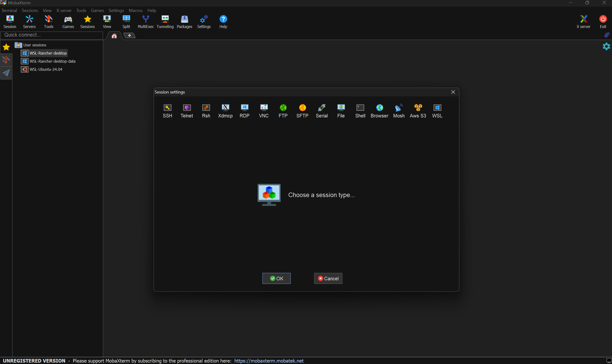

Renseigner une session par machine virtuelle :

| VM | Nom d'hôte | Remote host | Specify username | Port |
|---|---|---|---|---|
| Control Plane | `k8s-control-plane` | `192.168.189.10` | `ubuntu-server-01` | `22` |
| Worker 01 | `k8s-worker-01` | `192.168.189.11` | `ubuntu-worker-01` | `22` |
| Worker 02 | `k8s-worker-02` | `192.168.189.12` | `ubuntu-worker-02` | `22` |

> [!IMPORTANT]
> Le **Specify username** est le compte créé à l'installation d'Ubuntu, pas le nom d'hôte. Changer le nom d'hôte avec `hostnamectl` ne renomme pas le compte : saisir `k8s-control-plane` comme nom d'utilisateur provoque un `Access denied`.

Pour le Control Plane, cocher **Specify username** et saisir `ubuntu-server-01`, avec le port `22`.

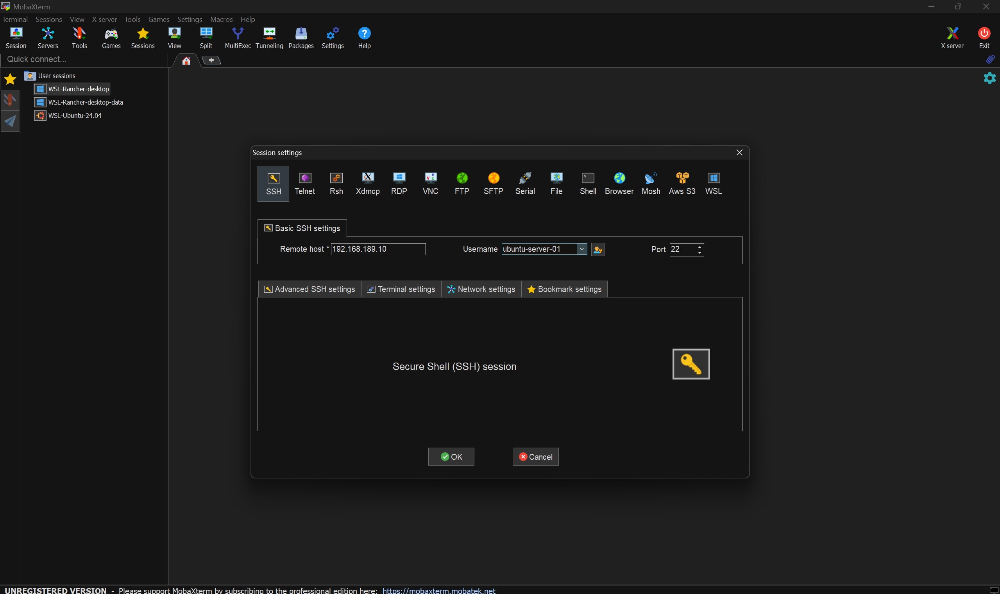

Cliquer sur **OK**. MobaXterm propose alors de définir un mot de passe maître pour protéger les sessions enregistrées.

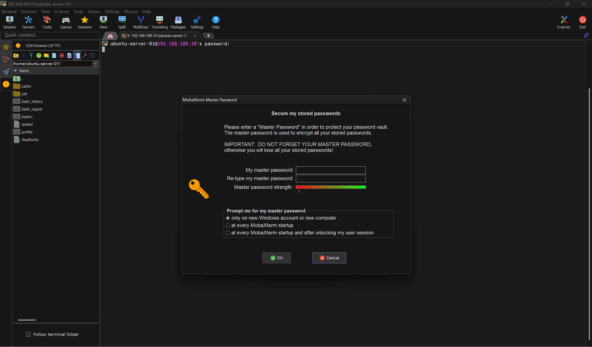

Cliquer sur **Cancel** : pour un laboratoire de test, ce mot de passe n'est pas nécessaire. Pour un projet sensible, il est recommandé de le définir et de le confirmer.

Saisir ensuite le mot de passe de l'utilisateur de la VM. La session s'ouvre dans un onglet :

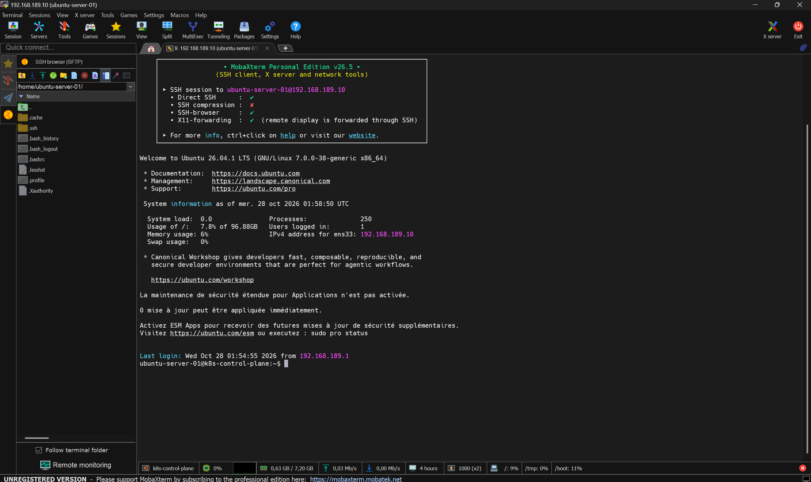

La procédure est identique pour **k8s-worker-01** (`192.168.189.11`) et **k8s-worker-02** (`192.168.189.12`), avec les valeurs du tableau.

> [!NOTE]
> Les trois machines virtuelles sont maintenant connectées et manipulables depuis MobaXterm.

---

### Étape 2 - Configurer le réseau (Netplan) et les noms

#### 2.0 - Plan d'adressage validé (remplace le plan initial)

Le plan de la section 2 correspond à ce qui avait été choisi au départ et configuré à l'installation, avec des VM nommées `Ubuntu-server-01`, `Ubuntu-worker-01`… Il a ensuite été modifié : les VM VMware portent désormais le même nom que leur nom d'hôte, pour éviter toute confusion entre le nom de la VM et celui de la machine.

C'est ce plan **validé** qui est appliqué dans la suite de l'étape.

| Machine virtuelle (VMware) | Rôle | Nom d'hôte (`hostname`) | Interface | Adresse IP statique | Passerelle | DNS |
|---|---|---|---|---|---|---|
| `k8s-control-plane` | **Control Plane** | `k8s-control-plane` | `ens33` | `192.168.189.10/24` | `192.168.189.2` | `1.1.1.1`, `8.8.8.8` |
| `k8s-worker-01` | **Worker 01** | `k8s-worker-01` | `ens33` | `192.168.189.11/24` | `192.168.189.2` | `1.1.1.1`, `8.8.8.8` |
| `k8s-worker-02` | **Worker 02** | `k8s-worker-02` | `ens33` | `192.168.189.12/24` | `192.168.189.2` | `1.1.1.1`, `8.8.8.8` |

#### 2.1 - Vérifier la configuration VMware

Dans **Edit > Virtual Network Editor**, sélectionner `VMnet8` :

- type **NAT**, sous-réseau `192.168.189.0`, masque `255.255.255.0` ;
- **NAT Settings** : passerelle `192.168.189.2` ;
- **DHCP Settings** : plage `192.168.189.128` à `192.168.189.254`.

Les captures de référence sont conservées dans [`docs/images/network-dns/`](docs/images/network-dns/) :

- [Paramètres réseau de la machine virtuelle](docs/images/network-dns/vm-settings/)
- [Virtual Network Editor](docs/images/network-dns/virtual-network-editor/)

Elles documentent le mode réseau choisi, le sous-réseau, la passerelle NAT et la plage DHCP.

<details>
<summary><strong>Pour aller plus loin - Comprendre les modes réseau VMware</strong></summary>

| Mode | Réseau virtuel | Effet |
|---|---|---|
| **Bridged** | `VMnet0` | La VM est sur le réseau physique (box), avec une IP de celui-ci. |
| **NAT** | `VMnet8` | Les VM partagent un réseau privé et sortent sur Internet via l'hôte. Les VM se parlent entre elles et l'hôte les joint via `192.168.189.1`. |
| **Host-only** | `VMnet1` | Réseau privé entre VM et hôte, sans accès à Internet. |
| **Custom** | au choix | Choisir soi-même le réseau virtuel. *Custom + VMnet8* équivaut à *NAT*. |

NAT est le meilleur choix pour ce lab : les adresses des VM restent indépendantes de la box et du Wi-Fi, ce qui est stable pour un cluster. Un réseau Custom n'est utile que pour isoler un cluster ou séparer plusieurs labs.

Sur l'ancien Ubuntu Desktop, le réseau marchait car le **DHCP** de VMware fournissait IP, passerelle et DNS automatiquement. En IP statique, rien n'est fourni : la passerelle et les DNS doivent être écrits dans Netplan (c'est le cas ci-dessous).

**Comparaison des trois modes**

| Critère | NAT | Bridged | Host-only |
|---|---|---|---|
| Communication entre les VM | Oui | Oui | Oui |
| Accès à Internet | Généralement oui | Selon le réseau physique | Non, généralement |
| Accès depuis le réseau local | Configuration supplémentaire possible | Oui, si le réseau l'autorise | Non, généralement |
| Isolation du réseau physique | Partielle | Faible | Forte |

> [!NOTE]
> Choisir un mode réseau dans VMware ne configure pas automatiquement une adresse IP statique dans Ubuntu : ce sont deux opérations distinctes. L'adresse statique se définit dans Netplan (étape 2.3).

</details>

#### 2.2 - Diagnostiquer le réseau Ubuntu actuel

Sur chaque machine :

```bash
ip -br address
ip route
resolvectl status
hostnamectl
ls -la /etc/netplan/
sudo netplan get
sudo ufw status verbose
```

Si le pare-feu UFW est actif, identifier les règles nécessaires à l'API Kubernetes, aux échanges entre nœuds et au CNI. Ne pas le désactiver systématiquement.

Informations à relever sur chaque machine avant de modifier Netplan :

| Information | Commande |
|---|---|
| Nom d'hôte | `hostname` |
| Interfaces réseau | `ip -br link` |
| Adresses IP | `ip -br address` |
| Passerelle | `ip route` |
| Serveurs DNS | `resolvectl status` |
| Fichiers Netplan | `ls -l /etc/netplan/` |

#### 2.3 - Configuration Netplan par machine

Fichier `/etc/netplan/50-cloud-init.yaml`. Seule l'adresse change d'une machine à l'autre.

**k8s-control-plane (`192.168.189.10`)**

```yaml
network:
  version: 2
  ethernets:
    ens33:
      dhcp4: false
      addresses:
        - 192.168.189.10/24
      routes:
        - to: default
          via: 192.168.189.2
      nameservers:
        addresses:
          - 1.1.1.1
          - 8.8.8.8
```

- **k8s-worker-01 (`192.168.189.11`)** : même fichier avec `- 192.168.189.11/24`.
- **k8s-worker-02 (`192.168.189.12`)** : même fichier avec `- 192.168.189.12/24`.

> [!IMPORTANT]
> Le YAML est sensible à l'indentation (espaces, jamais de tabulations). Vérifier le nom de l'interface avec `ip -br addr` : si ce n'est pas `ens33`, utiliser le nom réel.

#### 2.4 - Appliquer et sécuriser

```bash
sudo cp /etc/netplan/50-cloud-init.yaml /etc/netplan/50-cloud-init.yaml.bak
sudo chmod 600 /etc/netplan/*.yaml
sudo netplan generate
sudo netplan apply
ip -br address
ip route
```

`netplan generate` vérifie la syntaxe avant l'application. Le `chmod 600` supprime l'avertissement « Permissions … are too open ».

> [!WARNING]
> Applique `netplan apply` avec un moyen de récupérer la console en cas de perte du réseau. En SSH, la connexion se coupe au changement d'adresse IP : privilégier la console VMware, qui permet de corriger le fichier.

<details>
<summary><strong>Pour aller plus loin - Tester avec `netplan try` et sauvegarder tout le dossier</strong></summary>

Pour sauvegarder tous les fichiers Netplan dans un dossier daté :

```bash
sudo cp -a /etc/netplan "/root/netplan-backup-$(date +%F-%H%M%S)"
```

`netplan try` applique la configuration puis **annule automatiquement** les changements au bout de 120 secondes si on ne les confirme pas avec Entrée. C'est la méthode la plus sûre quand une erreur risque de couper l'accès à la machine :

```bash
sudo netplan try
```

Les exemples d'autres guides ajoutent la ligne `renderer: networkd` sous `version: 2`. Sur Ubuntu Server elle est facultative, car c'est le moteur utilisé par défaut.

</details>

<details>
<summary><strong>Pour aller plus loin - Empêcher cloud-init de réécrire le réseau</strong></summary>

`cloud-init` peut régénérer `50-cloud-init.yaml` au redémarrage. Pour garder la configuration statique :

```bash
echo 'network: {config: disabled}' | sudo tee /etc/cloud/cloud.cfg.d/99-disable-network-config.cfg
```

Garder un seul fichier Netplan actif évite les conflits (par exemple un `01netcfg.yml` vide en plus). Ne pas supprimer un fichier à l'aveugle : vérifier d'abord son rôle avec `sudo netplan get`.

</details>

#### 2.5 - Nom d'hôte unique

Sur chaque machine :

```bash
sudo hostnamectl set-hostname k8s-control-plane   # k8s-worker-01 / k8s-worker-02 sur les workers
hostnamectl
```

#### 2.6 - Résolution de noms locale (`/etc/hosts`)

Sur les trois nœuds, ajouter à `/etc/hosts` :

```text
192.168.189.10 k8s-control-plane
192.168.189.11 k8s-worker-01
192.168.189.12 k8s-worker-02
```

#### 2.7 - Valider le réseau

Depuis le Control Plane :

```bash
ping -c 3 192.168.189.2
ping -c 3 192.168.189.11
ping -c 3 192.168.189.12
getent hosts k8s-worker-01
getent hosts k8s-worker-02
getent hosts archive.ubuntu.com
sudo apt update
```

> [!NOTE]
> Un `ping` vers l'extérieur peut échouer alors qu'Internet fonctionne (ICMP filtré par le NAT, un pare-feu ou un VPN). Le test fiable est `sudo apt update` ou `curl -I https://archive.ubuntu.com`, avec la résolution DNS (`getent hosts`).

> [!WARNING]
> Un `apt update` qui fonctionne ne prouve pas que le DNS est sain : dans ce lab, les requêtes `AAAA` restaient sans réponse et les téléchargements d'images échouaient par intermittence (voir **E16**). Tester aussi `time curl -I --connect-timeout 10 https://quay.io` avant de déployer des charts Helm.

Documenter les résultats observés avant de passer à l'installation de `containerd` et de Kubernetes.

<details>
<summary><strong>Pour aller plus loin - Interpréter les résultats de ping</strong></summary>

| Symptôme | Cause probable |
|---|---|
| `Destination Host Unreachable` venant de l'IP de la VM elle-même, même vers `.2` et `.1` | La carte n'est pas sur `VMnet8` (souvent en Bridged), ou n'est pas connectée. |
| La passerelle `.2` répond, mais pas `1.1.1.1` | Service **VMware NAT Service** arrêté sous Windows (`services.msc`). |
| `1.1.1.1` répond mais pas `archive.ubuntu.com` | Problème de DNS : revoir la section `nameservers`, ou essayer `192.168.189.2` comme DNS (la passerelle VMware relaie le DNS de Windows). |
| Pas d'IP du tout au démarrage | **VMware DHCP Service** arrêté, ou carte non connectée. |

</details>

Document détaillé : [`docs/02-network-dns.md`](docs/02-network-dns.md)

---

### Étape 3 - Préparer le système (prérequis Kubernetes)

À réaliser sur les trois nœuds. Un worker neuf ne contient aucun composant Kubernetes : sans cette préparation, `kubelet` ne démarre pas correctement et le `kubeadm join` échoue.

**1. Vérifier les ressources et l'unicité des machines**

```bash
nproc
free -h
df -h
ip link
sudo cat /sys/class/dmi/id/product_uuid
```

Ces commandes affichent le nombre de processeurs, la mémoire, l'espace disque, les adresses MAC et l'identifiant système de la machine. Selon la documentation officielle de `kubeadm`, chaque nœud doit disposer d'au moins 2 Go de RAM, et le Control Plane d'au moins 2 CPU. Les noms d'hôte, adresses MAC et `product_uuid` doivent être **différents** sur les trois machines, ce qui compte surtout si une VM a été clonée.

**2. Désactiver le swap**

```bash
sudo swapoff -a
sudo sed -i '/ swap / s/^/#/' /etc/fstab
```

**3. Charger les modules noyau `overlay` et `br_netfilter`**

```bash
sudo tee /etc/modules-load.d/k8s.conf <<EOF
overlay
br_netfilter
EOF

sudo modprobe overlay
sudo modprobe br_netfilter
```

**4. Paramètres `sysctl`**

```bash
sudo tee /etc/sysctl.d/k8s.conf <<EOF
net.bridge.bridge-nf-call-iptables  = 1
net.bridge.bridge-nf-call-ip6tables = 1
net.ipv4.ip_forward                 = 1
EOF

sudo sysctl --system
```

**5. Vérifier**

```bash
free -h | grep -i swap        # Swap: 0B 0B 0B
lsmod | grep -E 'overlay|br_netfilter'
sysctl net.ipv4.ip_forward
```

> [!NOTE]
> Documenter les modifications persistantes (`/etc/fstab`, `/etc/modules-load.d/`, `/etc/sysctl.d/`) pour qu'elles restent cohérentes après un redémarrage.

> [!NOTE]
> Vérifier aussi **après chaque redémarrage** avec `swapon --show` (aucune ligne attendue). Un swap actif empêche `kubelet` de démarrer (voir E14).

<details>
<summary><strong>Pour aller plus loin - Swap en détail</strong></summary>

Examiner l'état actuel sur les trois machines :

```bash
swapon --show
free -h
```

Si `swapon --show` ne retourne aucune ligne, aucun swap n'est actif.

- **Désactivation temporaire** : `sudo swapoff -a` désactive le swap jusqu'au prochain redémarrage.
- **Désactivation persistante** : commenter l'entrée swap dans `/etc/fstab`, c'est ce que fait la commande `sed` de l'étape 3.

Pour le faire à la main, sauvegarder puis modifier le fichier :

```bash
cat /etc/fstab
sudo cp -a /etc/fstab /etc/fstab.backup
sudo nano /etc/fstab
```

Ajouter `#` au début de la seule ligne swap, sans toucher aux montages nécessaires au démarrage. Si le swap réapparaît après un redémarrage, chercher une unité `systemd` qui l'active :

```bash
systemctl list-units --type=swap
systemctl list-unit-files --type=swap
```

Ne désactiver une unité qu'après avoir identifié son rôle. Validation finale : `swapon --show` ne doit afficher aucune ligne.

</details>

<details>
<summary><strong>Pour aller plus loin - Pare-feu et ports Kubernetes</strong></summary>

Vérifier l'état d'UFW :

```bash
sudo ufw status verbose
```

`Status: inactive` signifie qu'UFW n'applique aucune règle, mais d'autres règles (`nftables`, hôte, réseau) peuvent exister. Pour les examiner :

```bash
sudo nft list ruleset
sudo ss -lntup
```

Si UFW est activé, autoriser d'abord l'accès SSH depuis le réseau du laboratoire, **avant** d'activer le pare-feu :

```bash
sudo ufw allow from 192.168.189.0/24 to any port 22 proto tcp
sudo ufw status numbered
```

Ports principaux utilisés par Kubernetes :

| Port ou plage | Protocole | Usage | Nœuds concernés |
|---|---|---|---|
| 6443 | TCP | API Server | Control Plane |
| 2379-2380 | TCP | etcd | Control Plane |
| 10250 | TCP | kubelet | Tous les nœuds |
| 10257 | TCP | Controller Manager | Control Plane |
| 10259 | TCP | Scheduler | Control Plane |
| 30000-32767 | TCP/UDP selon le service | NodePort, uniquement si utilisé | Workers |
| 8472 | UDP | Réseau des pods de Flannel (VXLAN) | Tous les nœuds |

> [!NOTE]
> Les règles du Control Plane et des Workers ne sont pas identiques, et les ports du CNI dépendent du plugin choisi : les vérifier dans sa documentation. Ne pas ouvrir ces ports à tous les réseaux, restreindre les sources au sous-réseau `192.168.189.0/24`.

</details>

---

### Étape 4 - Installer le runtime de conteneurs (`containerd`)

À réaliser sur les trois nœuds.

```bash
sudo apt-get update
sudo apt-get install -y containerd

sudo mkdir -p /etc/containerd
containerd config default | sudo tee /etc/containerd/config.toml
sudo sed -i 's/SystemdCgroup = false/SystemdCgroup = true/' /etc/containerd/config.toml

sudo systemctl restart containerd
sudo systemctl enable containerd
sudo systemctl status containerd --no-pager
ls -l /run/containerd/containerd.sock   # l'interface CRI doit être disponible
```

> [!NOTE]
> `containerd` doit être configuré avec une interface CRI compatible avec la version de Kubernetes installée, et `SystemdCgroup = true` pour s'aligner sur le cgroup driver de `kubelet`.

<details>
<summary><strong>Pour aller plus loin - Docker et Kubernetes</strong></summary>

Depuis Kubernetes 1.24, Docker Engine n'est plus pris en charge directement comme runtime natif. Il n'est pas nécessaire d'installer Docker Engine sur les nœuds pour utiliser `containerd`. Docker peut être utilisé séparément, ou avec un adaptateur CRI approprié.

Si `sudo systemctl status containerd` répond `Unit containerd.service could not be found`, le paquet n'est pas installé : vérifier d'abord la connectivité (`sudo apt update`).

</details>

<details>
<summary><strong>Pour aller plus loin - Vérifier et valider `containerd`</strong></summary>

Avant l'installation, voir quelle version les dépôts Ubuntu proposent :

```bash
apt-cache policy containerd
```

Après l'installation et la configuration, valider :

```bash
containerd --version
sudo systemctl is-active containerd
grep SystemdCgroup /etc/containerd/config.toml
```

Le service doit répondre `active` et la ligne doit afficher `SystemdCgroup = true`.

La structure du fichier `config.toml` diffère entre `containerd` 1.x et 2.x : la ligne `SystemdCgroup` se trouve dans la section du runtime `runc`, sous une arborescence qui change selon la version. Ne pas la copier à un emplacement arbitraire : modifier la ligne existante, comme le fait la commande `sed`.

Dans ce laboratoire, le paquet Ubuntu `containerd` (`2.2.2-0ubuntu1.2`) est installé sur les trois nœuds. La documentation de Kubernetes cite aussi le paquet `containerd.io` du dépôt Docker : les deux conviennent tant que `SystemdCgroup = true` et que la **même source** est utilisée sur tous les nœuds. Éviter de mélanger plusieurs sources de paquets.

</details>

---

### Étape 5 - Installer les outils Kubernetes (`kubeadm`, `kubelet`, `kubectl`)


<h2 style="display: flex; align-items: center; gap: 12px;">
  
  <span style="font-size: 28px; font-weight: bold;">Guide d'installation de Kubernetes (mise à jour 2026)</span>
</h2>

---

À réaliser sur les trois nœuds. Choisir la version de Kubernetes et remplacer `v1.30` dans les commandes ci-dessous par la version souhaitée. Utiliser la **même branche mineure** de Kubernetes sur les trois machines.

> [!WARNING]
> Vérifier sur la documentation officielle quelle version est encore supportée avant d'installer. Ce laboratoire a été réalisé avec `v1.30.14`, dont la branche n'est plus maintenue : elle sert ici d'exemple. Les versions de `kubeadm`, `kubelet` et `kubectl` doivent être compatibles entre elles.

> [!NOTE]
> L'ancien dépôt `apt.kubernetes.io` (`kubernetes-xenial`) est **obsolète et supprimé**. Il faut utiliser le dépôt `pkgs.k8s.io`, comme dans les commandes ci-dessous.

#### 5.1 - Mettre à jour le système

Mettre à jour la liste des paquets, puis les paquets déjà installés :

```bash
sudo apt update && sudo apt upgrade -y
sudo reboot
```

Les deux écritures suivantes sont équivalentes : le `&&` enchaîne simplement les deux commandes sur une ligne.

```bash
sudo apt update
sudo apt upgrade -y
sudo reboot
```

> [!NOTE]
> Le `sudo reboot` ferme la session MobaXterm : attendre le redémarrage de la VM, puis rouvrir la session.

#### 5.2 - Installer les dépendances

Installer les outils nécessaires pour utiliser un dépôt en HTTPS et vérifier sa clé de signature :

```bash
sudo apt-get update
sudo apt-get install -y apt-transport-https ca-certificates curl gpg
```

> [!NOTE]
> Le guide d'origine installe `gnupg` et `lsb-release` à la place de `gpg`. Les deux jeux de paquets conviennent : `gnupg` fournit aussi la commande `gpg`.

#### 5.3 - Ajouter le dépôt officiel de Kubernetes

Créer le dossier des clés, télécharger la clé de signature, puis déclarer le dépôt (remplacer `v1.30` par la version choisie) :

```bash
sudo mkdir -p -m 755 /etc/apt/keyrings

curl -fsSL https://pkgs.k8s.io/core:/stable:/v1.30/deb/Release.key \
  | sudo gpg --dearmor -o /etc/apt/keyrings/kubernetes-apt-keyring.gpg

echo 'deb [signed-by=/etc/apt/keyrings/kubernetes-apt-keyring.gpg] https://pkgs.k8s.io/core:/stable:/v1.30/deb/ /' \
  | sudo tee /etc/apt/sources.list.d/kubernetes.list

sudo apt-get update
```

#### 5.4 - Installer `kubeadm`, `kubelet` et `kubectl`

`kubectl` ne se lance que sur le Control Plane : les Workers n'ont besoin que de `kubelet` et `kubeadm`.

**Sur le Control Plane**

```bash
sudo apt-get install -y kubelet kubeadm kubectl
sudo apt-mark hold kubelet kubeadm kubectl
sudo systemctl enable --now kubelet
```

**Sur chaque Worker**

```bash
sudo apt-get install -y kubelet kubeadm
sudo apt-mark hold kubelet kubeadm
sudo systemctl enable --now kubelet
```

`apt-mark hold` empêche une mise à jour automatique accidentelle des composants. `systemctl enable --now kubelet` active `kubelet` au démarrage et le lance tout de suite.

> [!NOTE]
> Avant le `kubeadm join`, `kubelet` affiche `activating (auto-restart)` : c'est normal. Il redémarre en boucle tant qu'il n'a pas de configuration, et se stabilise après la jonction au cluster.

> [!TIP]
> En cas d'erreur liée à des versions installées avec Snap, les supprimer d'abord :
>
> ```bash
> sudo snap remove kubelet kubectl kubeadm
> ```

Vérifier les versions installées :

```bash
kubeadm version
kubelet --version
kubectl version --client      # Control Plane uniquement
```

<details>
<summary><strong>Pour aller plus loin - Activer l'autocomplétion de kubectl</strong></summary>

L'autocomplétion permet de compléter les commandes et les noms de ressources avec la touche Tab (sur le Control Plane) :

```bash
sudo apt install -y bash-completion
echo 'source <(kubectl completion bash)' >> ~/.bashrc
source ~/.bashrc
```

</details>

#### 5.5 - Vérifier un nœud avant de continuer

Sur chaque nœud, avant `kubeadm init` ou `kubeadm join` :

```bash
systemctl is-active containerd                           # active
systemctl is-enabled kubelet                             # enabled
sudo grep -i SystemdCgroup /etc/containerd/config.toml   # SystemdCgroup = true
free -h | grep -i swap                                   # Swap: 0B 0B 0B
ip -br address                                           # lo et ens33 seulement
sudo ls -la /etc/cni/net.d/                              # vide, ou seulement .kubernetes-cni-keep
```

Document détaillé (préparation système, runtime et outils Kubernetes) : [`docs/03-container-runtime.md`](docs/03-container-runtime.md)

> [!NOTE]
> Source : procédure adaptée et traduite du guide « Kubernetes Installation Guide (2026 Update) » de [H A R S H H A A](https://www.github.com/NotHarshhaa).

---

### Étape 6 - Initialiser le cluster

#### 6.1 - Control Plane (`k8s-control-plane`)

Avant l'initialisation du Control Plane, vérifier sur les trois VM :

- que le runtime fonctionne et que son interface CRI est disponible ;
- que les modules noyau et les paramètres réseau nécessaires sont actifs ;
- que le swap est désactivé ;
- que les versions de `kubeadm`, `kubelet` et `kubectl` sont compatibles ;
- que le réseau permet les communications nécessaires entre les composants.

```bash
sudo kubeadm init \
  --apiserver-advertise-address=192.168.189.10 \
  --pod-network-cidr=10.244.0.0/16
```

Configurer `kubectl` pour l'utilisateur courant :

```bash
mkdir -p $HOME/.kube
sudo cp -i /etc/kubernetes/admin.conf $HOME/.kube/config
sudo chown $(id -u):$(id -g) $HOME/.kube/config
ls -l $HOME/.kube/config
```

> [!IMPORTANT]
> Recopier ces trois commandes **en entier, avec `sudo`**. `cp admin.conf` ou `chown` lancés sans leurs arguments échouent, et `kubeadm token create` répond alors `permission denied` sur `/etc/kubernetes/admin.conf`.

> [!IMPORTANT]
> Fixer définitivement les trois adresses IP **avant** `kubeadm init` : le cluster mémorise l'adresse du Control Plane, et la changer ensuite pose problème.

Vérifier que le Control Plane répond :

```bash
kubectl get nodes
```

Le nœud est `NotReady` tant qu'aucun CNI n'est installé : c'est normal à ce stade.

#### 6.2 - Installer le plugin réseau (CNI)

> [!CAUTION]
> Installer **un seul CNI** par cluster. Flannel et Calico gèrent tous les deux le réseau des pods : les installer ensemble rend le réseau instable (nœud `NotReady`, CoreDNS `Pending`).

##### 6.2.1 - Flannel (retenu pour ce lab, avec `10.244.0.0/16`)

```bash
kubectl apply -f https://github.com/flannel-io/flannel/releases/latest/download/kube-flannel.yml
```

Après l'installation du CNI, vérifier la disponibilité des nœuds et l'état des pods système avant de poursuivre :

```bash
kubectl get nodes -w
kubectl get pods -n kube-flannel
kubectl get pods -n kube-system
```

Le Control Plane doit passer à `Ready` en une à deux minutes (arrêter le `-w` avec `Ctrl + C`), et les pods `coredns` doivent passer à `Running`.

<details>
<summary><strong>Pour aller plus loin - Choisir un autre CNI</strong></summary>

Calico, Cilium ou Weave sont des alternatives. Chaque CNI attend un CIDR de pods précis (à passer à `--pod-network-cidr`) et peut demander des règles de pare-feu supplémentaires. Vérifier la compatibilité avec la version de Kubernetes avant de choisir.

| Plugin | Quand l'envisager |
|---|---|
| Flannel | Laboratoire simple, besoins réseau classiques (choix retenu ici) |
| Calico | Réseau de pods avec politiques réseau et configurations variées |
| Cilium | Fonctions réseau avancées et observabilité |

Le CNI doit être choisi **avant** `kubeadm init`, afin d'utiliser un CIDR de pods compatible et la bonne procédure d'installation.

</details>

##### 6.2.2 - Alternative : Calico (opérateur Tigera)

À utiliser **à la place de** Flannel, jamais en plus. Si Flannel est déjà installé, suivre d'abord la procédure de nettoyage du dépannage (point 1) avant de passer à Calico. L'ancienne méthode `kubectl apply -f https://docs.projectcalico.org/manifests/calico.yaml` est **obsolète** : la méthode actuelle passe par l'opérateur Tigera.

> [!CAUTION]
> Le guide d'origine utilise `--pod-network-cidr=192.168.0.0/16`. Ce réseau **chevauche** celui des VM (`192.168.189.0/24`) et ne doit pas être utilisé dans ce laboratoire. Choisir un réseau de pods distinct, par exemple `10.244.0.0/16`, le passer à `kubeadm init --pod-network-cidr=...`, puis utiliser **la même valeur** dans le champ `cidr` de `custom-resources.yaml`.

**a) Installer l'opérateur Tigera**

```bash
kubectl create -f https://raw.githubusercontent.com/projectcalico/calico/v3.31.4/manifests/tigera-operator.yaml
```

**b) Télécharger les ressources personnalisées**

```bash
curl -O https://raw.githubusercontent.com/projectcalico/calico/v3.31.4/manifests/custom-resources.yaml
```

**c) Modifier le champ `cidr`**, car Calico utilise `192.168.0.0/16` par défaut :

```bash
nano custom-resources.yaml
```

Repérer la ligne `cidr: 192.168.0.0/16` et la remplacer par `cidr: 10.244.0.0/16`, la valeur passée à `kubeadm init`. Enregistrer, puis vérifier avant d'appliquer :

```bash
grep cidr custom-resources.yaml     # cidr: 10.244.0.0/16
kubectl create -f custom-resources.yaml
```

> [!IMPORTANT]
> Un décalage entre le `--pod-network-cidr` de `kubeadm init` et le `cidr` de Calico empêche les pods d'obtenir une adresse IP et laisse le nœud en `NotReady`.

**d) Vérifier que Calico fonctionne** et attendre que tous les pods soient `Running` avant de continuer

```bash
watch kubectl get pods -n calico-system
```

> [!NOTE]
> `v3.31.4` est la version indiquée dans le guide d'origine : vérifier la dernière version sur la documentation officielle de Calico avant de l'utiliser.

#### 6.3 - Joindre les Workers

Sur le **Control Plane**, générer la commande de jonction :

```bash
kubeadm token create --print-join-command
```

Copier la **ligne entière** affichée, ajouter `sudo` devant, et l'exécuter **sur chaque Worker**, l'un après l'autre. Elle prend la forme suivante :

```bash
sudo kubeadm join 192.168.189.10:6443 --token <TOKEN> --discovery-token-ca-cert-hash sha256:<HASH>
```

> [!IMPORTANT]
> `<TOKEN>` et `<HASH>` sont des **espaces réservés** : ils doivent être remplacés par les vraies valeurs affichées par le Control Plane. Les recopier tels quels provoque `syntax error near unexpected token 'newline'`, car le shell lit `<` et `>` comme des redirections.

> [!IMPORTANT]
> `kubeadm join` ne se lance **que sur les Workers**. Sur un Control Plane déjà initialisé, ou sur un Worker déjà joint, il échoue au contrôle préalable avec `/etc/kubernetes/kubelet.conf already exists` et `Port 10250 is in use` : c'est le comportement attendu, et la preuve que le nœud est déjà en place. Sans `sudo`, l'erreur est `user is not running as root`.

Sortie attendue sur le Worker :

```text
This node has joined the cluster:
* Certificate signing request was sent to apiserver and a response was received.
* The Kubelet was informed of the new secure connection details.
```

Vérifier ensuite **depuis le Control Plane** :

```bash
kubectl get nodes
```

> [!CAUTION]
> Ne publie jamais dans le dépôt une commande `kubeadm join` contenant son jeton, une clé privée SSH, un mot de passe ou un kubeconfig sensible. Un jeton expire au bout de 24 heures : `kubeadm token list` les affiche, et `kubeadm token delete <identifiant>` en supprime un.

<details>
<summary><strong>Pour aller plus loin - Dépannage du cluster</strong></summary>

**1. Réinitialiser un nœud et nettoyer complètement**

`kubeadm reset` ne nettoie **ni** la configuration CNI, **ni** les interfaces réseau, **ni** les règles `iptables`, **ni** le kubeconfig. Après un reset, nettoyer le nœud :

```bash
sudo kubeadm reset -f
sudo rm -rf /etc/cni/net.d/* /var/lib/cni/ $HOME/.kube
sudo ip link delete cni0      2>/dev/null || true
sudo ip link delete flannel.1 2>/dev/null || true
sudo systemctl restart containerd
sudo iptables -F && sudo iptables -t nat -F && sudo iptables -t mangle -F && sudo iptables -X
```

Si le cluster utilise IPVS, ajouter `sudo ipvsadm --clear`.

> [!WARNING]
> Ces commandes effacent la configuration Kubernetes et les règles `iptables` du nœud où elles sont exécutées. À lancer uniquement sur la machine à réinitialiser, et jamais pour « réessayer » un `kubeadm join` : un Worker déjà joint n'a pas besoin d'être réinitialisé.

**2. Reconstruire le Control Plane après un reset**

Une fois le nettoyage du point 1 fait :

```bash
sudo kubeadm init \
  --apiserver-advertise-address=192.168.189.10 \
  --pod-network-cidr=10.244.0.0/16

mkdir -p $HOME/.kube
sudo cp -i /etc/kubernetes/admin.conf $HOME/.kube/config
sudo chown $(id -u):$(id -g) $HOME/.kube/config

kubectl get nodes
kubectl apply -f https://github.com/flannel-io/flannel/releases/latest/download/kube-flannel.yml
kubectl get nodes -w
kubectl get pods -A
```

Régénérer ensuite la commande de jonction (point 6). Les Workers déjà joints à l'ancien cluster doivent eux aussi être réinitialisés (point 1) avant de rejoindre le nouveau.

**3. `kubectl` répond `The connection to the server localhost:8080 was refused`**

Le message d'erreur indique que `kubectl` essaie de se connecter à `localhost:8080`, mais qu'aucun serveur Kubernetes ne répond à cette adresse. Bonne nouvelle : cela ne signifie pas nécessairement que le cluster est en panne — il est possible que la configuration de `kubectl` ne soit plus chargée dans la session SSH.

Ce n'est pas un problème de réseau ni de `kubelet`. `kubectl` retombe sur son adresse par défaut `localhost:8080` quand il ne trouve pas de kubeconfig. Examiner la situation :

```bash
ls -l ~/.kube/config
echo "$KUBECONFIG"
sudo ls -l /etc/kubernetes/admin.conf
```

- Si `/etc/kubernetes/admin.conf` existe, le cluster est intact et seul le kubeconfig manque : le recréer.

```bash
mkdir -p "$HOME/.kube"
sudo cp /etc/kubernetes/admin.conf "$HOME/.kube/config"
sudo chown "$(id -u):$(id -g)" "$HOME/.kube/config"
export KUBECONFIG="$HOME/.kube/config"
kubectl cluster-info
kubectl get nodes -o wide
kubectl get pods -n kube-flannel
```

- Si `/etc/kubernetes/` ne contient plus que des dossiers `manifests` et `pki` vides, le cluster a été détruit par un `kubeadm reset` : le reconstruire (point 2).

Dans le doute, ne pas relancer `kubeadm init` avant d'avoir regardé l'état de `kubelet` et des conteneurs :

```bash
sudo systemctl status kubelet --no-pager
sudo crictl --runtime-endpoint unix:///run/containerd/containerd.sock ps -a
```

**4. Un seul CNI, avec le bon CIDR**

Ne jamais mélanger Flannel et Calico. Pour changer de CNI plus tard : `kubeadm reset`, nettoyage complet (point 1), puis installation de l'autre CNI. Le `--pod-network-cidr` de `kubeadm init` doit correspondre au CIDR attendu par le CNI : `10.244.0.0/16` pour Flannel, et la valeur du champ `cidr` de `custom-resources.yaml` pour Calico.

**5. Consulter les journaux**

```bash
journalctl -xeu kubelet --no-pager
kubectl describe pod <nom-du-pod> -n kube-system
```

Des lignes se terminant par `drive>` ou `plugi>` sont simplement **tronquées par l'affichage du terminal** (pagination de `journalctl`) : elles ne sont pas la cause d'un `NotReady`. L'option `--no-pager` évite cette troncature pour `journalctl`, et `-l` fait de même pour `systemctl status`.

**6. Régénérer la commande de jonction** quand le jeton a expiré (les jetons expirent après 24 heures). À exécuter sur le Control Plane :

```bash
kubeadm token create --print-join-command
```

**7. `containerd` est inactif**

```bash
sudo systemctl status containerd --no-pager
sudo journalctl -u containerd -n 100 --no-pager
```

**8. Un Worker ne rejoint pas le cluster**

```bash
ip route
getent hosts k8s-control-plane
nc -vz 192.168.189.10 6443
sudo systemctl status kubelet --no-pager
sudo journalctl -u kubelet -n 100 --no-pager
```

`nc -vz` teste l'accès TCP au port `6443` du Control Plane. Vérifier aussi les règles de pare-feu et les paramètres de la commande `kubeadm join`.

**9. Les nœuds restent `NotReady`**

```bash
kubectl get nodes -o wide
kubectl get pods -A
kubectl describe node k8s-worker-01
```

Examiner le runtime, le CNI et les événements Kubernetes, puis vérifier qu'un seul CNI est installé avec le bon CIDR (point 4).

> [!CAUTION]
> **Erreur rencontrée : `kubectl` échoue après `sudo su`**
>
> ```text
> root@k8s-control-plane:/home/ubuntu-server-01# kubectl get nodes
> E1030 16:09:43.034940 ... couldn't get current server API group list:
> Get "http://localhost:8080/api?timeout=32s": dial tcp 127.0.0.1:8080:
> connect: connection refused
> The connection to the server localhost:8080 was refused - did you specify the right host or port?
> ```
>
> **Cause :** après `sudo su`, l'utilisateur devient `root`. `kubectl` cherche son kubeconfig dans `~/.kube/config`, c'est-à-dire `/root/.kube/config` pour root — un chemin qui **n'existe pas** (le kubeconfig a été créé pour `ubuntu-server-01` à l'étape 6.1). Sans kubeconfig, `kubectl` retombe sur son endpoint par défaut `http://localhost:8080`, où aucun API server n'écoute.
>
> **Ce n'est pas une variable d'environnement mal configurée** : c'est un fichier de configuration introuvable pour l'utilisateur courant.

Trois méthodes permettent de corriger cette erreur. Choisir la plus adaptée au contexte.

**Option 1 — Quitter root (la plus simple)**

```bash
exit
# L'utilisateur redevient ubuntu-server-01, dont le kubeconfig existe déjà
kubectl get nodes
```

**Résultat attendu :**

```text
NAME                STATUS   ROLES           AGE    VERSION
k8s-control-plane   Ready    control-plane   2d3h   v1.30.14
k8s-worker-01       Ready    <none>          2d3h   v1.30.14
k8s-worker-02       Ready    <none>          2d3h   v1.30.14
```

C'est la méthode la plus simple et celle qui a résolu le problème dans ce laboratoire : `ubuntu-server-01` possède déjà `~/.kube/config` depuis l'étape 6.1.

**Option 2 — Rester root, mais exporter `KUBECONFIG`**

```bash
export KUBECONFIG=/etc/kubernetes/admin.conf
kubectl get nodes
```

`/etc/kubernetes/admin.conf` est le kubeconfig administrateur du cluster, créé par `kubeadm init`. Il fonctionne pour root et pour tout utilisateur qui peut le lire.

> [!IMPORTANT]
> Cet export ne dure que pour la session courante. Fermer le terminal ou ouvrir un nouvel onglet fait perdre la variable. Pour le rendre persistant :
>
> ```bash
> echo 'export KUBECONFIG=/etc/kubernetes/admin.conf' >> /root/.bashrc
> source /root/.bashrc
> ```

**Option 3 — Copier le kubeconfig dans `/root/.kube/`**

```bash
mkdir -p /root/.kube
cp /etc/kubernetes/admin.conf /root/.kube/config
chmod 600 /root/.kube/config
kubectl get nodes
```

C'est l'équivalent de ce qui a été fait pour `ubuntu-server-01`, mais pour root. Le fichier est présent en permanence, sans dépendre d'une variable d'environnement.

> [!NOTE]
> **Règle à retenir :** chaque utilisateur qui veut lancer `kubectl` doit avoir **son propre** kubeconfig dans **son propre** `$HOME/.kube/config`, ou définir `$KUBECONFIG` vers un fichier accessible.
>
> | Utilisateur | Kubeconfig utilisé |
> |---|---|
> | `ubuntu-server-01` | `/home/ubuntu-server-01/.kube/config` (créé à l'étape 6.1) |
> | `root` | `/root/.kube/config` (n'existe pas par défaut) |
> | N'importe qui avec `KUBECONFIG` | `$KUBECONFIG` (prioritaire sur `~/.kube/config`) |

**Résolution retenue dans ce laboratoire :** Option 1 (`exit` pour revenir à `ubuntu-server-01`). Le cluster répond correctement, les trois nœuds sont `Ready`.

**10. Points d'attention — Résumé global**

> [!CAUTION]
> **Ne mélangez jamais Flannel et Calico.** Si vous voulez changer de CNI plus tard, refaites `kubeadm reset` **puis** le nettoyage complet (`/etc/cni/net.d`, `/var/lib/cni`, règles `iptables`) **avant** d'installer l'autre CNI.

> [!CAUTION]
> **Le `--pod-network-cidr` de `kubeadm init` doit correspondre au CIDR attendu par le CNI.**
> - **Flannel** attend `10.244.0.0/16` par défaut.
> - **Calico** via `custom-resources.yaml` attend le CIDR que vous y mettez (souvent `192.168.0.0/16` par défaut, d'où l'édition avec `nano`).
>
> Un décalage entre ces deux valeurs empêche les pods d'obtenir une IP et laisse le nœud en `NotReady`.

> [!CAUTION]
> **Les erreurs `drive>` / `plugi>` dans `journalctl -xeu kubelet` ne sont pas la cause du `NotReady`.** Elles sont simplement **tronquées par le terminal** (largeur d'affichage) et datent du **moment du reset** (arrêt forcé des conteneurs). Ne les prenez pas pour la cause initiale du problème.

> [!CAUTION]
> **Après un `kubeadm reset`, nettoyez toujours la config CNI et redémarrez containerd.**
> ```bash
> sudo rm -rf /etc/cni/net.d
> sudo rm -rf /var/lib/cni/
> sudo systemctl restart containerd
> ```
> Sinon un **ancien CNI fantôme** peut empêcher le nouveau cluster de démarrer correctement.

> [!WARNING]
> **En résumé :** `kubectl` échoue parce que le cluster n'existe plus. Réinitialisez proprement, choisissez **un seul CNI**, et le cluster repartira.

</details>

Document détaillé : [`docs/04-kubernetes.md`](docs/04-kubernetes.md)

---

### Étape 7 - Installer Rancher


Pour ce laboratoire, étudier l'installation de Rancher sur Kubernetes avec Helm. Avant le déploiement, vérifier les prérequis officiels, installer Helm sur le poste d'administration (ou une machine ayant accès au cluster) et préparer l'accès HTTPS avec un certificat adapté.

#### 7.1 - Installation pour un laboratoire

> [!NOTE]
> Procédure complète (installation, exposition NodePort, première connexion, dépannage) :
> **[`docs/05-rancher.md`](docs/05-rancher.md)**

Résumé des commandes principales :

```bash
# 1. Installer Helm
curl -fsSL -o get_helm.sh https://raw.githubusercontent.com/helm/helm/main/scripts/get-helm-3
chmod +x get_helm.sh && sudo ./get_helm.sh

# Vérifier Helm
# Attendu : version.BuildInfo{Version:"v3.22.1", ...}

# 2. Ajouter les dépôts
helm repo add rancher-latest https://releases.rancher.com/server-charts/latest
helm repo add jetstack https://charts.jetstack.io
helm repo update

# 3. Installer cert-manager
kubectl create namespace cert-manager

helm install cert-manager jetstack/cert-manager \
  --namespace cert-manager \
  --set crds.enabled=true

# 4. Installer Rancher (lab)
kubectl create namespace cattle-system

helm install rancher rancher-latest/rancher \
  --namespace cattle-system \
  --set hostname=rancher.192.168.189.10.sslip.io \
  --set bootstrapPassword=admin \
  --set service.type=NodePort \
  --set replicas=1
```

Accès : `https://rancher.192.168.189.10.sslip.io:<PORT>` (admin / admin)

> [!IMPORTANT]
> Les trois pods `cert-manager` doivent être `Running` avant l'installation de Rancher (`kubectl get pods -n cert-manager`). Sinon, voir **E15** et **E16**.
> Après l'installation, `kubectl get svc -n cattle-system` donne le port NodePort réel (entre 30000 et 32767) à mettre dans l'URL.

#### 7.2 - Installation pour une entreprise (haute disponibilité)

> [!WARNING]
> Cette section décrit une installation **HA** (production). Elle nécessite un cluster Kubernetes **dédié** avec **au moins 3 nœuds** et un **load balancer L4** en amont. **Ne l'appliquez pas sur votre lab mono-nœud.**

> [!NOTE]
> Procédure complète : **[`docs/05-rancher-enterprise.md`](docs/05-rancher-enterprise.md)**

Différences clés par rapport au lab :

| Paramètre | Lab (7.1) | Entreprise (7.2) |
|---|---|---|
| Dépôt Helm | `rancher-latest` | `rancher-stable` |
| Réplicas | `1` | `3` (minimum HA) |
| Anti-affinité | non défini | `required` |
| Certificats | auto-signé (`rancher`) | `letsEncrypt` ou `secret` |
| Exposition | NodePort | Load Balancer L4 |

#### 7.3 - Alternative : Rancher via Vagrant, VirtualBox et RKE

> [!NOTE]
> Procédure complète : **[`docs/rancher-vagrant-virtualBox.md`](docs/rancher-vagrant-virtualBox.md)**

Méthode alternative de déploiement local de Kubernetes et de Rancher, basée sur Vagrant + RKE, pour comparer avec `kubeadm` + Helm.

| Technologie | Rôle |
|---|---|
| Vagrant | Automatisation de la création des machines virtuelles |
| RKE | Déploiement du cluster Kubernetes |
| Rancher | Administration du cluster Kubernetes |

Références :

- [Dépôt GitHub original](https://github.com/SUSE-Rancher-Community/local-setup-of-rancher-with-rke)
- [Documentation de RKE](https://rke.docs.rancher.com/installation)

<details>
<summary><strong>Pour aller plus loin - Rancher en conteneur Docker unique</strong></summary>

Un conteneur Docker Rancher unique peut servir à des tests rapides, mais cette méthode ne doit pas être présentée comme une architecture de production. Pour un déploiement destiné à durer, privilégier l'installation sur Kubernetes avec Helm.

</details>

Documentation : [`docs/05-rancher.md`](docs/05-rancher.md), [`docs/05-rancher-enterprise.md`](docs/05-rancher-enterprise.md), [`docs/rancher-vagrant-virtualBox.md`](docs/rancher-vagrant-virtualBox.md)

---

### Étape 8 - Valider le cluster

Depuis le Control Plane :

```bash
kubectl get nodes -o wide
kubectl get pods -A
kubectl cluster-info
```

> [!TIP]
> Vérifier que les trois nœuds sont `Ready`, que les pods système fonctionnent et qu'un déploiement de test démarre correctement avant de déclarer le cluster opérationnel.

Test de déploiement :

```bash
kubectl create deployment nginx-test --image=nginx
kubectl get pods -o wide -w       # attendre STATUS Running, puis Ctrl + C
kubectl delete deployment nginx-test
```

**Résultat obtenu lors du laboratoire**

```text
NAME                STATUS   ROLES           AGE     VERSION
k8s-control-plane   Ready    control-plane   35m     v1.30.14
k8s-worker-01       Ready    <none>          7m      v1.30.14
k8s-worker-02       Ready    <none>          7m      v1.30.14
```

Pods système attendus, tous en `Running` :

```text
NAMESPACE      NAME                                        READY   STATUS
kube-flannel   kube-flannel-ds-*  (x3)                     1/1     Running
kube-system    coredns-*          (x2)                     1/1     Running
kube-system    etcd-k8s-control-plane                      1/1     Running
kube-system    kube-apiserver-k8s-control-plane            1/1     Running
kube-system    kube-controller-manager-k8s-control-plane   1/1     Running
kube-system    kube-proxy-*       (x3)                     1/1     Running
kube-system    kube-scheduler-k8s-control-plane            1/1     Running
```

> [!NOTE]
> Juste après la jonction, un Worker peut apparaître `NotReady` pendant une à deux minutes, et ses pods `kube-proxy` redémarrer une ou deux fois : le temps que Flannel et `kube-proxy` s'installent. Relancer `kubectl get nodes` avant de conclure à un problème.

> [!NOTE]
> **Test de déploiement validé à l'étape 9.** Le déploiement manuel `nginx-test` de cette étape a été refait et validé dans le cadre de l'étape 9 (Pods, Service, Deployment, auto-réparation). Voir la section 9.11 pour le bilan.

Document détaillé : [`docs/06-validation.md`](docs/06-validation.md)

---

### Étape 9 - Gestion des applications et des Services Kubernetes

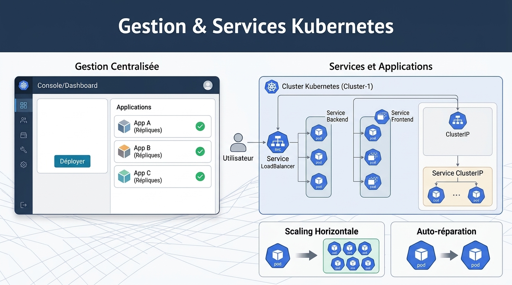


Ce document présente les manipulations réalisées dans le laboratoire Kubernetes pour comprendre le déploiement, l'exposition et la gestion des applications conteneurisées au sein d'un cluster Kubernetes.

L'objectif est de maîtriser les relations entre les principaux objets Kubernetes :

- **Pod** : unité d'exécution d'une application conteneurisée.
- **Label** : mécanisme d'identification et de sélection des ressources.
- **Service** : point d'accès réseau stable vers un ensemble de Pods.
- **Endpoint** : adresse IP et port des Pods sélectionnés par un Service.
- **Deployment** : objet de gestion déclarative des applications.
- **ReplicaSet** : contrôleur chargé de maintenir le nombre de Pods souhaité.

Les expérimentations ont été effectuées sur le cluster déployé aux étapes précédentes (VMware Workstation + Ubuntu Server).

#### 9.1 - Architecture du laboratoire

Le cluster est constitué de trois machines virtuelles :

| Machine | Rôle | Adresse IP |
|---|---|---|
| k8s-control-plane | Control Plane | 192.168.189.10 |
| k8s-worker-01 | Worker 01 | 192.168.189.11 |
| k8s-worker-02 | Worker 02 | 192.168.189.12 |

**Environnement technique :**

- Hyperviseur : VMware Workstation
- Réseau : NAT — VMnet8
- Système : Ubuntu Server 26.04.1 LTS
- Kubernetes : v1.30.14
- Runtime : containerd 2.2.2
- Réseau Kubernetes : Flannel
- DNS interne : CoreDNS
- Administration : Rancher


*Figure 1 — Architecture logique de l'infrastructure VMware et des trois machines virtuelles.*

#### 9.2 - Déploiement des Pods Nginx

La première expérimentation consiste à créer deux Pods Nginx indépendants.

**Création du premier Pod**

```bash
kubectl run nginx-test \
  --image=nginx \
  --port=80
```

**Création du second Pod** (à partir d'un manifeste YAML)

```bash
kubectl apply -f nginx-worker01.yaml
```

**Vérification**

```bash
kubectl get pods -o wide
```

Résultat observé :

| Pod | Adresse IP | Nœud |
|---|---|---|
| nginx-test | 10.244.2.39 | k8s-worker-02 |
| nginx-worker01 | 10.244.1.65 | k8s-worker-01 |

Les deux Pods sont à l'état `Running`.

#### 9.3 - Gestion des Labels

Les Labels permettent d'associer des métadonnées aux ressources Kubernetes. Ils sont notamment utilisés par les Services et les contrôleurs pour sélectionner les Pods concernés.

Dans notre expérimentation, les deux Pods Nginx ont reçu le Label suivant :

```bash
kubectl label pod nginx-test app=nginx
kubectl label pod nginx-worker01 app=nginx
```

Vérification :

```bash
kubectl get pods --show-labels
```

Les deux Pods possèdent maintenant le Label `app=nginx`.

#### 9.4 - Création d'un Service ClusterIP

Un Service fournit un point d'accès réseau stable vers les Pods sélectionnés. Contrairement à l'adresse IP d'un Pod, qui peut changer lorsqu'un Pod est recréé, la ClusterIP du Service reste stable pendant la durée de vie de celui-ci.

**Manifeste `nginx-service.yaml`**

```yaml
apiVersion: v1
kind: Service
metadata:
  name: nginx-service
spec:
  type: ClusterIP
  selector:
    app: nginx
  ports:
    - name: http
      protocol: TCP
      port: 80
      targetPort: 80
```

Application :

```bash
kubectl apply -f nginx-service.yaml
```

Vérification :

```bash
kubectl get services
kubectl get endpoints nginx-service
```

Résultat observé :

- Service : `nginx-service`
- Type : `ClusterIP`
- Adresse : `10.110.107.145`
- Port : `80/TCP`
- Endpoints : `10.244.1.65:80` et `10.244.2.39:80`

Le Service sélectionne automatiquement les deux Pods grâce au Label `app=nginx`.

#### 9.5 - DNS interne et communication entre Pods

Kubernetes utilise CoreDNS pour permettre aux applications de retrouver les Services à partir de leur nom DNS. Un Pod BusyBox a été créé pour réaliser les tests réseau.

```bash
kubectl run dns-test \
  --image=busybox:1.36 \
  --restart=Never \
  --command -- sleep 3600
```

**Résolution DNS**

```bash
kubectl exec dns-test -- \
  nslookup nginx-service.default.svc.cluster.local
```

Résultat attendu :

```text
Name: nginx-service.default.svc.cluster.local
Address: 10.110.107.145
```

**Test HTTP**

```bash
kubectl exec dns-test -- \
  wget -qO- http://nginx-service
```

La page HTML d'accueil de Nginx est retournée.


*Figure 2 — Chemin logique d'une requête HTTP depuis un Pod client vers les endpoints Nginx.*

Cette expérimentation valide la résolution DNS interne et la communication entre Pods à travers un Service ClusterIP.

#### 9.6 - Deployment et ReplicaSet

Après les déploiements manuels, un Deployment a été créé pour automatiser la gestion des Pods Nginx.

**Manifeste `nginx-deployment.yaml`**

```yaml
apiVersion: apps/v1
kind: Deployment
metadata:
  name: nginx-deployment
spec:
  replicas: 3
  selector:
    matchLabels:
      app: nginx-deployment
  template:
    metadata:
      labels:
        app: nginx-deployment
    spec:
      containers:
        - name: nginx
          image: nginx:latest
          imagePullPolicy: IfNotPresent
          ports:
            - containerPort: 80
```

Application :

```bash
kubectl apply -f nginx-deployment.yaml
```

Vérification :

```bash
kubectl get deployments
kubectl get replicasets
kubectl get pods -l app=nginx-deployment -o wide
```

Résultat observé :

- Deployment : `nginx-deployment`
- ReplicaSet : `nginx-deployment-75f6447756`
- Nombre de réplicas souhaité : 3
- Nombre de Pods disponibles : 3

**Relation entre les objets Kubernetes**

Le Deployment pilote le ReplicaSet, qui maintient le nombre de Pods demandé. Le Service sélectionne les Pods grâce à leurs Labels et fournit un point d'accès réseau stable.


*Figure 3 — Relation hiérarchique entre Deployment, ReplicaSet et Pods, avec le Service comme point d'accès.*

#### 9.7 - Test d'auto-réparation du Deployment

L'un des principaux avantages d'un Deployment est le maintien de l'état souhaité de l'application. Pour vérifier ce comportement, un Pod a été supprimé manuellement.

```bash
kubectl delete pod nginx-deployment-75f6447756-2tkk2
```

Surveillance :

```bash
kubectl get pods -l app=nginx-deployment -w
```

Le ReplicaSet a détecté qu'il ne restait plus que deux Pods et a automatiquement créé un nouveau Pod :

```text
nginx-deployment-75f6447756-vqp2z
```

Le Deployment est ensuite revenu à trois Pods disponibles.

> [!IMPORTANT]
> Kubernetes ne restaure pas le Pod supprimé à l'identique. Il en crée un nouveau à partir du modèle défini dans le Deployment.

#### 9.8 - Analyse de la répartition sur les Workers

Après le remplacement du Pod supprimé, la répartition observée était la suivante :

| Nœud | Adresse IP du nœud | Nombre de Pods |
|---|---|---:|
| k8s-worker-01 | 192.168.189.11 | 2 |
| k8s-worker-02 | 192.168.189.12 | 1 |
| k8s-control-plane | 192.168.189.10 | 0 |

Adresses IP des Pods :

- Worker 01 : `10.244.1.67` et `10.244.1.68`
- Worker 02 : `10.244.2.41`


*Figure 4 — Répartition observée des trois Pods du Deployment sur les deux Workers.*

**Interprétation**

La répartition 2 + 1 est normale. Kubernetes utilise son Scheduler pour placer les Pods sur les nœuds disponibles, en tenant compte des ressources, des contraintes et des règles de planification. Avec trois réplicas et deux Workers, Kubernetes ne garantit pas automatiquement une répartition parfaitement équilibrée.

Pour observer la distribution :

```bash
kubectl get pods \
  -l app=nginx-deployment \
  -o wide
```

Pour imposer ultérieurement une meilleure distribution, il est possible d'étudier `topologySpreadConstraints` et les règles d'affinité.

#### 9.9 - Service dédié au Deployment

Un second Service a été créé pour exposer exclusivement les trois Pods du Deployment.

**Manifeste `nginx-deployment-service.yaml`**

```yaml
apiVersion: v1
kind: Service
metadata:
  name: nginx-deployment-service
spec:
  type: ClusterIP
  selector:
    app: nginx-deployment
  ports:
    - name: http
      protocol: TCP
      port: 80
      targetPort: 80
```

Application :

```bash
kubectl apply -f nginx-deployment-service.yaml
```

Vérification :

```bash
kubectl get services
kubectl get endpoints nginx-deployment-service
```

Résultat observé :

| Propriété | Valeur |
|---|---|
| Service | nginx-deployment-service |
| Type | ClusterIP |
| ClusterIP | 10.102.64.231 |
| Port | 80/TCP |
| Endpoints | 3 Pods |

Ce Service utilise le Label `app=nginx-deployment`, différent du Label `app=nginx` des Pods créés manuellement. Les deux Services sont donc indépendants.

#### 9.10 - Validation HTTP avec port-forward

Pour tester le Service du Deployment depuis le Control Plane, un transfert de port temporaire a été utilisé.

```bash
kubectl port-forward svc/nginx-deployment-service 8081:80
```

Dans un second terminal :

```bash
curl -I http://127.0.0.1:8081
```

Résultat obtenu :

```text
HTTP/1.1 200 OK
Server: nginx/1.31.8
Content-Type: text/html
```

Le code HTTP `200 OK` confirme que le serveur Nginx a répondu correctement.

> [!NOTE]
> Le `port-forward` est un mécanisme de diagnostic temporaire. Il ne transforme pas le Service ClusterIP en service accessible de manière permanente depuis le réseau local.

#### 9.11 - Bilan des tests

| Test | Résultat |
|---|---|
| État des nœuds | 3/3 Ready |
| Pods Nginx statiques | 2/2 Running |
| Service nginx-service | 2 endpoints |
| Résolution DNS interne | Réussie |
| Communication HTTP interne | Réussie |
| Deployment Nginx | 3/3 disponibles |
| Auto-réparation | Nouveau Pod créé |
| Service du Deployment | 3 endpoints |
| Test HTTP via port-forward | HTTP 200 OK |


*Figure 5 — Synthèse visuelle des principaux tests réalisés et validés.*

#### 9.12 - Commandes de référence

**État du cluster**

```bash
kubectl get nodes -o wide
kubectl get namespaces
kubectl get pods -A
```

**Gestion des Pods**

```bash
kubectl get pods -o wide
kubectl describe pod nginx-test
kubectl get pods --show-labels
```

**Gestion des Services**

```bash
kubectl get services
kubectl describe service nginx-service
kubectl get endpoints nginx-service
```

**Gestion des Deployments**

```bash
kubectl get deployments
kubectl get replicasets
kubectl get pods -l app=nginx-deployment -o wide
```

**Diagnostic réseau**

```bash
kubectl exec dns-test -- nslookup nginx-service.default.svc.cluster.local
kubectl exec dns-test -- wget -qO- http://nginx-service
```

#### 9.13 - Conclusion de l'étape

Ce laboratoire a permis de mettre en pratique les principaux mécanismes de gestion des applications Kubernetes. Les expérimentations ont démontré la complémentarité des objets Kubernetes :

- Les Pods exécutent les applications.
- Les Labels identifient les ressources.
- Les Services assurent un accès réseau stable.
- Les Endpoints identifient les Pods ciblés.
- Les ReplicaSets maintiennent le nombre de réplicas.
- Les Deployments pilotent les ReplicaSets et facilitent la gestion du cycle de vie des applications.

Le cluster a validé les tests de communication réseau, de résolution DNS, d'exposition par Service et d'auto-réparation.

**Pistes d'approfondissement**

1. La mise à l'échelle avec `kubectl scale`.
2. Les mises à jour progressives avec Rolling Update.
3. Le retour à une version précédente avec Rollback.
4. La configuration des applications avec ConfigMap et Secret.
5. La persistance des données avec PersistentVolume et PersistentVolumeClaim.
6. L'exposition externe des applications avec NodePort et Ingress.
7. La répartition contrôlée des Pods avec `topologySpreadConstraints`.

Document détaillé : [`docs/08-applications-services.md`](docs/08-applications-services.md)

---

### Étape 10 - Documenter les problèmes (troubleshooting)

Pour chaque incident, noter : le message d'erreur exact, la machine concernée, les commandes de diagnostic, la cause confirmée si elle est connue, la correction et le résultat après correction.

#### 10.1 - Incidents liés aux VM et au réseau (phase de préparation)

| Symptôme | Cause confirmée | Correction |
|---|---|---|
| `ping 192.168.189.2` : `Destination Host Unreachable` depuis `192.168.189.10` | Carte réseau de la VM en **Bridged** au lieu de NAT | Éteindre la VM, **Settings > Network Adapter > NAT**, rallumer |
| `Invalid YAML: inconsistent indentation` au `netplan apply` | Indentation incorrecte de la ligne `via:` | Aligner `via:` sous `to:` (espaces uniquement) |
| Netplan ne prend pas la configuration | Fautes de frappe : `namesservers` au lieu de `nameservers`, `/244` au lieu de `/24` | Corriger le fichier puis `sudo netplan generate` |
| `Permissions for /etc/netplan/…yaml are too open` | Droits trop larges sur le fichier | `sudo chmod 600 /etc/netplan/*.yaml` |
| `Temporary failure in name resolution` | DNS absent ou réseau non fonctionnel | Vérifier la passerelle, puis la section `nameservers` |
| Ping vers `1.1.1.1` sans réponse alors qu'`apt update` fonctionne | ICMP filtré par le NAT | Tester avec `apt update` ou `curl` plutôt qu'avec `ping` |
| `Unit containerd.service could not be found` | `containerd` non installé (paquets non téléchargés faute de réseau, ou Worker neuf) | Rétablir le réseau, puis `sudo apt install -y containerd` (étape 4) |
| Login ou mot de passe refusé sur une VM neuve | Clavier QWERTY choisi à l'installation | Réinstaller en choisissant la disposition **French** |
| Plusieurs VM avec le même nom ou le même `machine-id` | VM clonée sans personnalisation | `hostnamectl set-hostname`, puis régénérer le `machine-id` |
| `Network error: Connection refused` dans MobaXterm | OpenSSH server non installé sur la VM, rien n'écoute sur le port 22 | Installer et démarrer OpenSSH (étape 1.5.2) |
| `Access denied` dans MobaXterm alors que le mot de passe est correct | Nom d'utilisateur erroné : nom d'hôte saisi à la place du compte, ou faute de frappe | Utiliser le compte créé à l'installation (`ubuntu-server-01`, `ubuntu-worker-01`…) |

#### 10.2 - Erreurs de cluster rencontrées lors du déploiement réel

Le détail complet (E1→E16) est documenté dans le bloc ci-dessous. Résumé :

| # | Erreur | Cause | Correction clé |
|---|---|---|---|
| E1 | `apt-bet` inconnu | Faute de frappe | `apt-get` |
| E2 | Cluster `NotReady` | Flannel + Calico ensemble | **Un seul CNI** |
| E3 | Cluster cassé | `kubeadm reset` prématuré | Nettoyage complet + reconstruction |
| E4 | `localhost:8080 refused` | Kubeconfig manquant | Recréer `~/.kube/config` |
| E5 | `drive>` / `plugi>` dans `journalctl` | Terminal MobaXterm trop étroit | `journalctl --no-pager` |
| E6 | Workers vides | Ubuntu fraîche, rien d'installé | Étape 3, 4, 5.4 (Worker) |
| E7 | `cp`/`chown` échouent | Arguments manquants + sans `sudo` | Copier les commandes entières |
| E8 | `syntax error near unexpected token` | Placeholders `<TOKEN>`/`<HASH>` littéraux | Copier la ligne complète du control plane |
| E9 | Join échoue sur control plane | Un CP ne se joint pas à lui-même | Join **uniquement** sur les workers |
| E10 | Join échoue (déjà joint) | Rejeu du join | Normal — vérifier avec `kubectl get nodes` |
| E11 | `kubectl: not found` sur worker | `kubectl` non installé sur les workers | Lancer `kubectl` sur le control plane |
| E12 | containerd paquet Ubuntu vs `.io` | Choix de paquet | Rester cohérent (paquet Ubuntu + SystemdCgroup) |
| E13 | Prérequis manquants | Swap, modules, sysctl | Étape 3 |
| E14 | `kubelet` en `activating (auto-restart)`, journal : `running with swap on is not supported` | Swap actif sur les deux Workers (`/swap.img` encore monté) | `sudo swapoff -a`, commenter la ligne swap dans `/etc/fstab`, `sudo systemctl restart kubelet` |
| E15 | Pods `cert-manager` et `cert-manager-webhook` en `ImagePullBackOff` | Timeouts réseau/DNS vers `quay.io` sur le Worker (`i/o timeout`, `TLS handshake timeout`) | Aucune action sur les images : kubelet a réessayé, les pods sont passés `Running` ; la cause DNS est traitée en E16 |
| E16 | `dig AAAA` en timeout, `curl -I` (sans `-4`) échoue par intermittence sur les 3 nœuds | Requêtes `AAAA` sans réponse sur le port 53 (origine non établie) | **DNSOverTLS** dans `systemd-resolved` + retrait de `192.168.189.2` des `nameservers` du Control Plane |

<details>
<summary><strong>Pour aller plus loin - Retour d'expérience détaillé du déploiement (E1→E16)</strong></summary>

Ce déroulé reprend, dans l'ordre, chaque erreur rencontrée pendant le déploiement, avec la commande fautive, la sortie exacte, le diagnostic et la résolution. Il est destiné aux prochains intervenants pour éviter de reproduire les mêmes pièges.

### E1 — Faute de frappe `apt-bet`

**Commande :**

```bash
sudo apt-bet install -y apt-transport-https ca-certificates curl gpg
```

**Erreur :**

```
sudo: 'apt-bet': command not found
```

**Diagnostic :** Faute de frappe (`apt-bet` au lieu de `apt-get`).

**Résolution :**

```bash
sudo apt-get install -y apt-transport-https ca-certificates curl gpg
```

---

### E2 — Installation simultanée de Flannel **et** Calico (erreur principale)

**Commandes fautives :**

```bash
kubectl apply -f https://github.com/flannel-io/flannel/releases/latest/download/kube-flannel.yml
kubectl create -f https://raw.githubusercontent.com/projectcalico/calico/v3.31.4/manifests/tigera-operator.yaml
kubectl create -f custom-resources.yaml
```

**Symptômes :**

- Nœud `k8s-control-plane` resté `NotReady` pendant plusieurs minutes
- Pods `coredns-*` bloqués en `Pending`
- Après un `kubeadm reset`, des interfaces `cni0` et `flannel.1` restaient présentes
- `/etc/cni/net.d/10-flannel.conflist` restait après reset

**Diagnostic :** Flannel et Calico gèrent tous deux le réseau des pods (interfaces, routes, règles iptables/BGP/VXLAN). Les installer **en même temps** produit un réseau instable et empêche les pods système (CoreDNS) de démarrer.

**Résolution :** Choisir **un seul CNI**. Dans ce lab, Flannel a été retenu (CIDR `10.244.0.0/16` déjà aligné avec `kubeadm init`).

```bash
# Après reset + nettoyage complet :
kubectl apply -f https://github.com/flannel-io/flannel/releases/latest/download/kube-flannel.yml
# NE PAS appliquer Calico par-dessus.
```

> [!CAUTION]
> **Règle absolue : un seul CNI par cluster.** Pour changer plus tard : `kubeadm reset` + nettoyage complet (`/etc/cni/net.d`, `/var/lib/cni`, interfaces `cni0`/`flannel.1`, iptables) **avant** d'installer l'autre.

---

### E3 — `kubeadm reset -f` exécuté par désespoir

**Commandes exécutées :**

```bash
sudo kubeadm reset -f
sudo rm -rf $HOME/.kube
sudo iptables -F && sudo iptables -t nat -F && sudo iptables -t mangle -F && sudo iptables -X
```

**Conséquences :**

- `/etc/kubernetes/{admin.conf,kubelet.conf,controller-manager.conf,scheduler.conf,super-admin.conf}` supprimés
- `/etc/kubernetes/manifests` et `/etc/kubernetes/pki` vidés
- `/var/lib/etcd` supprimé
- `kubelet.service` arrêté
- `~/.kube/config` supprimé → `kubectl` devient inutilisable

**Ce que `kubeadm reset` ne nettoie pas** (message explicite dans la sortie) :

- `/etc/cni/net.d/` (config CNI)
- `/var/lib/cni/`
- Interfaces réseau `cni0`, `flannel.1`
- Règles `iptables` et tables IPVS
- `~/.kube/config` (supprimé manuellement ici)

**Diagnostic :** Ce reset n'était pas nécessaire — le vrai problème était E2 (double CNI). Il a rallongé le debug.

**Résolution :** Nettoyage complet **après** le reset :

```bash
sudo rm -f /etc/cni/net.d/10-flannel.conflist
sudo rm -rf /var/lib/cni/
sudo ip link delete cni0      2>/dev/null || true
sudo ip link delete flannel.1 2>/dev/null || true
sudo systemctl restart containerd
sudo iptables -F && sudo iptables -t nat -F && sudo iptables -t mangle -F && sudo iptables -X
```

Puis reconstruire le cluster (voir Étape 6.1, ou le dépannage du cluster point 2).

---

### E4 — `kubectl` échoue avec `localhost:8080 refused`

**Erreur :**

```
The connection to the server localhost:8080 was refused - did you specify the right host or port?
```

**Diagnostic :**

1. `~/.kube/config` supprimé (par `rm -rf $HOME/.kube`)
2. Sans kubeconfig, `kubectl` retombe sur l'endpoint par défaut `http://localhost:8080`
3. Aucun API server n'écoute sur `localhost:8080` → `connection refused`

Ce n'est **pas** un problème réseau ni de kubelet. C'est la conséquence directe de E3.

**Résolution :** Reconstruire le kubeconfig après le `kubeadm init` (voir E7).

---

### E5 — Erreurs tronquées `drive>` / `plugi>` dans `journalctl`

**Sortie (tronquée) :**

```
kubelet[163456]: E1028 09:54:55.484544 163456 drive>
kubelet[163456]: E1028 09:54:55.484656 163456 plugi>
```

**Diagnostic :** Ces lignes sont **tronquées par la largeur du terminal MobaXterm**. Elles correspondent à des erreurs internes de kubelet au moment du `kubeadm reset` (arrêt forcé des conteneurs, `exit_status:137` = SIGKILL). **Ce n'est pas la cause du `NotReady`.** C'est un faux positif visuel.

**Résolution :** Utiliser `journalctl -u kubelet -n 200 --no-pager -l` (option `-l` pour ne pas tronquer) si besoin de lire en entier. Ne pas s'acharner sur ces lignes.

---

### E6 — Workers sans containerd ni kubelet/kubeadm

**Symptômes (sur .11 et .12) :**

```
Unit containerd.service could not be found.
ls: impossible d'accéder à '/etc/cni/net.d/' : Aucun fichier ou répertoire de ce type
```

**Diagnostic :** Les workers étaient des installations Ubuntu 24.04 fraîches — aucun composant Kubernetes n'était installé. Normal, il faut les préparer avant le `join`.

**Résolution :** Préparation standard (voir Étape 3, 4 et 5.4 côté Worker).

---

### E7 — `cp admin.conf` et `chown` exécutés seuls (arguments manquants)

**Commandes fautives :**

```bash
cp admin.conf
chown
```

**Erreurs :**

```
cp: missing destination file operand after 'admin.conf'
chown : arguments requis suivants non fournis : <OWNER> <FILE>...
```

**Diagnostic :** Les commandes ont été recopiées **partiellement**, en oubliant les arguments. Elles ont aussi été lancées **sans `sudo`**.

**Conséquence immédiate :**

```bash
kubeadm token create --print-join-command
# failed to load admin kubeconfig: open /etc/kubernetes/admin.conf: permission denied
```

**Résolution :** Recopier les commandes **intégralement**, avec `sudo` :

```bash
mkdir -p $HOME/.kube
sudo cp -i /etc/kubernetes/admin.conf $HOME/.kube/config
sudo chown $(id -u):$(id -g) $HOME/.kube/config
ls -l $HOME/.kube/config
# → -rw------- 1 ubuntu-server-01 ubuntu-server-01 ... /home/ubuntu-server-01/.kube/config
```

---

### E8 — Placeholders `<TOKEN>` et `<HASH>` copiés littéralement

**Commande fautive :**

```bash
sudo kubeadm join 192.168.189.10:6443 --token <TOKEN> \
  --discovery-token-ca-cert-hash sha256:<HASH>
```

**Erreur :**

```
-bash: syntax error near unexpected token `newline'
```

**Diagnostic :** `<TOKEN>` et `<HASH>` sont des **placeholders** à remplacer par les vraies valeurs (renvoyées par `kubeadm token create --print-join-command`). Le shell interprète `<` et `>` comme des redirections de fichiers, d'où l'erreur de syntaxe.

**Résolution :** Copier la **ligne entière** retournée par le control plane, sans la découper :

```bash
# Sur le control plane :
kubeadm token create --print-join-command
# → kubeadm join 192.168.189.10:6443 --token f8ju5r.agguxmhq4sn2xt43 --discovery-token-ca-cert-hash sha256:95966396c0af47321fa7206c06b9c876b7b0cefcdb26c513d53c2f2530ae6af7

# Sur chaque worker, préfixer par sudo et coller tel quel :
sudo kubeadm join 192.168.189.10:6443 --token f8ju5r.agguxmhq4sn2xt43 --discovery-token-ca-cert-hash sha256:95966396c0af47321fa7206c06b9c876b7b0cefcdb26c513d53c2f2530ae6af7
```

---

### E9 — `kubeadm join` lancé sur le control plane

**Commande fautive (sur .10) :**

```bash
sudo kubeadm join 192.168.189.10:6443 --token f8ju5r.agguxmhq4sn2xt43 --discovery-token-ca-cert-hash sha256:95966396c0af47321fa7206c06b9c876b7b0cefcdb26c513d53c2f2530ae6af7
```

**Erreur :**

```
[ERROR FileAvailable--etc-kubernetes-kubelet.conf]: /etc/kubernetes/kubelet.conf already exists
[ERROR Port-10250]: Port 10250 is in use
[ERROR FileAvailable--etc-kubernetes-pki-ca.crt]: /etc/kubernetes/pki/ca.crt already exists
```

**Diagnostic :** Un control plane déjà initialisé ne se joint pas à lui-même. Le preflight détecte les fichiers déjà présents et bloque — c'est le comportement attendu. **Aucun dégât.**

**Résolution :** Ne pas exécuter `kubeadm join` sur le control plane. Lancer `kubeadm join` **uniquement** sur les workers.

---

### E10 — `kubeadm join` rejoué sur un worker déjà joint

**Erreur (sur .11 et .12 après un premier join réussi) :**

```
[ERROR FileAvailable--etc-kubernetes-kubelet.conf]: /etc/kubernetes/kubelet.conf already exists
[ERROR Port-10250]: Port 10250 is in use
[ERROR FileAvailable--etc-kubernetes-pki-ca.crt]: /etc/kubernetes/pki/ca.crt already exists
```

**Diagnostic :** Le worker avait **déjà** rejoint le cluster (message `This node has joined the cluster`). Relancer `kubeadm join` échoue au preflight. **C'est le signe que tout s'est bien passé.**

**Résolution :** Ne rien faire. Ne pas faire `kubeadm reset` pour « réessayer » — cela casserait le nœud. Vérifier depuis le control plane :

```bash
kubectl get nodes
```

---

### E11 — `kubectl` exécuté sur les workers

**Erreur (sur .11 / .12) :**

```
Command 'kubectl' not found, but can be installed with:
sudo snap install kubectl
```

**Diagnostic :** Les workers n'ont que `kubelet` + `kubeadm` (pas `kubectl`). C'est volontaire et suffisant. **Toutes les commandes `kubectl` se lancent sur le control plane.**

**Résolution :** Se connecter au control plane (192.168.189.10) pour tout `kubectl`.

---

### E12 — Paquet `containerd` vs `containerd.io` sur les workers

**Contexte :** Sur le control plane, containerd avait été installé manuellement (paquet système Ubuntu, version `2.2.2-0ubuntu1.2`). Sur les workers, `sudo apt-get install -y containerd` a installé exactement le même paquet système.

**Résultat :** Aucun problème. Les deux configs sont compatibles (`SystemdCgroup = true` des deux côtés).

**Note :** La documentation officielle Kubernetes suggère `containerd.io` depuis le dépôt Docker. Le paquet `containerd` d'Ubuntu fonctionne aussi, tant que `SystemdCgroup = true` est configuré. Dans ce lab, on reste sur le paquet Ubuntu pour rester cohérent avec le control plane.

---

### E13 — `swapoff` / modules noyau / sysctl absents sur les workers

**Diagnostic :** Un worker Kubernetes **exige** :

- Swap désactivé (sinon kubelet refuse de démarrer)
- Modules `overlay` + `br_netfilter` chargés
- `net.bridge.bridge-nf-call-iptables = 1` et `net.ipv4.ip_forward = 1`

**Résolution (sur chaque worker) :**

```bash
sudo swapoff -a
sudo sed -i '/ swap / s/^\(.*\)$/#\1/g' /etc/fstab

sudo modprobe overlay && sudo modprobe br_netfilter
cat <<EOF | sudo tee /etc/modules-load.d/k8s.conf
overlay
br_netfilter
EOF

cat <<EOF | sudo tee /etc/sysctl.d/k8s.conf
net.bridge.bridge-nf-call-iptables  = 1
net.bridge.bridge-nf-call-ip6tables = 1
net.ipv4.ip_forward                 = 1
EOF
sudo sysctl --system
```

**Vérification :**

```bash
free -h | grep -i swap       # → Swap: 0B 0B 0B
lsmod | grep -E 'overlay|br_netfilter'
```

---

### E14 — `kubelet` ne démarre pas sur un Worker : swap actif

**Symptôme :** le nœud est `NotReady` côté Control Plane (`Kubelet stopped posting node status`), et sur le Worker :

```text
failed to run Kubelet: running with swap on is not supported, please disable swap!
/proc/swaps contained: [... /swap.img file 4194300 0 -1]
kubelet.service: Scheduled restart job, restart counter is at 343
```

**Diagnostic :** `/swap.img` était actif, et `kubelet` refuse de démarrer dans ce cas. **Les deux Workers étaient touchés** : le compteur de redémarrages de `kubelet` atteignait 343 sur `k8s-worker-01` et 381 sur `k8s-worker-02`, avec la même erreur. Le problème durait donc depuis longtemps : les pods Flannel et `kube-proxy` des nœuds affichaient plus de 300 redémarrages pour la même raison. La cause exacte du retour du swap n'est pas établie (préparation de l'étape 3 non appliquée sur ces nœuds, ou ligne `/etc/fstab` restaurée).

**Résolution (sur chaque Worker) :**

```bash
sudo swapoff -a
sudo nano /etc/fstab            # commenter la ligne /swap.img
free -h                         # Swap: 0B 0B 0B
sudo systemctl restart kubelet
sudo ss -lntp | grep 10250      # kubelet doit écouter
```

**Résultat :** `kubelet` passe à `active (running)` sur les deux Workers et `ss` montre `kubelet` à l'écoute sur le port `10250`. Vérifier `/etc/fstab` sur les trois nœuds : un simple `swapoff -a` ne survit pas au redémarrage.

---

### E15 — `cert-manager` en `ImagePullBackOff`

**Symptôme :** `cert-manager` et `cert-manager-webhook` sont en `ImagePullBackOff`, alors que `cainjector`, du même chart, est `Running`.

**Diagnostic :**

```bash
kubectl describe pod -n cert-manager <pod> | tail -20
kubectl get pods -n cert-manager -o wide      # sur quel Worker ?
getent hosts quay.io                          # depuis ce Worker
sudo crictl pull quay.io/jetstack/cert-manager-controller:v1.21.3
```

Le message de l'événement `Failed to pull image` donne la cause : `no such host` (DNS), `timeout` (réseau ou proxy), `manifest unknown` (tag). Ces pods ont été planifiés sur un Worker qui était alors en panne (E14) : tester le pull sur un Worker sain avant de conclure à un problème de registre.

**Cause confirmée :** le `describe` des pods affiche des `i/o timeout` et des `TLS handshake timeout` vers `quay.io`, ainsi qu'un `lookup quay.io on 127.0.0.53:53: i/o timeout`. Le problème venait du réseau et du DNS, pas du tag ni du registre (`curl -I https://quay.io` répondait `HTTP/2 200` par moments). Le DNS était lent (environ 6 s par requête) sur les trois nœuds.

**Résolution :** aucune action sur les images : kubelet a réessayé et les trois pods sont passés `Running`. La lenteur du DNS qui a causé ces échecs est traitée en E16.

---

### E16 — Timeouts DNS : requêtes `AAAA` sans réponse sur le port 53, DNS-over-TLS fonctionnel

**Symptôme (sur les trois nœuds) :**

```text
$ time dig @1.1.1.1 AAAA quay.io +short
;; communications error to 1.1.1.1#53: timed out   (x3)
real 0m15,027s

$ time dig @1.1.1.1 quay.io +short                 # requête A (IPv4)
(réponse en moins d'une seconde)

$ time dig @127.0.0.53 quay.io +short              # stub systemd-resolved, requête A
(réponse en moins de 0,2 s)

$ dig +tls @1.1.1.1 AAAA quay.io +short            # DNS chiffré, port 853
2600:1f18:d77:9002:c98f:7cab:507:7198              # répond
...

$ curl -I --connect-timeout 10 https://quay.io
curl: (28) Resolving timed out after 10002 milliseconds

$ curl -4 -I --connect-timeout 10 https://quay.io
HTTP/2 200                                         # réussit parfois, échoue à d'autres moments
```

`resolvectl query quay.io` mettait environ 6 s avant les tests, et `sudo resolvectl statistics` montrait des dizaines de timeouts cumulés (52, 29 et 58 selon les nœuds).

**Diagnostic :**

Les requêtes DNS de type `AAAA` (IPv6) sur le port 53 n'obtiennent aucune réponse, ni vers `1.1.1.1`, ni vers `8.8.8.8`, ni vers `192.168.189.2` (UDP : timeout, TCP : `connection reset`, même avec `+noedns`), alors que les requêtes `A` répondent en moins d'une seconde. Le DNS chiffré (`dig +tls`, port 853) répond aux deux types. L'origine du blocage n'est pas établie : le pare-feu Windows est écarté (test avec pare-feu désactivé), la box, le fournisseur d'accès et l'antivirus n'ont pas été testés de façon concluante.

> [!NOTE]
> **Pistes écartées :** le mode réseau VMware (NAT) n'est pas en cause, puisque les requêtes `A` passent normalement. Désactiver IPv6 à chaud (`sysctl net.ipv6.conf.all.disable_ipv6=1`) ramène `resolvectl query` sous 150 ms mais ne règle pas `curl` : ne pas le rendre permanent. Si ce sysctl a été appliqué, le remettre à `0` sur les trois nœuds.

**Résolution appliquée :**

**1. Control Plane uniquement : retirer `192.168.189.2` des `nameservers` Netplan.** Il reste la passerelle (`via:`), mais il ne parle pas DNS chiffré et deviendrait inutilisable avec `DNSOverTLS=yes`. Les Workers n'avaient déjà que `1.1.1.1` et `8.8.8.8`.

```bash
sudo nano /etc/netplan/50-cloud-init.yaml
```

La section `nameservers:` doit contenir uniquement :

```yaml
      nameservers:
        addresses:
          - 1.1.1.1
          - 8.8.8.8
```

```bash
sudo netplan apply
```

**2. Sur les trois nœuds : activer DNS-over-TLS dans `/etc/systemd/resolved.conf`.**

```bash
sudo nano /etc/systemd/resolved.conf
```

Dans la section `[Resolve]` (à créer en tête de fichier si elle est absente, comme sur le Control Plane) :

```ini
[Resolve]
DNS=1.1.1.1#cloudflare-dns.com 8.8.8.8#dns.google
DNSOverTLS=yes
```

```bash
sudo systemctl restart systemd-resolved
```

Commencer par un seul nœud : une erreur de syntaxe dans ce fichier peut couper la résolution de noms de la machine.

**Validation :**

```bash
resolvectl status
time resolvectl query quay.io
time curl -I --connect-timeout 10 https://quay.io
```

Attendu : `resolvectl status` affiche `+DNSOverTLS` et les deux serveurs avec leur nom, `resolvectl query` répond en moins d'une seconde, et `curl` (sans `-4`) répond `HTTP/2 200` en moins de 2 s.

**Résultat :** à compléter avec les sorties réelles des trois commandes ci-dessus sur chaque nœud.

> [!IMPORTANT]
> **Leçon à retenir :** un `apt update` qui fonctionne ne prouve pas que le DNS est sain. Quand des pods d'un même chart tombent en `ImagePullBackOff`, tester `time resolvectl query <registre>` et `curl -I` (avec et sans `-4`) **avant** de suspecter le registre ou le tag.

> [!NOTE]
> `192.168.189.2` reste la **passerelle** NAT dans `routes: via:`. Il est simplement retiré du champ `nameservers:` : ce sont deux usages distincts.

---

</details>

<details>
<summary><strong>Pour aller plus loin - Commandes utiles</strong></summary>

**Diagnostic depuis le Control Plane**

```bash
kubectl get nodes -o wide
kubectl get pods -A -o wide
kubectl describe node k8s-worker-01 | tail -30
kubectl describe pod -n kube-system <nom-du-pod>

sudo systemctl status containerd --no-pager
sudo systemctl status kubelet --no-pager
journalctl -u kubelet -n 200 --no-pager
journalctl -u containerd -n 100 --no-pager

sudo crictl --runtime-endpoint unix:///run/containerd/containerd.sock info
sudo crictl --runtime-endpoint unix:///run/containerd/containerd.sock ps -a
sudo ls -la /etc/cni/net.d/
ip -br address
```

**Jetons de jonction**

```bash
kubeadm token create --print-join-command
kubeadm token list
kubeadm token delete <identifiant-du-jeton>
```

Un jeton est valable 24 heures. Pour réinitialiser un nœud, voir le dépannage du cluster (étape 6.3, point 1).

</details>

Document détaillé : [`docs/07-troubleshooting.md`](docs/07-troubleshooting.md)

---

## 7. Critères de réussite

- [x] Les trois VM démarrent correctement.
- [x] Les cartes réseau sont en NAT (`VMnet8`).
- [x] Les noms d'hôtes sont uniques et corrects.
- [x] Les adresses IP sont configurées sans conflit.
- [x] Les nœuds communiquent entre eux et accèdent à Internet.
- [x] Le runtime fonctionne sur chaque nœud.
- [x] Le Control Plane est initialisé.
- [x] Les deux Workers ont rejoint le cluster.
- [x] `kubectl get nodes -o wide` affiche trois nœuds `Ready`.
- [x] Les pods système sont dans un état attendu.
- [x] Un déploiement de test fonctionne.
- [ ] Rancher est accessible et permet de consulter le cluster.
- [x] Les versions, commandes et résultats sont documentés.

> [!IMPORTANT]
> Coche chaque case uniquement après avoir effectué et vérifié le test correspondant.

---

## 8. Sécurité et bonnes pratiques

> [!CAUTION]
> Ne versionne jamais une clé privée SSH, un mot de passe, un jeton ou un kubeconfig sensible. Vérifie toujours les fichiers à publier avant un commit.

- Vérifier `git status` avant chaque commit.
- Ne pas publier de captures contenant des secrets ou des informations sensibles.
- Noter les versions utilisées et vérifier leur compatibilité.
- Sauvegarder les fichiers de configuration avant de les modifier.
- Indiquer sur quelle machine chaque commande doit être exécutée.
- Distinguer les commandes exécutées des commandes proposées.
- Ne pas déclarer une étape réussie sans vérification.
- Utiliser un mot de passe simple uniquement pour le laboratoire, et le durcir avant tout usage réel.
- Documenter les adresses IP réellement attribuées.
- Garder un accès à la console VMware pendant les modifications réseau.
- Ne pas installer Kubernetes avant d'avoir validé la connectivité entre les nœuds.

**Bonnes pratiques Kubernetes**

- Installer **un seul CNI** par cluster, avec un `--pod-network-cidr` identique à celui attendu par ce CNI.
- Après un `kubeadm reset`, nettoyer toujours `/etc/cni/net.d`, `/var/lib/cni`, les interfaces `cni0` et `flannel.1`, les règles `iptables`, puis redémarrer `containerd`.
- Recopier les commandes de la documentation **en entier**, avec `sudo`, et remplacer les espaces réservés (`<TOKEN>`, `<HASH>`, `<nom-du-pod>`) par les vraies valeurs.
- Lancer `kubectl` **uniquement sur le Control Plane**, et `kubeadm join` **uniquement sur les Workers**.
- Ne pas s'inquiéter d'un `kubelet` en `activating (auto-restart)` avant la jonction d'un Worker.
- Après un `kubeadm init`, vérifier systématiquement `kubectl get nodes`, `kubectl get pods -A` et `kubeadm token create --print-join-command`.
- Ne pas faire de `kubeadm reset` par réflexe : chercher d'abord la cause réelle (`kubectl get pods -A`, `kubectl describe`, journaux).
- Tester la résolution DNS des nœuds (`time resolvectl query quay.io`, `curl -I`) avant d'installer des charts qui téléchargent des images.
- Utiliser des Labels cohérents et documentés pour les Pods, Services et Deployments.
- Préférer un Deployment à des Pods nus pour les applications qui doivent rester disponibles.
- Valider un Service avec `kubectl get endpoints` : un Service sans endpoint ne route aucun trafic.
- Réserver `port-forward` au diagnostic ; pour un accès durable, utiliser `NodePort` ou `Ingress`.

---

## 9. Références officielles

- [Documentation Kubernetes](https://kubernetes.io/docs/home/)
- [Installation de kubeadm](https://kubernetes.io/docs/setup/production-environment/tools/kubeadm/install-kubeadm/)
- [Création d'un cluster avec kubeadm](https://kubernetes.io/docs/setup/production-environment/tools/kubeadm/create-cluster-kubeadm/)
- [Ports et protocoles Kubernetes](https://kubernetes.io/docs/reference/networking/ports-and-protocols/)
- [Documentation Ubuntu Server](https://documentation.ubuntu.com/server/)
- [Documentation Netplan](https://netplan.readthedocs.io/)
- [Documentation systemd-resolved](https://www.freedesktop.org/software/systemd/man/systemd-resolved.service.html)
- [Documentation containerd](https://containerd.io/docs/)
- [Documentation Flannel](https://github.com/flannel-io/flannel)
- [Documentation Calico](https://docs.tigera.io/calico/latest)
- [Documentation Helm](https://helm.sh/docs/)
- [Documentation Rancher](https://ranchermanager.docs.rancher.com/)
- [Installer Rancher sur Kubernetes avec Helm](https://ranchermanager.docs.rancher.com/getting-started/installation-and-upgrade/install-upgrade-on-a-kubernetes-cluster)
- [Installer Docker Engine sur Ubuntu](https://docs.docker.com/engine/install/ubuntu/)
- [MobaXterm](https://mobaxterm.mobatek.net/)
- [Kubernetes — Pods](https://kubernetes.io/docs/concepts/workloads/pods/)
- [Kubernetes — Labels et Selectors](https://kubernetes.io/docs/concepts/overview/working-with-objects/labels/)
- [Kubernetes — Services](https://kubernetes.io/docs/concepts/services-networking/service/)
- [Kubernetes — Endpoints](https://kubernetes.io/docs/concepts/services-networking/service/#endpointslices)
- [Kubernetes — Deployments](https://kubernetes.io/docs/concepts/workloads/controllers/deployment/)
- [Kubernetes — ReplicaSet](https://kubernetes.io/docs/concepts/workloads/controllers/replicaset/)
- [Kubernetes — DNS pour les Services et Pods](https://kubernetes.io/docs/concepts/services-networking/dns-pod-service/)
- [Kubernetes — kubectl port-forward](https://kubernetes.io/docs/tasks/access-application-cluster/port-forward-access-application-cluster/)
- [Kubernetes — topologySpreadConstraints](https://kubernetes.io/docs/concepts/scheduling-eviction/topology-spread-constraints/)

---

## 10. État actuel

> [!NOTE]
> Le dépôt a été cloné sur le poste Windows. La clé SSH a été créée et ajoutée au compte GitHub, et le test `ssh -T git@github.com` a réussi. Les trois VM sont créées, configurées en réseau avec leurs adresses IP statiques, et accessibles en SSH avec MobaXterm.

### 10.1 - État du cluster (au 2026-11-03)

**Nœuds (relevé du 2026-11-03) :**

```text
NAME                STATUS   ROLES           AGE     VERSION    OS-IMAGE             KERNEL-VERSION
k8s-control-plane   Ready    control-plane   5d23h   v1.30.14   Ubuntu 26.04.1 LTS   7.0.0-42-generic
k8s-worker-01       Ready    <none>          5d22h   v1.30.14   Ubuntu 26.04.1 LTS   7.0.0-38-generic
k8s-worker-02       Ready    <none>          5d22h   v1.30.14   Ubuntu 26.04.1 LTS   7.0.0-38-generic
```

**Pods système et applicatifs :** tous `Running`, dont les trois pods `cert-manager` (`cert-manager`, `cert-manager-cainjector`, `cert-manager-webhook`), Flannel sur les 3 nœuds et CoreDNS (×2).

**Applications de test :** deux Pods Nginx (`nginx-test`, `nginx-worker01`), le Deployment `nginx-deployment` (3 réplicas) et les Services `nginx-service` / `nginx-deployment-service` sont déployés et validés (voir Étape 9).

**Bilan :** cluster Kubernetes `v1.30.14` opérationnel — 1 Control Plane + 2 Workers `Ready`, cert-manager `Running`, applications déployées, exposées et auto-réparées. Deux incidents majeurs ont été traités après la mise en place du cluster : le swap actif sur les Workers (E14) et les timeouts DNS (E15/E16).

**Restant à faire :**

- Valider DNS-over-TLS sur les trois nœuds (`time curl -I --connect-timeout 10 https://quay.io` en moins de 2 s, sans `-4`).
- Redémarrer les Workers (nouveau noyau `7.0.0-42` installé mais non chargé) et vérifier `swapon --show` au retour.
- Installer Rancher (étape 7.1).

**Dernière mise à jour :** 2026-11-03.

---

*Fin du README.*