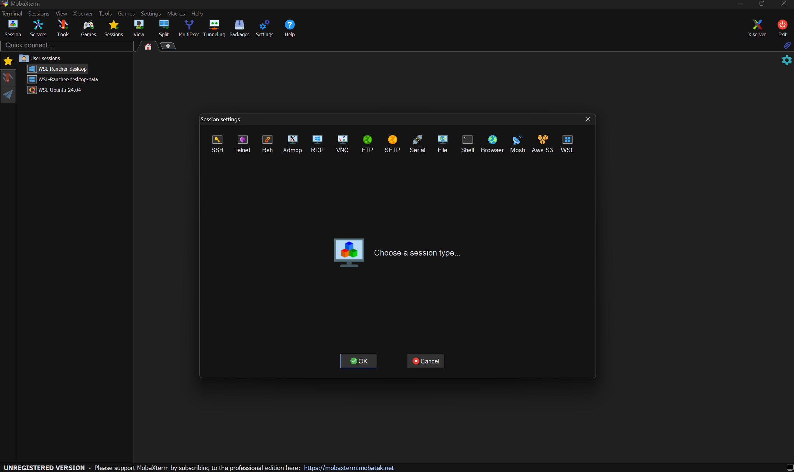
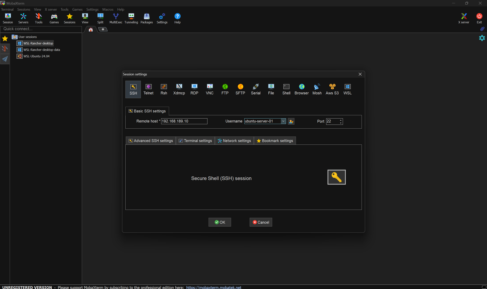
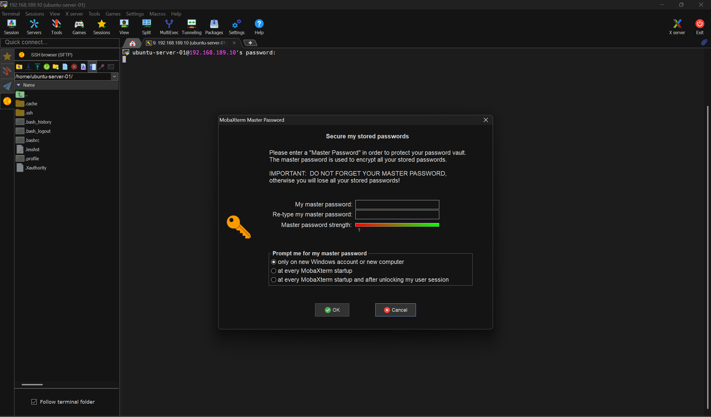
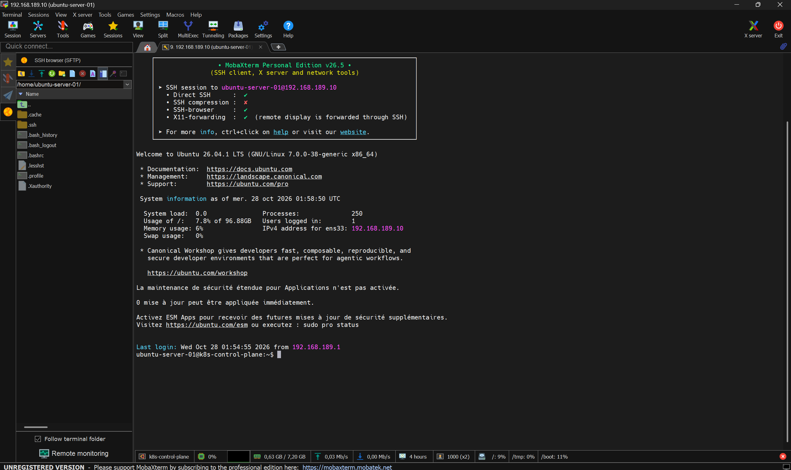

# Kubernetes Lab - Ubuntu Server 24.04

Projet de laboratoire pour déployer un cluster Kubernetes (1 Control Plane, 2 Workers) sur trois machines virtuelles Ubuntu Server 24.04 LTS sous VMware Workstation avec le réseau NAT (`VMnet8`), puis intégrer Rancher pour l'administration du cluster.

> [!NOTE]
> Les blocs **« Pour aller plus loin »** ne sont pas nécessaires pour réaliser le laboratoire. Ils conservent les méthodes alternatives, les diagnostics détaillés et les explications destinés aux prochains intervenants qui voudront approfondir.

---

## 1. Illustrations du projet

### Google Cloud Platform


### Kubernetes


### Cluster Kubernetes


### Rancher


### Workflow Rancher


---

## 2. Architecture cible et plan d'adressage choisi

| Machine virtuelle (VMware) | Rôle | Nom d'hôte (`hostname`) | Interface | Adresse IP statique | Passerelle | DNS |
|---|---|---|---|---|---|---|
| `Ubuntu-server-01` | **Control Plane** | `k8s-control-plane` | `ens33` | `192.168.189.10/24` | `192.168.189.2` | `1.1.1.1`, `8.8.8.8` |
| `Ubuntu-worker-01` | **Worker 01** | `k8s-worker-01` | `ens33` | `192.168.189.11/24` | `192.168.189.2` | `1.1.1.1`, `8.8.8.8` |
| `Ubuntu-worker-03` | **Worker 02** | `k8s-worker-02` | `ens33` | `192.168.189.12/24` | `192.168.189.2` | `1.1.1.1`, `8.8.8.8` |

### Spécifications de l'environnement

- **Hyperviseur :** VMware Workstation (réseau NAT `VMnet8`)
- **Système d'exploitation :** Ubuntu Server LTS, sans interface graphique (vérifier la version exacte avec `lsb_release -a`)
- **Sous-réseau NAT :** `192.168.189.0/24` (plage DHCP VMware : `192.168.189.128` à `192.168.189.254`)
- **Adresse de l'hôte Windows sur VMnet8 :** `192.168.189.1`
- **Passerelle NAT :** `192.168.189.2`
- **Plage réservée aux adresses statiques :** `.3` à `.127` (les adresses `.10`, `.11` et `.12` sont hors de la plage DHCP, ce qui évite tout conflit)
- **Gestionnaire réseau :** Netplan (`/etc/netplan/50-cloud-init.yaml`)
- **Runtime de conteneurs :** `containerd` (avec `SystemdCgroup = true`)
- **Outils Kubernetes :** `kubeadm`, `kubelet`, `kubectl` (version à choisir, voir l'étape 5)
- **Réseau des pods (CNI) :** Flannel, `10.244.0.0/16`

> [!IMPORTANT]
> Le réseau des pods (`10.244.0.0/16`) ne doit jamais chevaucher le réseau des VM (`192.168.189.0/24`).

<details>
<summary><strong>Pour aller plus loin - Rôle du Control Plane et des Workers</strong></summary>

**Control Plane** : il gère le cluster. Il regroupe quatre composants principaux :

- **API Server** : point d'entrée du cluster, toutes les commandes `kubectl` passent par lui ;
- **Scheduler** : choisit le nœud sur lequel chaque pod sera exécuté ;
- **Controller Manager** : surveille l'état du cluster et le ramène à l'état voulu ;
- **etcd** : base de données qui conserve l'état du cluster.

**Workers** : ils exécutent les applications conteneurisées sous forme de pods, et reçoivent leurs instructions du Control Plane.

Chaque nœud doit posséder une adresse IP unique et stable, un nom d'hôte unique et une connectivité réseau fonctionnelle vers les autres nœuds.

</details>

---

## 3. Objectifs du projet

1. Créer trois VM Ubuntu Server sous VMware Workstation en mode NAT (`VMnet8`).
2. Configurer un nom d'hôte unique sur chaque machine (`hostnamectl`).
3. Configurer les adresses IP statiques via Netplan avec la passerelle `192.168.189.2`.
4. Configurer la résolution des noms locale (`/etc/hosts`).
5. Vérifier la connectivité entre les nœuds et vers Internet.
6. Préparer les prérequis système (swap, modules noyau `overlay` et `br_netfilter`, paramètres `sysctl`).
7. Installer et configurer `containerd` avec `SystemdCgroup = true`.
8. Installer les outils Kubernetes (`kubeadm`, `kubelet`, `kubectl`).
9. Initialiser le Control Plane, installer le CNI et joindre les Workers.
10. Valider le cluster avec `kubectl get nodes -o wide`.
11. Installer et configurer Rancher pour l'administration.
12. Documenter les commandes, les résultats, les erreurs et les corrections.

---

## 4. Prérequis

- Trois VM Ubuntu Server avec un accès administrateur `sudo` sur chacune.
- Réseau virtuel permettant la communication entre les nœuds.
- Connectivité Internet pour télécharger les paquets et les images.
- Ressources CPU, mémoire et stockage adaptées (voir la note ci-dessous).
- VMware Workstation, un terminal Windows et un client SSH (par exemple MobaXterm) sur le poste d'administration.
- Swap désactivé sur les trois VM, sauf configuration explicitement compatible.
- Modules noyau et paramètres réseau nécessaires au runtime et au plugin CNI.
- État du pare-feu UFW identifié, avec les règles nécessaires entre les nœuds.
- Compatibilité vérifiée entre les versions de Kubernetes, containerd, du plugin CNI et de Rancher.
- Helm si Rancher est installé sur Kubernetes avec son chart.

> [!IMPORTANT]
> Kubernetes et Rancher peuvent demander davantage de ressources selon les composants installés. Une configuration minimale ne garantit pas de bonnes performances.

---

## 5. Structure de la documentation

```text
kubernetes-lab/
├── README-kubernetes-lab.md
├── LICENSE
├── .gitignore
└── docs/
    ├── 01-vm-setup.md
    ├── 02-network-dns.md
    ├── 03-container-runtime.md
    ├── 04-kubernetes.md
    ├── 05-rancher.md
    ├── 06-validation.md
    ├── 07-troubleshooting.md
    ├── kubernetes/
    │   └── kubernetes-installation-guide.jpg
    ├── mobaxterm/
    │   ├── ssh/
    │   └── k8s-control-plane/
    └── images/
        ├── Google-Cloud-Platform-01.png
        ├── Kubernetes-01.png
        ├── Kubernetes-Cluster-01.png
        ├── Cluster-Manager-01.png
        ├── Rancher-01.png
        ├── Rancher-workflow-01.png
        ├── favicon/
        ├── creation-de-vm/
        ├── choix-de-l-iso/
        └── network-dns/
            ├── preparer-les-VM/
            ├── vm-settings/
            └── virtual-network-editor/
```

Créer les fichiers référencés avant de considérer la documentation comme complète.

---

## 6. Parcours d'installation et procédures

### Étape 1 - Créer et configurer les VM

Trois machines virtuelles personnalisées (Custom) sous VMware Workstation, avec l'ISO Ubuntu Server et le mode réseau **NAT (`VMnet8`)**.


#### 1.1 - Choisir le type de machine virtuelle

- **Typical** : création rapide en quelques étapes, sans entrer dans la configuration avancée (système, emplacement, taille du disque).
- **Custom** : configuration personnalisée et précise (matériel, contrôleurs…). C'est l'option retenue pour ce laboratoire.


#### 1.2 - Configuration de l'assistant

Choisir **I will install the operating system later** pour garder la maîtrise de l'installation de l'ISO.


Sélectionner **Linux** et la version correspondante pour Ubuntu.


Donner un nom à la machine virtuelle.


Attribuer les ressources processeur, la mémoire et la taille du disque.


Finaliser la création, puis choisir l'ISO.


#### 1.3 - Associer l'image ISO Ubuntu Server

Clic droit sur la machine virtuelle, puis **Settings**.


Sélectionner **CD/DVD (SATA)**, cocher **Connect at power on**, puis **Use ISO image file** et **Browse** pour choisir le fichier ISO. Le chemin utilisé ici est `D:\Download\software\linux\Ubuntu\Server\ISO`, il sera différent selon la machine.


Valider avec **OK**.


> [!NOTE]
> Si l'ISO n'a pas été choisi à la création, il suffit d'éteindre la VM, de refaire ces réglages, puis de rallumer : la VM démarre sur l'ISO car son disque est vide.

#### 1.4 - Carte réseau en NAT

Dans **Settings > Network Adapter**, choisir **NAT: Used to share the host's IP address** (équivalent à *Custom: VMnet8*). Cocher **Connect at power on**.

> [!WARNING]
> Une carte en **Bridged** place la VM sur le réseau de la box (`192.168.1.x`) : elle ne voit alors ni `VMnet8`, ni la passerelle `192.168.189.2`. C'est la cause d'un `Destination Host Unreachable` vers `.2` (voir la section 6, étape 9).

#### 1.5 - Questions de l'installateur Ubuntu

- **Clavier** : choisir la disposition **French** (un mot de passe correct refusé au login vient presque toujours d'un clavier QWERTY).
- **Réseau** : laisser le DHCP, l'IP statique sera définie après l'installation dans Netplan.
- **Proxy** : laisser vide.
- **Nom du serveur** : un nom unique par machine (obligatoire pour Kubernetes).
- **Featured server snaps** : ne rien cocher, surtout pas `microk8s`, qui entre en conflit avec une installation `kubeadm`.
- **OpenSSH server** : l'installer, pour se connecter avec MobaXterm.

> [!NOTE]
> Documenter la version d'Ubuntu, le nombre de CPU, la mémoire, le disque, le mode réseau VMware, les noms d'hôtes et la méthode d'accès SSH.

##### 1.5.1 - Cloner une VM et VM absente de l'interface

<details>
<summary><strong>Pour aller plus loin - Cloner une VM au lieu de réinstaller</strong></summary>

Une VM déjà configurée peut être clonée : éteindre la VM source, clic droit, **Manage > Clone**, puis **Create a full clone** (un *linked clone* dépend de la VM d'origine et ne démarre plus sans elle, ce qui est risqué pour un cluster).

Sur chaque clone, il faut ensuite :

```bash
sudo hostnamectl set-hostname k8s-worker-01
sudo nano /etc/netplan/50-cloud-init.yaml     # changer l'adresse IP
sudo rm /etc/machine-id /var/lib/dbus/machine-id
sudo systemd-machine-id-setup
```

Le `machine-id` doit être différent sur chaque nœud, sinon Kubernetes et le réseau peuvent se comporter de façon incohérente.

</details>

> [!WARNING]
> Dans certaines situations, une VM peut être créée sans apparaître dans l'interface VMware. Dans ce cas, ouvrir **Documents > Virtual Machines** et supprimer manuellement les dossiers des VM qui ne fonctionnent pas : supprimer une VM depuis VMware seul ne suffit pas, ses fichiers restent présents sur le disque.

Document détaillé : [`docs/01-vm-setup.md`](docs/01-vm-setup.md)

##### 1.5.2 - Installer OpenSSH server

OpenSSH server permet de se connecter aux VM à distance, par exemple avec MobaXterm.

**Pendant l'installation d'Ubuntu** : sur l'écran *SSH configuration*, cocher **Install OpenSSH server** avec la barre d'espace.

**Si la VM est déjà installée**, exécuter sur chaque VM :

```bash
sudo apt update
sudo apt install -y openssh-server
sudo systemctl enable --now ssh
sudo systemctl status ssh --no-pager
```

```console
sudo apt update
sudo apt install -y openssh-server
sudo systemctl enable --now ssh
sudo systemctl status ssh --no-pager
```

Le service doit afficher `active (running)`. Si le pare-feu UFW est actif, autoriser aussi le port 22 :

```bash
sudo ufw allow ssh
```

##### 1.5.3 - Présentation de MobaXterm

**MobaXterm** est un client de terminal pour Windows qui permet de piloter les machines Linux à distance. Il regroupe dans une seule application le SSH, le transfert de fichiers (SFTP), l'affichage graphique à distance (X11) et d'autres protocoles (RDP, VNC, Telnet). La version Home Edition est gratuite et suffit pour ce laboratoire.

##### 1.5.3.1 - Comment il fonctionne

MobaXterm se connecte au serveur OpenSSH installé sur la VM (étape 1.5.2) en utilisant le protocole **SSH** (*Secure Shell*) sur le port `22`. Il ouvre un canal chiffré entre Windows et la VM, s'authentifie avec le nom d'utilisateur et le mot de passe (ou une clé SSH), puis affiche dans un onglet le terminal de la VM : chaque commande tapée est exécutée sur la VM, pas sur Windows. En parallèle, un panneau latéral ouvre une session SFTP sur la même connexion et affiche les fichiers de la VM, ce qui permet de les glisser-déposer depuis Windows.

##### 1.5.3.2 - Pourquoi il est important pour ce laboratoire

- **Confort de travail** : la console VMware ne permet pas toujours le copier-coller, gère mal le clavier et le défilement. Avec MobaXterm, les longues commandes (installation de `containerd`, `kubeadm join`…) se collent sans erreur de frappe.
- **Trois machines en parallèle** : une session mémorisée par VM, chacune dans son onglet, et un accès immédiat sans repasser par VMware.
- **MultiExec** : cette fonction envoie la même commande aux trois nœuds en une seule fois, utile pour les étapes identiques sur tout le cluster (désactivation du swap, modules noyau, installation de `containerd`, `kubeadm`, `kubelet`).
- **Transfert de fichiers** : le panneau SFTP facilite l'échange de fichiers de configuration, de manifestes YAML ou du `kubeconfig` entre Windows et les VM.
- **Pratique réaliste** : en entreprise, les serveurs n'ont ni écran ni clavier et s'administrent presque toujours à distance en SSH. Ce laboratoire reproduit ce mode de travail.

> [!NOTE]
> MobaXterm n'est pas obligatoire : le client `ssh` intégré à Windows (PowerShell), Windows Terminal ou PuTTY permettent la même connexion. MobaXterm est retenu ici pour ses sessions enregistrées, son panneau SFTP et MultiExec.

> [!WARNING]
> Un mot de passe simple comme celui du laboratoire ne convient qu'à un environnement de test. Pour un usage réel, utiliser des clés SSH et désactiver l'authentification par mot de passe. Ne publie jamais dans le dépôt de capture montrant un mot de passe, une clé privée ou un jeton.

##### 1.5.3.3 - Connexion avec MobaXterm

Ouvrir **Session > SSH**.



Renseigner une session par machine virtuelle :

| VM | Nom d'hôte | Remote host | Specify username | Port |
|---|---|---|---|---|
| Control Plane | `k8s-control-plane` | `192.168.189.10` | `ubuntu-server-01` | `22` |
| Worker 01 | `k8s-worker-01` | `192.168.189.11` | `ubuntu-worker-01` | `22` |
| Worker 02 | `k8s-worker-02` | `192.168.189.12` | `ubuntu-worker-02` | `22` |

> [!IMPORTANT]
> Le **Specify username** est le compte créé à l'installation d'Ubuntu, pas le nom d'hôte. Changer le nom d'hôte avec `hostnamectl` ne renomme pas le compte : saisir `k8s-control-plane` comme nom d'utilisateur provoque un `Access denied`.

Pour le Control Plane, cocher **Specify username** et saisir `ubuntu-server-01`, avec le port `22`.



Cliquer sur **OK**. MobaXterm propose alors de définir un mot de passe maître pour protéger les sessions enregistrées.



Cliquer sur **Cancel** : pour un laboratoire de test, ce mot de passe n'est pas nécessaire. Pour un projet sensible, il est recommandé de le définir et de le confirmer.

Saisir ensuite le mot de passe de l'utilisateur de la VM. La session s'ouvre dans un onglet :



La procédure est identique pour **k8s-worker-01** (`192.168.189.11`) et **k8s-worker-02** (`192.168.189.12`), avec les valeurs du tableau.

> [!NOTE]
> Les trois machines virtuelles sont maintenant connectées et manipulables depuis MobaXterm.

---

### Étape 2 - Configurer le réseau (Netplan) et les noms

#### 2.0 - Plan d'adressage validé (remplace le plan initial)

Le plan de la section 2 correspond à ce qui avait été choisi au départ et configuré à l'installation, avec des VM nommées `Ubuntu-server-01`, `Ubuntu-worker-01`… Il a ensuite été modifié : les VM VMware portent désormais le même nom que leur nom d'hôte, pour éviter toute confusion entre le nom de la VM et celui de la machine.

C'est ce plan **validé** qui est appliqué dans la suite de l'étape.

| Machine virtuelle (VMware) | Rôle | Nom d'hôte (`hostname`) | Interface | Adresse IP statique | Passerelle | DNS |
|---|---|---|---|---|---|---|
| `k8s-control-plane` | **Control Plane** | `k8s-control-plane` | `ens33` | `192.168.189.10/24` | `192.168.189.2` | `1.1.1.1`, `8.8.8.8` |
| `k8s-worker-01` | **Worker 01** | `k8s-worker-01` | `ens33` | `192.168.189.11/24` | `192.168.189.2` | `1.1.1.1`, `8.8.8.8` |
| `k8s-worker-02` | **Worker 02** | `k8s-worker-02` | `ens33` | `192.168.189.12/24` | `192.168.189.2` | `1.1.1.1`, `8.8.8.8` |

#### 2.1 - Vérifier la configuration VMware

Dans **Edit > Virtual Network Editor**, sélectionner `VMnet8` :

- type **NAT**, sous-réseau `192.168.189.0`, masque `255.255.255.0` ;
- **NAT Settings** : passerelle `192.168.189.2` ;
- **DHCP Settings** : plage `192.168.189.128` à `192.168.189.254`.

Les captures de référence sont conservées dans [`docs/images/network-dns/`](docs/images/network-dns/) :

- [Paramètres réseau de la machine virtuelle](docs/images/network-dns/vm-settings/)
- [Virtual Network Editor](docs/images/network-dns/virtual-network-editor/)

Elles documentent le mode réseau choisi, le sous-réseau, la passerelle NAT et la plage DHCP.

<details>
<summary><strong>Pour aller plus loin - Comprendre les modes réseau VMware</strong></summary>

| Mode | Réseau virtuel | Effet |
|---|---|---|
| **Bridged** | `VMnet0` | La VM est sur le réseau physique (box), avec une IP de celui-ci. |
| **NAT** | `VMnet8` | Les VM partagent un réseau privé et sortent sur Internet via l'hôte. Les VM se parlent entre elles et l'hôte les joint via `192.168.189.1`. |
| **Host-only** | `VMnet1` | Réseau privé entre VM et hôte, sans accès à Internet. |
| **Custom** | au choix | Choisir soi-même le réseau virtuel. *Custom + VMnet8* équivaut à *NAT*. |

NAT est le meilleur choix pour ce lab : les adresses des VM restent indépendantes de la box et du Wi-Fi, ce qui est stable pour un cluster. Un réseau Custom n'est utile que pour isoler un cluster ou séparer plusieurs labs.

Sur l'ancien Ubuntu Desktop, le réseau marchait car le **DHCP** de VMware fournissait IP, passerelle et DNS automatiquement. En IP statique, rien n'est fourni : la passerelle et les DNS doivent être écrits dans Netplan (c'est le cas ci-dessous).

**Comparaison des trois modes**

| Critère | NAT | Bridged | Host-only |
|---|---|---|---|
| Communication entre les VM | Oui | Oui | Oui |
| Accès à Internet | Généralement oui | Selon le réseau physique | Non, généralement |
| Accès depuis le réseau local | Configuration supplémentaire possible | Oui, si le réseau l'autorise | Non, généralement |
| Isolation du réseau physique | Partielle | Faible | Forte |

> [!NOTE]
> Choisir un mode réseau dans VMware ne configure pas automatiquement une adresse IP statique dans Ubuntu : ce sont deux opérations distinctes. L'adresse statique se définit dans Netplan (étape 2.3).

</details>

#### 2.2 - Diagnostiquer le réseau Ubuntu actuel

Sur chaque machine :

```bash
ip -br address
ip route
resolvectl status
hostnamectl
ls -la /etc/netplan/
sudo netplan get
sudo ufw status verbose
```

Si le pare-feu UFW est actif, identifier les règles nécessaires à l'API Kubernetes, aux échanges entre nœuds et au CNI. Ne pas le désactiver systématiquement.

Informations à relever sur chaque machine avant de modifier Netplan :

| Information | Commande |
|---|---|
| Nom d'hôte | `hostname` |
| Interfaces réseau | `ip -br link` |
| Adresses IP | `ip -br address` |
| Passerelle | `ip route` |
| Serveurs DNS | `resolvectl status` |
| Fichiers Netplan | `ls -l /etc/netplan/` |

#### 2.3 - Configuration Netplan par machine

Fichier `/etc/netplan/50-cloud-init.yaml`. Seule l'adresse change d'une machine à l'autre.

**k8s-control-plane (`192.168.189.10`)**

```yaml
network:
  version: 2
  ethernets:
    ens33:
      dhcp4: false
      addresses:
        - 192.168.189.10/24
      routes:
        - to: default
          via: 192.168.189.2
      nameservers:
        addresses:
          - 1.1.1.1
          - 8.8.8.8
```

**k8s-worker-01 (`192.168.189.11`)** : même fichier avec `- 192.168.189.11/24`.

**k8s-worker-02 (`192.168.189.12`)** : même fichier avec `- 192.168.189.12/24`.

> [!IMPORTANT]
> Le YAML est sensible à l'indentation (espaces, jamais de tabulations). Vérifier le nom de l'interface avec `ip -br addr` : si ce n'est pas `ens33`, utiliser le nom réel.

#### 2.4 - Appliquer et sécuriser

```bash
sudo cp /etc/netplan/50-cloud-init.yaml /etc/netplan/50-cloud-init.yaml.bak
sudo chmod 600 /etc/netplan/*.yaml
sudo netplan generate
sudo netplan apply
ip -br address
ip route
```

`netplan generate` vérifie la syntaxe avant l'application. Le `chmod 600` supprime l'avertissement « Permissions … are too open ».

> [!WARNING]
> Applique `netplan apply` avec un moyen de récupérer la console en cas de perte du réseau. En SSH, la connexion se coupe au changement d'adresse IP : privilégier la console VMware, qui permet de corriger le fichier.

<details>
<summary><strong>Pour aller plus loin - Tester avec `netplan try` et sauvegarder tout le dossier</strong></summary>

Pour sauvegarder tous les fichiers Netplan dans un dossier daté :

```bash
sudo cp -a /etc/netplan "/root/netplan-backup-$(date +%F-%H%M%S)"
```

`netplan try` applique la configuration puis **annule automatiquement** les changements au bout de 120 secondes si on ne les confirme pas avec Entrée. C'est la méthode la plus sûre quand une erreur risque de couper l'accès à la machine :

```bash
sudo netplan try
```

Les exemples d'autres guides ajoutent la ligne `renderer: networkd` sous `version: 2`. Sur Ubuntu Server elle est facultative, car c'est le moteur utilisé par défaut.

</details>

<details>
<summary><strong>Pour aller plus loin - Empêcher cloud-init de réécrire le réseau</strong></summary>

`cloud-init` peut régénérer `50-cloud-init.yaml` au redémarrage. Pour garder la configuration statique :

```bash
echo 'network: {config: disabled}' | sudo tee /etc/cloud/cloud.cfg.d/99-disable-network-config.cfg
```

Garder un seul fichier Netplan actif évite les conflits (par exemple un `01netcfg.yml` vide en plus). Ne pas supprimer un fichier à l'aveugle : vérifier d'abord son rôle avec `sudo netplan get`.

</details>

#### 2.5 - Nom d'hôte unique

Sur chaque machine :

```bash
sudo hostnamectl set-hostname k8s-control-plane   # k8s-worker-01 / k8s-worker-02 sur les workers
hostnamectl
```

#### 2.6 - Résolution de noms locale (`/etc/hosts`)

Sur les trois nœuds, ajouter à `/etc/hosts` :

```text
192.168.189.10 k8s-control-plane
192.168.189.11 k8s-worker-01
192.168.189.12 k8s-worker-02
```

#### 2.7 - Valider le réseau

Depuis le Control Plane :

```bash
ping -c 3 192.168.189.2
ping -c 3 192.168.189.11
ping -c 3 192.168.189.12
getent hosts k8s-worker-01
getent hosts k8s-worker-02
getent hosts archive.ubuntu.com
sudo apt update
```

> [!NOTE]
> Un `ping` vers l'extérieur peut échouer alors qu'Internet fonctionne (ICMP filtré par le NAT, un pare-feu ou un VPN). Le test fiable est `sudo apt update` ou `curl -I https://archive.ubuntu.com`, avec la résolution DNS (`getent hosts`).

Documenter les résultats observés avant de passer à l'installation de `containerd` et de Kubernetes.

<details>
<summary><strong>Pour aller plus loin - Interpréter les résultats de ping</strong></summary>

| Symptôme | Cause probable |
|---|---|
| `Destination Host Unreachable` venant de l'IP de la VM elle-même, même vers `.2` et `.1` | La carte n'est pas sur `VMnet8` (souvent en Bridged), ou n'est pas connectée. |
| La passerelle `.2` répond, mais pas `1.1.1.1` | Service **VMware NAT Service** arrêté sous Windows (`services.msc`). |
| `1.1.1.1` répond mais pas `archive.ubuntu.com` | Problème de DNS : revoir la section `nameservers`, ou essayer `192.168.189.2` comme DNS (la passerelle VMware relaie le DNS de Windows). |
| Pas d'IP du tout au démarrage | **VMware DHCP Service** arrêté, ou carte non connectée. |

</details>

Document détaillé : [`docs/02-network-dns.md`](docs/02-network-dns.md)

---

### Étape 3 - Préparer le système (prérequis Kubernetes)

À réaliser sur les trois nœuds.

**1. Vérifier les ressources et l'unicité des machines**

```bash
nproc
free -h
df -h
ip link
sudo cat /sys/class/dmi/id/product_uuid
```

Ces commandes affichent le nombre de processeurs, la mémoire, l'espace disque, les adresses MAC et l'identifiant système de la machine. Selon la documentation officielle de `kubeadm`, chaque nœud doit disposer d'au moins 2 Go de RAM, et le Control Plane d'au moins 2 CPU. Les noms d'hôte, adresses MAC et `product_uuid` doivent être **différents** sur les trois machines, ce qui compte surtout si une VM a été clonée.

**2. Désactiver le swap**

```bash
sudo swapoff -a
sudo sed -i '/ swap / s/^/#/' /etc/fstab
```

**3. Charger les modules noyau `overlay` et `br_netfilter`**

```bash
sudo tee /etc/modules-load.d/k8s.conf <<EOF
overlay
br_netfilter
EOF

sudo modprobe overlay
sudo modprobe br_netfilter
```

**4. Paramètres `sysctl`**

```bash
sudo tee /etc/sysctl.d/k8s.conf <<EOF
net.bridge.bridge-nf-call-iptables  = 1
net.bridge.bridge-nf-call-ip6tables = 1
net.ipv4.ip_forward                 = 1
EOF

sudo sysctl --system
```

**5. Vérifier**

```bash
free -h
lsmod | grep -E 'overlay|br_netfilter'
sysctl net.ipv4.ip_forward
```

> [!NOTE]
> Documenter les modifications persistantes (`/etc/fstab`, `/etc/modules-load.d/`, `/etc/sysctl.d/`) pour qu'elles restent cohérentes après un redémarrage.

<details>
<summary><strong>Pour aller plus loin - Swap en détail</strong></summary>

Examiner l'état actuel sur les trois machines :

```bash
swapon --show
free -h
```

Si `swapon --show` ne retourne aucune ligne, aucun swap n'est actif.

- **Désactivation temporaire** : `sudo swapoff -a` désactive le swap jusqu'au prochain redémarrage.
- **Désactivation persistante** : commenter l'entrée swap dans `/etc/fstab`, c'est ce que fait la commande `sed` de l'étape 3.

Pour le faire à la main, sauvegarder puis modifier le fichier :

```bash
cat /etc/fstab
sudo cp -a /etc/fstab /etc/fstab.backup
sudo nano /etc/fstab
```

Ajouter `#` au début de la seule ligne swap, sans toucher aux montages nécessaires au démarrage. Si le swap réapparaît après un redémarrage, chercher une unité `systemd` qui l'active :

```bash
systemctl list-units --type=swap
systemctl list-unit-files --type=swap
```

Ne désactiver une unité qu'après avoir identifié son rôle. Validation finale : `swapon --show` ne doit afficher aucune ligne.

</details>

<details>
<summary><strong>Pour aller plus loin - Pare-feu et ports Kubernetes</strong></summary>

Vérifier l'état d'UFW :

```bash
sudo ufw status verbose
```

`Status: inactive` signifie qu'UFW n'applique aucune règle, mais d'autres règles (`nftables`, hôte, réseau) peuvent exister. Pour les examiner :

```bash
sudo nft list ruleset
sudo ss -lntup
```

Si UFW est activé, autoriser d'abord l'accès SSH depuis le réseau du laboratoire, **avant** d'activer le pare-feu :

```bash
sudo ufw allow from 192.168.189.0/24 to any port 22 proto tcp
sudo ufw status numbered
```

Ports principaux utilisés par Kubernetes :

| Port ou plage | Protocole | Usage | Nœuds concernés |
|---|---|---|---|
| 6443 | TCP | API Server | Control Plane |
| 2379-2380 | TCP | etcd | Control Plane |
| 10250 | TCP | kubelet | Tous les nœuds |
| 10257 | TCP | Controller Manager | Control Plane |
| 10259 | TCP | Scheduler | Control Plane |
| 30000-32767 | TCP/UDP selon le service | NodePort, uniquement si utilisé | Workers |
| 8472 | UDP | Réseau des pods de Flannel (VXLAN) | Tous les nœuds |

> [!NOTE]
> Les règles du Control Plane et des Workers ne sont pas identiques, et les ports du CNI dépendent du plugin choisi : les vérifier dans sa documentation. Ne pas ouvrir ces ports à tous les réseaux, restreindre les sources au sous-réseau `192.168.189.0/24`.

</details>

---

### Étape 4 - Installer le runtime de conteneurs (`containerd`)

À réaliser sur les trois nœuds.

```bash
sudo apt-get update
sudo apt-get install -y containerd

sudo mkdir -p /etc/containerd
containerd config default | sudo tee /etc/containerd/config.toml
sudo sed -i 's/SystemdCgroup = false/SystemdCgroup = true/' /etc/containerd/config.toml

sudo systemctl restart containerd
sudo systemctl enable containerd
sudo systemctl status containerd --no-pager
ls -l /run/containerd/containerd.sock   # l'interface CRI doit être disponible
```

> [!NOTE]
> `containerd` doit être configuré avec une interface CRI compatible avec la version de Kubernetes installée, et `SystemdCgroup = true` pour s'aligner sur le cgroup driver de `kubelet`.

<details>
<summary><strong>Pour aller plus loin - Docker et Kubernetes</strong></summary>

Depuis Kubernetes 1.24, Docker Engine n'est plus pris en charge directement comme runtime natif. Il n'est pas nécessaire d'installer Docker Engine sur les nœuds pour utiliser `containerd`. Docker peut être utilisé séparément, ou avec un adaptateur CRI approprié.

Si `sudo systemctl status containerd` répond `Unit containerd.service could not be found`, le paquet n'est pas installé : vérifier d'abord la connectivité (`sudo apt update`).

</details>

<details>
<summary><strong>Pour aller plus loin - Vérifier et valider `containerd`</strong></summary>

Avant l'installation, voir quelle version les dépôts Ubuntu proposent :

```bash
apt-cache policy containerd
```

Après l'installation et la configuration, valider :

```bash
containerd --version
sudo systemctl is-active containerd
grep SystemdCgroup /etc/containerd/config.toml
```

Le service doit répondre `active` et la ligne doit afficher `SystemdCgroup = true`.

La structure du fichier `config.toml` diffère entre `containerd` 1.x et 2.x : la ligne `SystemdCgroup` se trouve dans la section du runtime `runc`, sous une arborescence qui change selon la version. Ne pas la copier à un emplacement arbitraire : modifier la ligne existante, comme le fait la commande `sed`.

`containerd` peut aussi être installé depuis les paquets maintenus par son éditeur plutôt que depuis les dépôts Ubuntu. Dans ce cas, vérifier la compatibilité avec Ubuntu 24.04 et éviter de mélanger plusieurs sources de paquets.

</details>

---

### Étape 5 - Installer les outils Kubernetes (`kubeadm`, `kubelet`, `kubectl`)


<h2 style="display: flex; align-items: center; gap: 12px;">
  
  <span style="font-size: 28px; font-weight: bold;">Guide d'installation de Kubernetes (mise à jour 2026)</span>
</h2>

---

À réaliser sur les trois nœuds. Choisir la version de Kubernetes et remplacer `v1.30` dans les commandes ci-dessous par la version souhaitée. Utiliser la **même branche mineure** de Kubernetes sur les trois machines.

> [!WARNING]
> Vérifier sur la documentation officielle quelle version est encore supportée avant d'installer : `v1.30` est donnée ici à titre d'exemple et peut ne plus être maintenue. Les versions de `kubeadm`, `kubelet` et `kubectl` doivent être compatibles entre elles.

> [!NOTE]
> L'ancien dépôt `apt.kubernetes.io` (`kubernetes-xenial`) est **obsolète et supprimé**. Il faut utiliser le dépôt `pkgs.k8s.io`, comme dans les commandes ci-dessous.

#### 5.1 - Mettre à jour le système

Mettre à jour la liste des paquets, puis les paquets déjà installés :

```bash
sudo apt update && sudo apt upgrade -y
sudo reboot
```

Les deux écritures suivantes sont équivalentes : le `&&` enchaîne simplement les deux commandes sur une ligne.

```bash
sudo apt update
sudo apt upgrade -y
sudo reboot
```

> [!NOTE]
> Le `sudo reboot` ferme la session MobaXterm : attendre le redémarrage de la VM, puis rouvrir la session.

#### 5.2 - Installer les dépendances

Installer les outils nécessaires pour utiliser un dépôt en HTTPS et vérifier sa clé de signature :

```bash
sudo apt-get update
sudo apt-get install -y apt-transport-https ca-certificates curl gpg
```

> [!NOTE]
> Le guide d'origine installe `gnupg` et `lsb-release` à la place de `gpg`. Les deux jeux de paquets conviennent : `gnupg` fournit aussi la commande `gpg`.

#### 5.3 - Ajouter le dépôt officiel de Kubernetes

Créer le dossier des clés, télécharger la clé de signature, puis déclarer le dépôt (remplacer `v1.30` par la version choisie) :

```bash
sudo mkdir -p -m 755 /etc/apt/keyrings

curl -fsSL https://pkgs.k8s.io/core:/stable:/v1.30/deb/Release.key \
  | sudo gpg --dearmor -o /etc/apt/keyrings/kubernetes-apt-keyring.gpg

echo 'deb [signed-by=/etc/apt/keyrings/kubernetes-apt-keyring.gpg] https://pkgs.k8s.io/core:/stable:/v1.30/deb/ /' \
  | sudo tee /etc/apt/sources.list.d/kubernetes.list

sudo apt-get update
```

#### 5.4 - Installer `kubeadm`, `kubelet` et `kubectl`

```bash
sudo apt-get install -y kubelet kubeadm kubectl
sudo apt-mark hold kubelet kubeadm kubectl
sudo systemctl enable --now kubelet
```

`apt-mark hold` empêche une mise à jour automatique accidentelle des composants. `systemctl enable --now kubelet` active `kubelet` au démarrage et le lance tout de suite.

> [!TIP]
> En cas d'erreur liée à des versions installées avec Snap, les supprimer d'abord :
>
> ```bash
> sudo snap remove kubelet kubectl kubeadm
> ```

Vérifier les versions installées :

```bash
kubeadm version
kubectl version --client
kubelet --version
```

<details>
<summary><strong>Pour aller plus loin - Activer l'autocomplétion de kubectl</strong></summary>

L'autocomplétion permet de compléter les commandes et les noms de ressources avec la touche Tab :

```bash
sudo apt install -y bash-completion
echo 'source <(kubectl completion bash)' >> ~/.bashrc
source ~/.bashrc
```

</details>

Document détaillé (préparation système, runtime et outils Kubernetes) : [`docs/03-container-runtime.md`](docs/03-container-runtime.md)

> [!NOTE]
> Source : procédure adaptée et traduite du guide « Kubernetes Installation Guide (2026 Update) » de [H A R S H H A A](https://www.github.com/NotHarshhaa).

---

### Étape 6 - Initialiser le cluster

#### 6.1 - Control Plane (`k8s-control-plane`)

Avant l'initialisation du Control Plane, vérifier sur les trois VM :

- que le runtime fonctionne et que son interface CRI est disponible ;
- que les modules noyau et les paramètres réseau nécessaires sont actifs ;
- que le swap est désactivé ;
- que les versions de `kubeadm`, `kubelet` et `kubectl` sont compatibles ;
- que le réseau permet les communications nécessaires entre les composants.

```bash
sudo kubeadm init \
  --apiserver-advertise-address=192.168.189.10 \
  --pod-network-cidr=10.244.0.0/16
```

Configurer `kubectl` pour l'utilisateur courant :

```bash
mkdir -p $HOME/.kube
sudo cp -i /etc/kubernetes/admin.conf $HOME/.kube/config
sudo chown $(id -u):$(id -g) $HOME/.kube/config
```

> [!IMPORTANT]
> Fixer définitivement les trois adresses IP **avant** `kubeadm init` : le cluster mémorise l'adresse du Control Plane, et la changer ensuite pose problème.

#### 6.2 - Installer le plugin réseau (CNI)

##### 6.2.1 - Flannel (retenu pour ce lab, avec `10.244.0.0/16`)

```bash
kubectl apply -f https://github.com/flannel-io/flannel/releases/latest/download/kube-flannel.yml
```

Après l'installation du CNI, vérifier la disponibilité des nœuds et l'état des pods système avant de poursuivre :

```bash
kubectl get nodes
kubectl get pods -n kube-system
```

<details>
<summary><strong>Pour aller plus loin - Choisir un autre CNI</strong></summary>

Calico, Cilium ou Weave sont des alternatives. Chaque CNI attend un CIDR de pods précis (à passer à `--pod-network-cidr`) et peut demander des règles de pare-feu supplémentaires. Vérifier la compatibilité avec la version de Kubernetes avant de choisir.

| Plugin | Quand l'envisager |
|---|---|
| Flannel | Laboratoire simple, besoins réseau classiques (choix retenu ici) |
| Calico | Réseau de pods avec politiques réseau et configurations variées |
| Cilium | Fonctions réseau avancées et observabilité |

Le CNI doit être choisi **avant** `kubeadm init`, afin d'utiliser un CIDR de pods compatible et la bonne procédure d'installation.

</details>

##### 6.2.2 - Alternative : Calico (opérateur Tigera)

À utiliser **à la place de** Flannel, jamais en plus. L'ancienne méthode `kubectl apply -f https://docs.projectcalico.org/manifests/calico.yaml` est **obsolète** : la méthode actuelle passe par l'opérateur Tigera.

> [!CAUTION]
> Le guide d'origine utilise `--pod-network-cidr=192.168.0.0/16`. Ce réseau **chevauche** celui des VM (`192.168.189.0/24`) et ne doit pas être utilisé dans ce laboratoire. Choisir un réseau de pods distinct, par exemple `10.244.0.0/16`, le passer à `kubeadm init --pod-network-cidr=...`, puis utiliser **la même valeur** dans le champ `cidr` de `custom-resources.yaml`.

**a) Installer l'opérateur Tigera**

```bash
kubectl create -f https://raw.githubusercontent.com/projectcalico/calico/v3.31.4/manifests/tigera-operator.yaml
```

**b) Télécharger les ressources personnalisées, modifier le champ `cidr`, puis les appliquer**

```bash
curl -O https://raw.githubusercontent.com/projectcalico/calico/v3.31.4/manifests/custom-resources.yaml
nano custom-resources.yaml     # remplacer cidr: 192.168.0.0/16 par le réseau de pods choisi
kubectl create -f custom-resources.yaml
```

> [!CAUTION] 
> il faut remplacer 192.168.0.0/16 par 10.244.0.0/16, car on as initialisé Kubernetes avec --pod-network-cidr=10.244.0.0/16

---
1. Vérifier l'état de Flannel

Sur ton Control Plane, exécute :

```bash
kubectl get pods -n kube-flannel
kubectl get pods -n kube-system
kubectl get nodes -o wide
```

2. Si tu souhaites finalement utiliser Calico

Dans ce cas, le CIDR à utiliser dans custom-resources.yaml est bien :

```bash
cidr: 10.244.0.0/16
```


Pour le modifier :

```bash
nano custom-resources.yaml
```

Repère la ligne :

```bash
cidr: 192.168.0.0/16
```

Remplace-la par :

```bash
cidr: 10.244.0.0/16
```

**c) Vérifier que Calico fonctionne** et attendre que tous les pods soient `Running` avant de continuer

```bash
watch kubectl get pods -n calico-system
```

> [!NOTE]
> `v3.31.4` est la version indiquée dans le guide d'origine : vérifier la dernière version sur la documentation officielle de Calico avant de l'utiliser.

#### 6.3 - Joindre les Workers

Sur le Control Plane, générer la commande de jonction :

```bash
kubeadm token create --print-join-command
```

Puis l'exécuter avec `sudo` sur `k8s-worker-01` et `k8s-worker-02` :

```bash
sudo kubeadm join 192.168.189.10:6443 --token <TOKEN> --discovery-token-ca-cert-hash sha256:<HASH>
```

> [!CAUTION]
> Ne publie jamais dans le dépôt une commande `kubeadm join` contenant son jeton, une clé privée SSH, un mot de passe ou un kubeconfig sensible.

<details>
<summary><strong>Pour aller plus loin - Dépannage du cluster</strong></summary>

**1. Réinitialiser le nœud** si l'installation échoue, puis recommencer :

```bash
sudo kubeadm reset -f
sudo rm -rf $HOME/.kube
sudo iptables -F && sudo iptables -t nat -F && sudo iptables -t mangle -F && sudo iptables -X
```

> [!WARNING]
> Ces commandes effacent la configuration Kubernetes et les règles `iptables` du nœud où elles sont exécutées. À lancer uniquement sur la machine à réinitialiser.

**2. Consulter les journaux** pour comprendre une erreur :

```bash
journalctl -xeu kubelet
kubectl describe pod <nom-du-pod> -n kube-system
```

**3. Régénérer la commande de jonction** quand le jeton a expiré (les jetons expirent après 24 heures). À exécuter sur le Control Plane :

```bash
kubeadm token create --print-join-command
```

**4. `containerd` est inactif**

```bash
sudo systemctl status containerd --no-pager
sudo journalctl -u containerd -n 100 --no-pager
```

**5. Un Worker ne rejoint pas le cluster**

```bash
ip route
getent hosts k8s-control-plane
nc -vz 192.168.189.10 6443
sudo systemctl status kubelet --no-pager
sudo journalctl -u kubelet -n 100 --no-pager
```

`nc -vz` teste l'accès TCP au port `6443` du Control Plane. Vérifier aussi les règles de pare-feu et les paramètres de la commande `kubeadm join`.

**6. Les nœuds restent `NotReady`**

```bash
kubectl get nodes -o wide
kubectl get pods -A
kubectl describe node k8s-worker-01
```

Examiner le runtime, le CNI et les événements Kubernetes.

<h2>
  Diagnostic
</h2>

À la fin de votre session, kubectl peux échoue avec :

```text
The connection to the server localhost:8080 was refused
```

Ce n'est pas un problème de réseau ni de kubelet : c'est la conséquence directe de deux commandes que vous avez lancées juste avant :

```bash
sudo kubeadm reset -f
sudo rm -rf $HOME/.kube
```


- `kubeadm reset -f a` **détruit le control-plane** (arrêt de kubelet, suppression de `/etc/kubernetes/*`, de `/var/lib/etcd`, des manifests statiques…). Il n'y a donc plus d'API server sur `192.168.189.10:6443`.
- `rm -rf $HOME/.kube` a **supprimé le kubeconfig**. Sans kubeconfig, `kubectl` retombe sur son endpoint par défaut `http://localhost:8080`, où plus rien n'écoute → `connection refused`.

Le cluster est donc dans l'état « reset », et vous essayez de l'interroger. C'est normal que ça échoue.

**La cause probable du reset : deux CNI installés**

Dans la session, vous avez appliqué **Flannel** :

```bash
kubectl apply -f https://github.com/flannel-io/flannel/releases/latest/download/kube-flannel.yml
```

puis **Calico** par-dessus :

```bash
kubectl create -f .../tigera-operator.yaml
kubectl create -f custom-resources.yaml
```

C'est la vraie erreur de fond. Flannel et Calico gèrent tous les deux le réseau des pods (interfaces `cni0`, routes, règles iptables, BGP/VXLAN…). Les installer simultanément produit un réseau instable : c'est très probablement pourquoi le nœud restait `NotReady`, que CoreDNS était `Pending`, et que vous avez fini par faire un `reset`.

Il faut choisir UN seul CNI.


**Ce que vous devez faire maintenant**

1. **Nettoyer les restes du reset**

`kubeadm reset` ne nettoie **pas** la config CNI ni les conteneurs containerd, comme il vous l'a lui-même indiqué. Il faut donc :

```bash
sudo rm -rf /etc/cni/net.d
sudo rm -rf /var/lib/cni/
sudo rm -rf $HOME/.kube
sudo systemctl restart containerd
sudo systemctl restart kubelet

# si vous utilisez IPVS :
sudo ipvsadm --clear 2>/dev/null || true

# iptables (déjà fait chez vous, mais à refaire après le restart)
sudo iptables -F && sudo iptables -t nat -F && sudo iptables -t mangle -F && sudo iptables -X
```

Le `systemctl restart containerd` est important : dans vos logs on voit encore des shims et sandboxes en cours de démontage (`exit_status:137`), ce sont les conteneurs tués par le reset. Un restart repart propre.

2. **Réinitialiser le control-plane**

```bash
sudo kubeadm init \
  --apiserver-advertise-address=192.168.189.10 \
  --pod-network-cidr=10.244.0.0/16
```


Puis reconfigurer le kubeconfig utilisateur :

```bash
mkdir -p $HOME/.kube
sudo cp -i /etc/kubernetes/admin.conf $HOME/.kube/config
sudo chown $(id -u):$(id -g) $HOME/.kube/config
```

3. **Installer un seul CNI**


**Option A — Flannel** (le CIDR `10.244.0.0/16` correspond par défaut) :


```bash
kubectl apply -f https://github.com/flannel-io/flannel/releases/latest/download/kube-flannel.yml
```

**Option B — Calico** (v3.31.4, comme vous avez commencé) :


```bash
kubectl create -f https://raw.githubusercontent.com/projectcalico/calico/v3.31.4/manifests/tigera-operator.yaml
curl -O https://raw.githubusercontent.com/projectcalico/calico/v3.31.4/manifests/custom-resources.yaml
# Éditer custom-resources.yaml : cidr doit être 10.244.0.0/16 (et non 192.168.0.0/16)
kubectl create -f custom-resources.yaml

```

> [!CAUTION]
> Dans l'option B, vérifiez bien que `custom-resources.yaml` contient `cidr: 10.244.0.0/16` **avant** de l'appliquer (c'est ce que vous faisiez avec `nano`, mais le contenu final n'apparaît pas dans le log — assurez-vous que la modification a bien été enregistrée).


4. **Vérifier**

```bash
kubectl get nodes -o wide
kubectl get pods -A
```

Le nœud doit passer à `Ready` en 1–2 minutes après l'application du CNI, et CoreDNS doit passer `Running`.


5. **Régénérer la commande de join pour les workers**

```bash
kubeadm token create --print-join-command
```

Puis exécuter cette commande sur `k8s-worker-01` (et les autres workers).

> [!CAUTION]
> **Ne mélangez jamais Flannel et Calico.**
> Si vous voulez changer de CNI plus tard, refaites `kubeadm reset` **puis** le nettoyage complet (`/etc/cni/net.d`, `/var/lib/cni`, règles iptables) **avant** d'installer l'autre CNI.

> [!CAUTION]
> **Le** `--pod-network-cidr` **de** `kubeadm init` **doit correspondre au CIDR attendu par le CNI.**
> 
> - **Flannel** attend `10.244.0.0/16` par défaut.
> - **Calico** via `custom-resources.yaml` attend le CIDR que vous y mettez (souvent `192.168.0.0/16` par défaut, d'où notre édition avec `nano`).
> Un décalage entre ces deux valeurs empêche les pods d'obtenir une IP et laisse le nœud en `NotReady`.

> [!CAUTION]
> **Les erreurs** `drive>` **/** `plugi>` **dans** `journalctl -xeu kubelet` **ne sont pas la cause du** `NotReady`.
> Elles sont simplement **tronquées par le terminal** (largeur d'affichage) et datent du **moment du reset** (arrêt forcé des conteneurs). Ne les prenez pas pour la cause initiale du problème.

> [!CAUTION]
> **Après un** `kubeadm reset`**, nettoyez toujours la config CNI et redémarrez containerd.**
>
> ```bach
> sudo rm -rf /etc/cni/net.d
> sudo rm -rf /var/lib/cni/
> sudo systemctl restart containerd
> ```
>
> Sinon un **ancien CNI fantôme** peut empêcher le nouveau cluster de démarrer correctement.

> [!CAUTION]
> **En résumé :** votre `kubectl` échoue simplement parce que **le cluster n'existe plus** (`kubeadm reset` + suppression de `$HOME/.kube`).
> Réinitialisez proprement, **choisissez un seul CNI**, et le cluster repartira.

---

**Variante : un seul bloc `[[!WARNING]` global**

Si vous préférez tout regrouper dans une seule admonition :


> [!WARNING]
> **Points d'attention**
> 1. **Ne mélangez jamais Flannel et Calico.** Pour changer de CNI plus tard : `kubeadm reset` + nettoyage (`/etc/cni/net.d`, `/var/lib/cni`, iptables) avant d'installer l'autre.
> 2. `--pod-network-cidr` **doit correspondre au CIDR du CNI**. Flannel attend `10.244.0.0/16` ; Calico attend celui défini dans `custom-resources.yaml` (souvent `192.168.0.0/16`).
> 3. **Les erreurs** `drive>` / `plugi>` **dans** `journalctl -xeu kubelet` sont tronquées par le terminal et datent du reset — ce n'est pas la cause initiale du `NotReady`.
> 4. **Après** `kubeadm reset`, toujours `rm -rf /etc/cni/net.d` + `systemctl restart containerd`, sinon un CNI fantôme bloque le redémarrage.
> 
> **En résumé :** `kubectl` échoue parce que le cluster n'existe plus. Réinitialisez proprement, choisissez `un seul CNI`, et le cluster repartira.


---


> [!IMPORTANT]
> Le message d'erreur indique que `kubectl` essaie de se connecter à `localhost:8080`, mais qu'aucun serveur Kubernetes ne répond à cette adresse.
> 
> **Bonne nouvelle : cela ne signifie pas nécessairement que ton cluster Kubernetes est en panne.** Il est possible que la configuration de `kubectl` ne soit plus chargée dans ta session SSH.
> 
> Nous allons vérifier cela sans réinitialiser ton cluster.
> 
> 
> ***Étape 1 — Vérifier le fichier de configuration***
> Sur ton Control Plane `192.168.189.10`, exécute :
> 
> ```bach
> ls -l ~/.kube/config
> ```
> 
> Puis :
> 
> ```bach
> echo "$KUBECONFIG"
> ``` 
> 
> Enfin :
> 
> ```bach
> sudo ls -l /etc/kubernetes/admin.conf
> ``` 
> Le fichier `/etc/kubernetes/admin.conf` a été créé avec succès lors de l'initialisation du cluster.
>
> ***Étape 2 — Reconfigurer kubectl***
> Si `/etc/kubernetes/admin.conf` existe, exécute ces commandes dans ta session SSH :
> 
> ```bach
> mkdir -p "$HOME/.kube"
> sudo cp /etc/kubernetes/admin.conf "$HOME/.kube/config"
> sudo chown "$(id -u):$(id -g)" "$HOME/.kube/config"
> export KUBECONFIG="$HOME/.kube/config"
> ```
> 
> Puis teste la connexion : 
> 
> ```bach
> kubectl cluster-info
> ```
> Si la connexion fonctionne, affiche les nœuds :
> ```bach
> kubectl get nodes -o wide
> ```
> Et les Pods du réseau Flannel :
> 
> ```bach
> kubectl get pods -n kube-flannel
> ```
> 
> **Pourquoi cette erreur est-elle apparue ?**
> Lors de l'initialisation de Kubernetes, tu as exécuté :
> 
> ```bach
> mkdir -p $HOME/.kube
> sudo cp -i /etc/kubernetes/admin.conf $HOME/.kube/config
> sudo chown $(id -u):$(id -g) $HOME/.kube/config
> ```
> Ces commandes configurent `kubectl` pour communiquer avec le serveur Kubernetes. Si le fichier est absent, inaccessible ou si une variable d'environnement modifie sa configuration, `kubectl` peut essayer d'utiliser une adresse par défaut comme `localhost:8080`.
> 
> L'erreur actuelle ne permet pas encore de savoir laquelle de ces situations s'est produite.
> 
> **Étape 3 — Si l'erreur persiste**
> Exécute :
> ```bach
> sudo systemctl status kubelet --no-pager
> ``` 
> Puis :
> ```bach
> sudo crictl ps
> ```
> Ces commandes nous aideront à vérifier si les composants du Control Plane fonctionnent.
> 
> **Pour l'instant, ne relance pas `kubeadm init` et ne supprime aucun composant Kubernetes.**


</details>

Document détaillé : [`docs/04-kubernetes.md`](docs/04-kubernetes.md)

---

### Étape 7 - Installer Rancher

Pour ce laboratoire, étudier l'installation de Rancher sur Kubernetes avec Helm. Avant le déploiement, vérifier les prérequis officiels, installer Helm sur le poste d'administration (ou une machine ayant accès au cluster) et préparer l'accès HTTPS avec un certificat adapté.

Trame de la méthode Helm (à adapter aux versions et au nom d'hôte choisi) :

```bash
helm repo add rancher-latest https://releases.rancher.com/server-charts/latest
helm repo add jetstack https://charts.jetstack.io
helm repo update

kubectl create namespace cattle-system

helm install cert-manager jetstack/cert-manager \
  --namespace cert-manager --create-namespace \
  --set crds.enabled=true

helm install rancher rancher-latest/rancher \
  --namespace cattle-system \
  --set hostname=rancher.<votre-domaine-ou-ip>
```

<details>
<summary><strong>Pour aller plus loin - Rancher en conteneur Docker unique</strong></summary>

Un conteneur Docker Rancher unique peut servir à des tests rapides, mais cette méthode ne doit pas être présentée comme une architecture de production. Pour un déploiement destiné à durer, privilégier l'installation sur Kubernetes avec Helm.

</details>

Document détaillé : [`docs/05-rancher.md`](docs/05-rancher.md)

---

### Étape 8 - Valider le cluster

Depuis le Control Plane :

```bash
kubectl get nodes -o wide
kubectl get pods -A
kubectl cluster-info
```

> [!TIP]
> Vérifier que les trois nœuds sont `Ready`, que les pods système fonctionnent et qu'un déploiement de test démarre correctement avant de déclarer le cluster opérationnel.

Test de déploiement :

```bash
kubectl create deployment nginx-test --image=nginx
kubectl get pods -o wide
kubectl delete deployment nginx-test
```

Document détaillé : [`docs/06-validation.md`](docs/06-validation.md)

---

### Étape 9 - Documenter les problèmes (troubleshooting)

Pour chaque incident, noter : le message d'erreur exact, la machine concernée, les commandes de diagnostic, la cause confirmée si elle est connue, la correction et le résultat après correction.

Incidents déjà rencontrés pendant ce laboratoire :

| Symptôme | Cause confirmée | Correction |
|---|---|---|
| `ping 192.168.189.2` : `Destination Host Unreachable` depuis `192.168.189.10` | Carte réseau de la VM en **Bridged** au lieu de NAT | Éteindre la VM, **Settings > Network Adapter > NAT**, rallumer |
| `Invalid YAML: inconsistent indentation` au `netplan apply` | Indentation incorrecte de la ligne `via:` | Aligner `via:` sous `to:` (espaces uniquement) |
| Netplan ne prend pas la configuration | Fautes de frappe : `namesservers` au lieu de `nameservers`, `/244` au lieu de `/24` | Corriger le fichier puis `sudo netplan generate` |
| `Permissions for /etc/netplan/…yaml are too open` | Droits trop larges sur le fichier | `sudo chmod 600 /etc/netplan/*.yaml` |
| `Temporary failure in name resolution` | DNS absent ou réseau non fonctionnel | Vérifier la passerelle, puis la section `nameservers` |
| Ping vers `1.1.1.1` sans réponse alors qu'`apt update` fonctionne | ICMP filtré par le NAT | Tester avec `apt update` ou `curl` plutôt qu'avec `ping` |
| `Unit containerd.service could not be found` | `containerd` non installé (paquets non téléchargés faute de réseau) | Rétablir le réseau, puis `sudo apt install -y containerd` |
| Login ou mot de passe refusé sur une VM neuve | Clavier QWERTY choisi à l'installation | Réinstaller en choisissant la disposition **French** |
| Plusieurs VM avec le même nom ou le même `machine-id` | VM clonée sans personnalisation | `hostnamectl set-hostname`, puis régénérer le `machine-id` |
| `Network error: Connection refused` dans MobaXterm | OpenSSH server non installé sur la VM, rien n'écoute sur le port 22 | Installer et démarrer OpenSSH (étape 1.5.2) |
| `Access denied` dans MobaXterm alors que le mot de passe est correct | Nom d'utilisateur erroné : nom d'hôte saisi à la place du compte, ou faute de frappe | Utiliser le compte créé à l'installation (`ubuntu-server-01`, `ubuntu-worker-01`…) |

Document détaillé : [`docs/07-troubleshooting.md`](docs/07-troubleshooting.md)

---

## 7. Critères de réussite

- [ ] Les trois VM démarrent correctement.
- [ ] Les cartes réseau sont en NAT (`VMnet8`).
- [ ] Les noms d'hôtes sont uniques et corrects.
- [ ] Les adresses IP sont configurées sans conflit.
- [ ] Les nœuds communiquent entre eux et accèdent à Internet.
- [ ] Le runtime fonctionne sur chaque nœud.
- [ ] Le Control Plane est initialisé.
- [ ] Les deux Workers ont rejoint le cluster.
- [ ] `kubectl get nodes -o wide` affiche trois nœuds `Ready`.
- [ ] Les pods système sont dans un état attendu.
- [ ] Un déploiement de test fonctionne.
- [ ] Rancher est accessible et permet de consulter le cluster.
- [ ] Les versions, commandes et résultats sont documentés.

> [!IMPORTANT]
> Coche chaque case uniquement après avoir effectué et vérifié le test correspondant.

---

## 8. Sécurité et bonnes pratiques

> [!CAUTION]
> Ne versionne jamais une clé privée SSH, un mot de passe, un jeton ou un kubeconfig sensible. Vérifie toujours les fichiers à publier avant un commit.

- Vérifier `git status` avant chaque commit.
- Ne pas publier de captures contenant des secrets ou des informations sensibles.
- Noter les versions utilisées et vérifier leur compatibilité.
- Sauvegarder les fichiers de configuration avant de les modifier.
- Indiquer sur quelle machine chaque commande doit être exécutée.
- Distinguer les commandes exécutées des commandes proposées.
- Ne pas déclarer une étape réussie sans vérification.
- Utiliser un mot de passe simple uniquement pour le laboratoire, et le durcir avant tout usage réel.
- Documenter les adresses IP réellement attribuées.
- Garder un accès à la console VMware pendant les modifications réseau.
- Ne pas installer Kubernetes avant d'avoir validé la connectivité entre les nœuds.

---

## 9. Références officielles

- [Documentation Kubernetes](https://kubernetes.io/docs/home/)
- [Installation de kubeadm](https://kubernetes.io/docs/setup/production-environment/tools/kubeadm/install-kubeadm/)
- [Création d'un cluster avec kubeadm](https://kubernetes.io/docs/setup/production-environment/tools/kubeadm/create-cluster-kubeadm/)
- [Ports et protocoles Kubernetes](https://kubernetes.io/docs/reference/networking/ports-and-protocols/)
- [Documentation Ubuntu Server](https://documentation.ubuntu.com/server/)
- [Documentation Netplan](https://netplan.readthedocs.io/)
- [Documentation containerd](https://containerd.io/docs/)
- [Documentation Flannel](https://github.com/flannel-io/flannel)
- [Documentation Calico](https://docs.tigera.io/calico/latest)
- [Documentation Helm](https://helm.sh/docs/)
- [Documentation Rancher](https://ranchermanager.docs.rancher.com/)
- [Installer Rancher sur Kubernetes avec Helm](https://ranchermanager.docs.rancher.com/getting-started/installation-and-upgrade/install-upgrade-on-a-kubernetes-cluster)
- [Installer Docker Engine sur Ubuntu](https://docs.docker.com/engine/install/ubuntu/)
- [MobaXterm](https://mobaxterm.mobatek.net/)

---

## 10. État actuel

> [!NOTE]
> Le dépôt a été cloné sur le poste Windows. La clé SSH a été créée et ajoutée au compte GitHub, et le test `ssh -T git@github.com` a réussi. Les trois VM sont créées, configurées en réseau avec leurs adresses IP statiques, et accessibles en SSH avec MobaXterm.

> [!WARNING]
> La documentation des étapes et les captures doivent encore être complétées. L'installation de Kubernetes et de Rancher reste à effectuer et à valider.

**Dernière mise à jour :** 2026-10-28.
