# Kubernetes Lab - Ubuntu Server 24.04

Projet de laboratoire pour déployer un cluster Kubernetes (1 Control Plane, 2 Workers) sur trois machines virtuelles Ubuntu Server 24.04 LTS sous VMware Workstation avec le réseau NAT (`VMnet8`), puis intégrer Rancher pour l'administration du cluster.

<!-- > [!NOTE]
> Les blocs **« Pour aller plus loin »** ne sont pas nécessaires pour réaliser le laboratoire. Ils conservent les méthodes alternatives, les diagnostics détaillés et les explications destinés aux prochains stagiaires qui voudront approfondir. -->

---

## 1. Illustrations du projet

### Google Cloud Platform
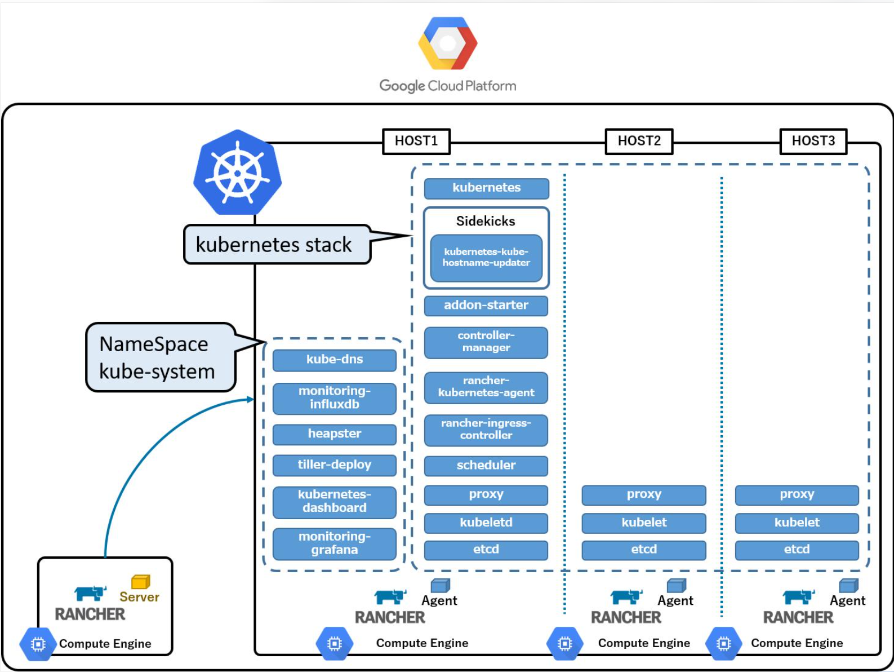

### Kubernetes
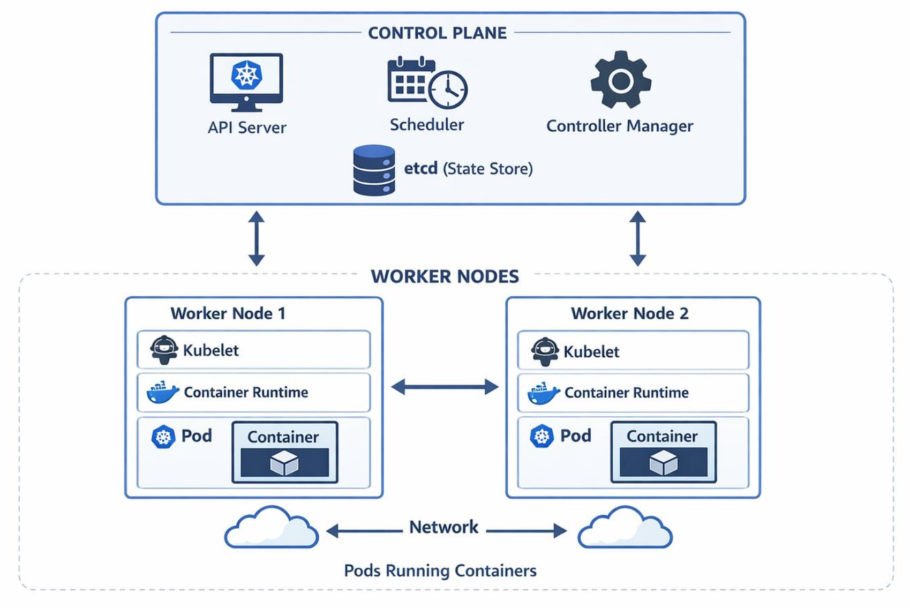

### Cluster Kubernetes
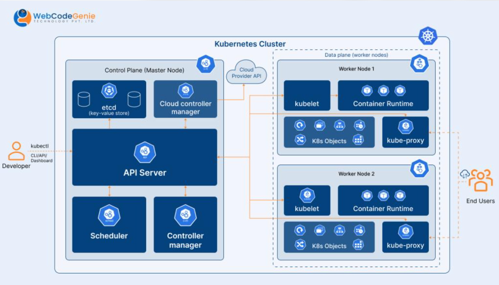
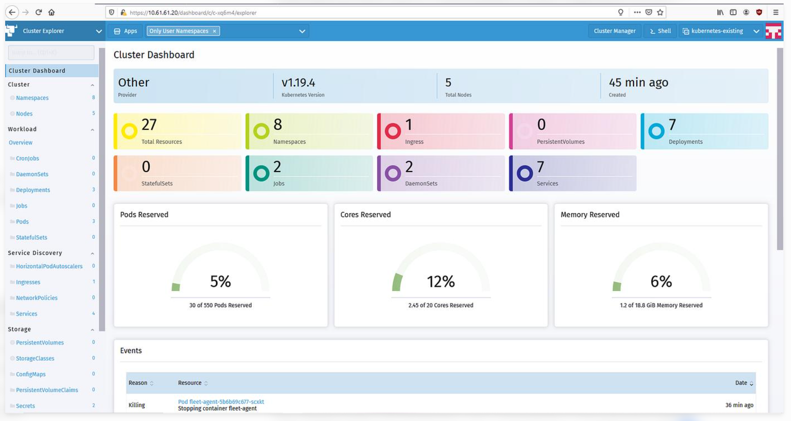

### Rancher
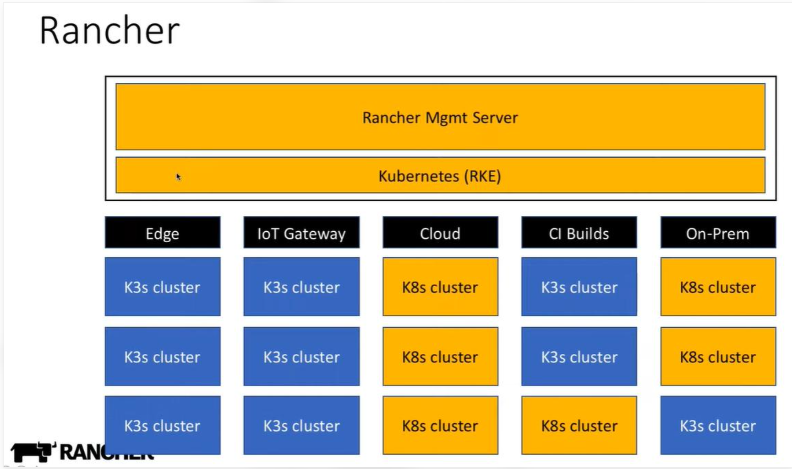

### Workflow Rancher
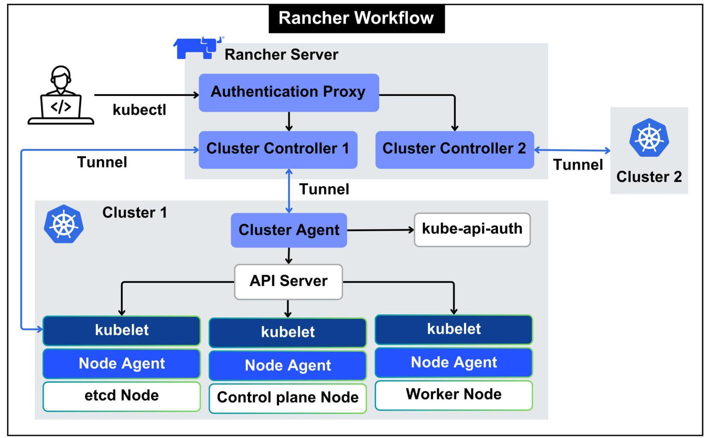

---

## 2. Architecture cible et plan d'adressage choisi

| Machine virtuelle (VMware) | Rôle | Nom d'hôte (`hostname`) | Interface | Adresse IP statique | Passerelle | DNS |
|---|---|---|---|---|---|---|
| `Ubuntu-server-01` | **Control Plane** | `k8s-control-plane` | `ens33` | `192.168.189.10/24` | `192.168.189.2` | `1.1.1.1`, `8.8.8.8` |
| `Ubuntu-worker-01` | **Worker 01** | `k8s-worker-01` | `ens33` | `192.168.189.11/24` | `192.168.189.2` | `1.1.1.1`, `8.8.8.8` |
| `Ubuntu-worker-03` | **Worker 02** | `k8s-worker-02` | `ens33` | `192.168.189.12/24` | `192.168.189.2` | `1.1.1.1`, `8.8.8.8` |


### Spécifications de l'environnement

- **Hyperviseur :** VMware Workstation (réseau NAT `VMnet8`)
- **Système d'exploitation :** Ubuntu Server LTS, sans interface graphique (vérifier la version exacte avec `lsb_release -a`)
- **Sous-réseau NAT :** `192.168.189.0/24` (plage DHCP VMware : `192.168.189.128` à `192.168.189.254`)
- **Adresse de l'hôte Windows sur VMnet8 :** `192.168.189.1`
- **Passerelle NAT :** `192.168.189.2`
- **Plage réservée aux adresses statiques :** `.3` à `.127` (les adresses `.10`, `.11` et `.12` sont hors de la plage DHCP, ce qui évite tout conflit)
- **Gestionnaire réseau :** Netplan (`/etc/netplan/50-cloud-init.yaml`)
- **Runtime de conteneurs :** `containerd` (avec `SystemdCgroup = true`)
- **Outils Kubernetes :** `kubeadm`, `kubelet`, `kubectl` (version à choisir, voir l'étape 5)
- **Réseau des pods (CNI) :** Flannel, `10.244.0.0/16`

> [!IMPORTANT]
> Le réseau des pods (`10.244.0.0/16`) ne doit jamais chevaucher le réseau des VM (`192.168.189.0/24`).

---

## 3. Objectifs du projet

1. Créer trois VM Ubuntu Server sous VMware Workstation en mode NAT (`VMnet8`).
2. Configurer un nom d'hôte unique sur chaque machine (`hostnamectl`).
3. Configurer les adresses IP statiques via Netplan avec la passerelle `192.168.189.2`.
4. Configurer la résolution des noms locale (`/etc/hosts`).
5. Vérifier la connectivité entre les nœuds et vers Internet.
6. Préparer les prérequis système (swap, modules noyau `overlay` et `br_netfilter`, paramètres `sysctl`).
7. Installer et configurer `containerd` avec `SystemdCgroup = true`.
8. Installer les outils Kubernetes (`kubeadm`, `kubelet`, `kubectl`).
9. Initialiser le Control Plane, installer le CNI et joindre les Workers.
10. Valider le cluster avec `kubectl get nodes -o wide`.
11. Installer et configurer Rancher pour l'administration.
12. Documenter les commandes, les résultats, les erreurs et les corrections.

---

## 4. Prérequis

- Trois VM Ubuntu Server avec un accès administrateur `sudo` sur chacune.
- Réseau virtuel permettant la communication entre les nœuds.
- Connectivité Internet pour télécharger les paquets et les images.
- Ressources CPU, mémoire et stockage adaptées (voir la note ci-dessous).
- VMware Workstation, un terminal Windows et un client SSH (par exemple MobaXterm) sur le poste d'administration.
- Swap désactivé sur les trois VM, sauf configuration explicitement compatible.
- Modules noyau et paramètres réseau nécessaires au runtime et au plugin CNI.
- État du pare-feu UFW identifié, avec les règles nécessaires entre les nœuds.
- Compatibilité vérifiée entre les versions de Kubernetes, containerd, du plugin CNI et de Rancher.
- Helm si Rancher est installé sur Kubernetes avec son chart.

> [!IMPORTANT]
> Kubernetes et Rancher peuvent demander davantage de ressources selon les composants installés. Une configuration minimale ne garantit pas de bonnes performances.

---

---

## 5. Structure de la documentation

```text
kubernetes-lab/
├── README-kubernetes-lab.md
├── LICENSE
├── .gitignore
└── docs/
    ├── 01-vm-setup.md
    ├── 02-network-dns.md
    ├── 03-container-runtime.md
    ├── 04-kubernetes.md
    ├── 05-rancher.md
    ├── 06-validation.md
    ├── 07-troubleshooting.md
    └── images/
        ├── Google-Cloud-Platform-01.png
        ├── Kubernetes-01.png
        ├── Kubernetes-Cluster-01.png
        ├── Cluster-Manager-01.png
        ├── Rancher-01.png
        ├── Rancher-workflow-01.png
        ├── creation-de-vm/
        ├── choix-de-l-iso/
        └── network-dns/
            ├── preparer-les-VM/
            ├── vm-settings/
            └── virtual-network-editor/
```

Créer les fichiers référencés avant de considérer la documentation comme complète.

---

## 6. Parcours d'installation et procédures

### Étape 1 - Créer et configurer les VM

Trois machines virtuelles personnalisées (Custom) sous VMware Workstation, avec l'ISO Ubuntu Server et le mode réseau **NAT (`VMnet8`)**.

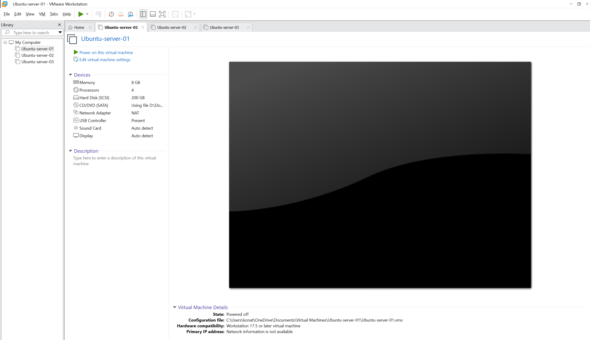

#### 1.1 - Choisir le type de machine virtuelle

- **Typical** : création rapide en quelques étapes, sans entrer dans la configuration avancée (système, emplacement, taille du disque).
- **Custom** : configuration personnalisée et précise (matériel, contrôleurs…). C'est l'option retenue pour ce laboratoire.

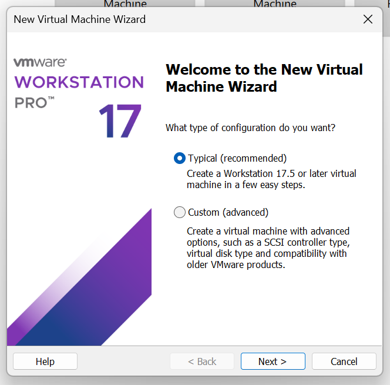

#### 1.2 - Configuration de l'assistant

Choisir **I will install the operating system later** pour garder la maîtrise de l'installation de l'ISO.

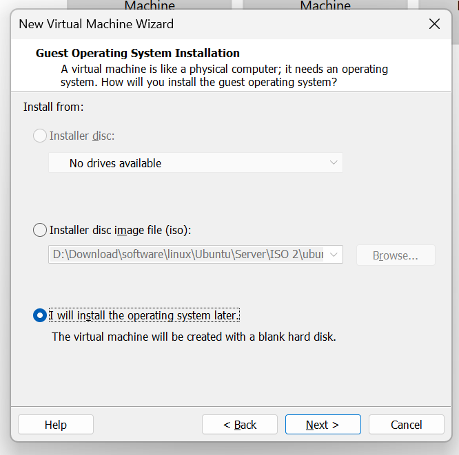

Sélectionner **Linux** et la version correspondante pour Ubuntu.

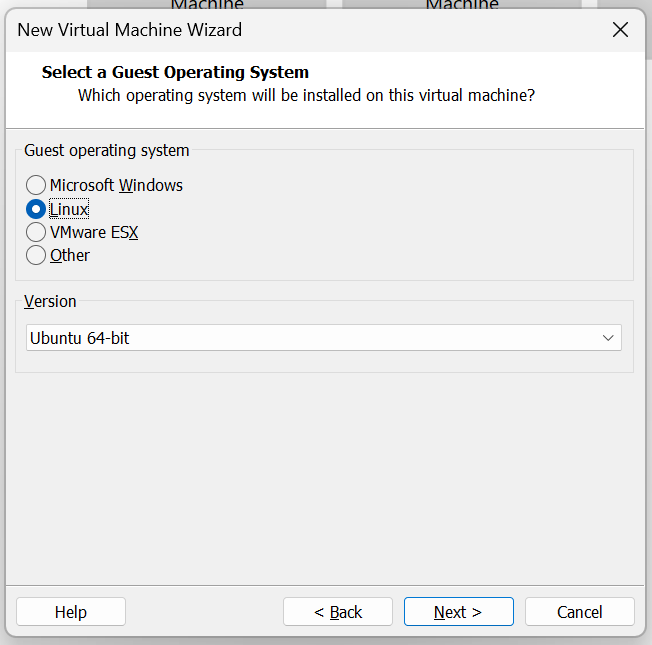

Donner un nom à la machine virtuelle.

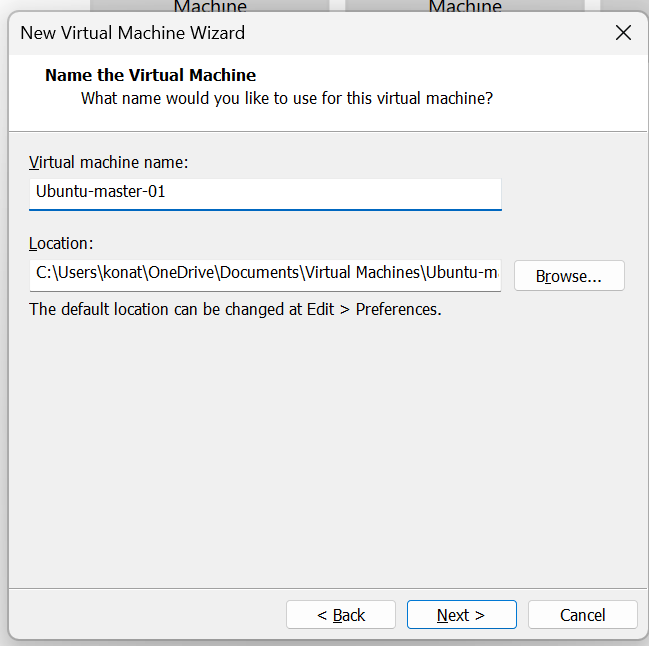

Attribuer les ressources processeur, la mémoire et la taille du disque.

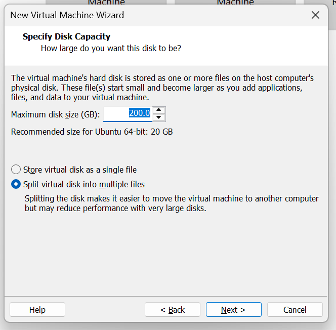

Finaliser la création, puis choisir l'ISO.

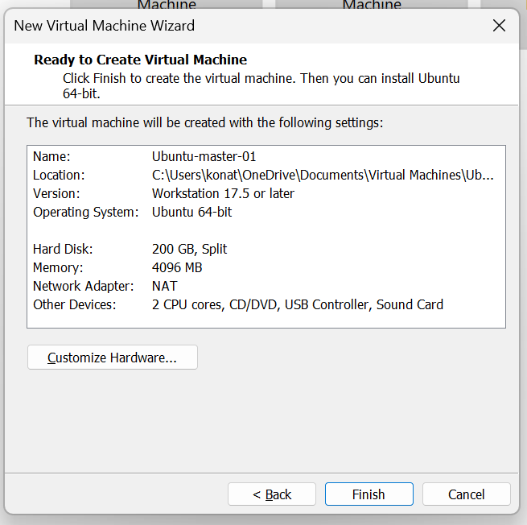

#### 1.3 - Associer l'image ISO Ubuntu Server

Clic droit sur la machine virtuelle, puis **Settings**.

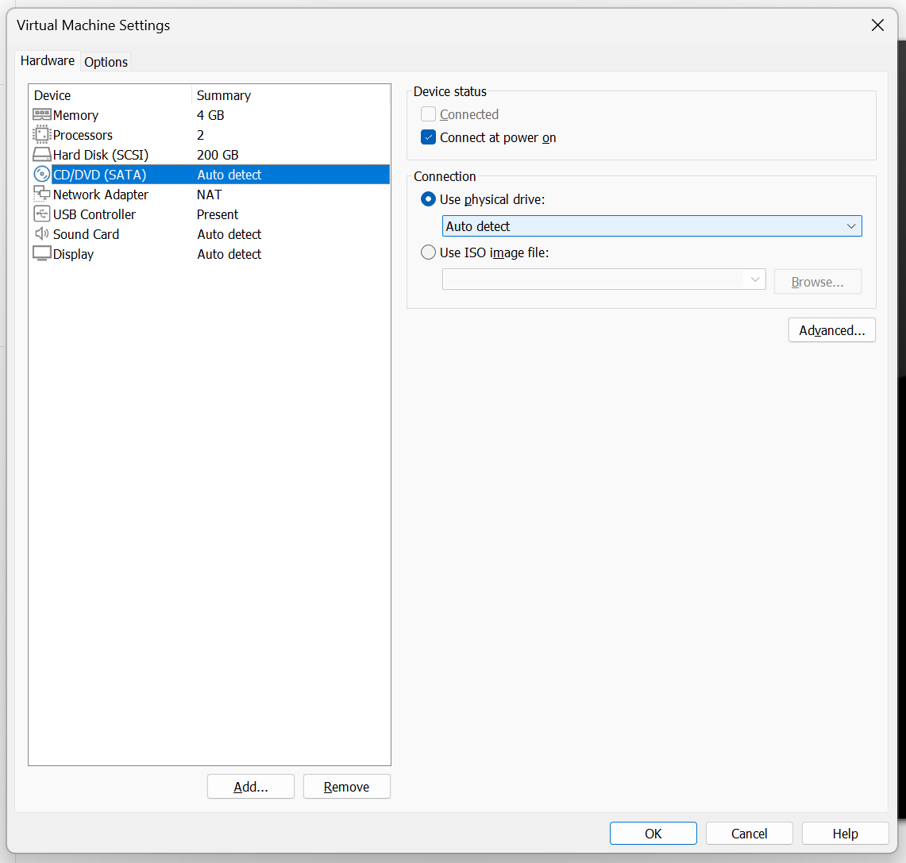

Sélectionner **CD/DVD (SATA)**, cocher **Connect at power on**, puis **Use ISO image file** et **Browse** pour choisir le fichier ISO. Le chemin utilisé ici est `D:\Download\software\linux\Ubuntu\Server\ISO`, il sera différent selon la machine.

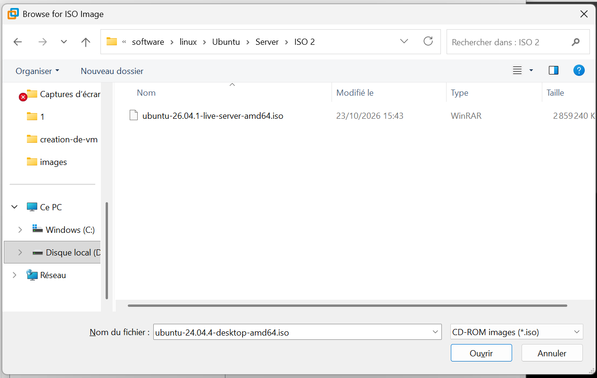

Valider avec **OK**.

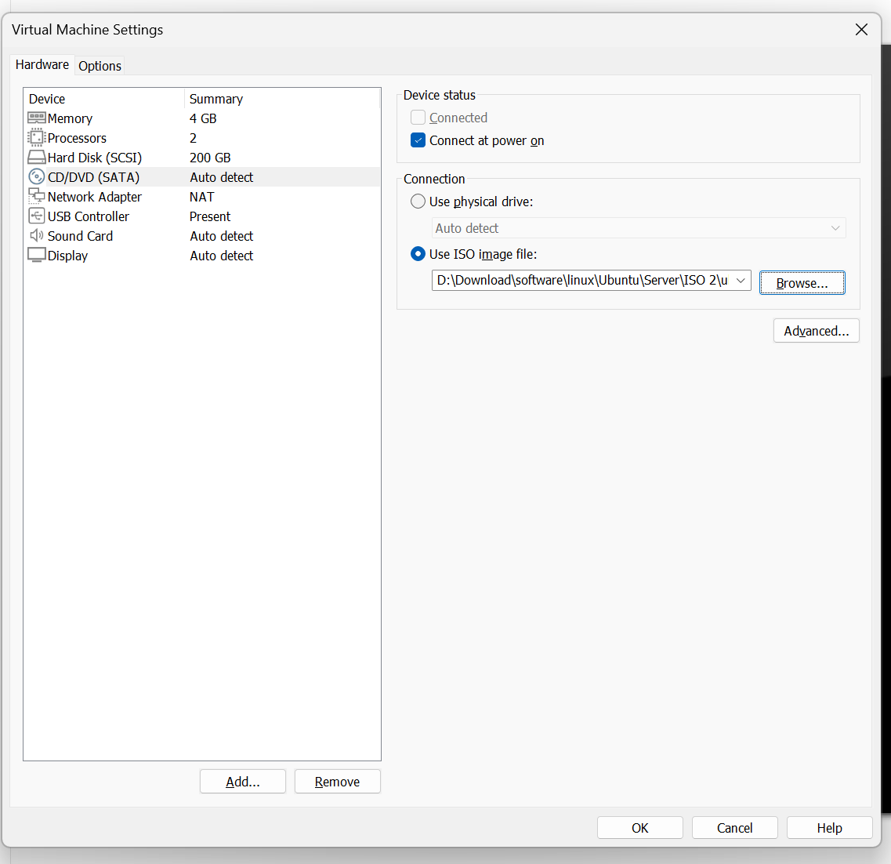

> [!NOTE]
> Si l'ISO n'a pas été choisi à la création, il suffit d'éteindre la VM, de refaire ces réglages, puis de rallumer : la VM démarre sur l'ISO car son disque est vide.

#### 1.4 - Carte réseau en NAT

Dans **Settings > Network Adapter**, choisir **NAT: Used to share the host's IP address** (équivalent à *Custom: VMnet8*). Cocher **Connect at power on**.

> [!WARNING]
> Une carte en **Bridged** place la VM sur le réseau de la box (`192.168.1.x`) : elle ne voit alors ni `VMnet8`, ni la passerelle `192.168.189.2`. C'est la cause d'un `Destination Host Unreachable` vers `.2` (voir la section 6, étape 9).

#### 1.5 - Questions de l'installateur Ubuntu

- **Clavier** : choisir la disposition **French** (un mot de passe correct refusé au login vient presque toujours d'un clavier QWERTY).
- **Réseau** : laisser le DHCP, l'IP statique sera définie après l'installation dans Netplan.
- **Proxy** : laisser vide.
- **Nom du serveur** : un nom unique par machine (obligatoire pour Kubernetes).
- **Featured server snaps** : ne rien cocher, surtout pas `microk8s`, qui entre en conflit avec une installation `kubeadm`.
- **OpenSSH server** : l'installer, pour se connecter avec MobaXterm.

> [!NOTE]
> Documenter la version d'Ubuntu, le nombre de CPU, la mémoire, le disque, le mode réseau VMware, les noms d'hôtes et la méthode d'accès SSH.

<details>
<summary><strong>Pour aller plus loin - Cloner une VM au lieu de réinstaller</strong></summary>

Une VM déjà configurée peut être clonée : éteindre la VM source, clic droit, **Manage > Clone**, puis **Create a full clone** (un *linked clone* dépend de la VM d'origine et ne démarre plus sans elle, ce qui est risqué pour un cluster).

Sur chaque clone, il faut ensuite :

```bash
sudo hostnamectl set-hostname k8s-worker-01
sudo nano /etc/netplan/50-cloud-init.yaml     # changer l'adresse IP
sudo rm /etc/machine-id /var/lib/dbus/machine-id
sudo systemd-machine-id-setup
```

Le `machine-id` doit être différent sur chaque nœud, sinon Kubernetes et le réseau peuvent se comporter de façon incohérente.

</details>

> [!DANGE]
<details>
<summary> cependant, dans certaines situation, elle peuvent ne pas afficher, sur l'interface mais elle est créer pour autant, dans ce cas allez dans<strong> Documents-Virtual Machines</strong> et supprimer manuellemnt les éléments créer qui ne marche pas, cars supprimer sur VMWare seul ne suffit pas, les fichiers reste présent</summary>
</details>

---

### Étape 2 - Configurer le réseau (Netplan) et les noms


#### 2.0 - Plan d'adressage validé (remplace le plan initial)

Le plan de la section 2 correspond à ce qui avait été choisi au départ et configuré à l'installation, avec des VM nommées `Ubuntu-server-01`, `Ubuntu-worker-01`… Il a ensuite été modifié : les VM VMware portent désormais le même nom que leur nom d'hôte, pour éviter toute confusion entre le nom de la VM et celui de la machine.

C'est ce plan **validé** qui est appliqué dans la suite de l'étape.

| Machine virtuelle (VMware) | Rôle | Nom d'hôte (`hostname`) | Interface | Adresse IP statique | Passerelle | DNS |
|---|---|---|---|---|---|---|
| `k8s-control-plane` | **Control Plane** | `k8s-control-plane` | `ens33` | `192.168.189.10/24` | `192.168.189.2` | `1.1.1.1`, `8.8.8.8` |
| `k8s-worker-01` | **Worker 01** | `k8s-worker-01` | `ens33` | `192.168.189.11/24` | `192.168.189.2` | `1.1.1.1`, `8.8.8.8` |
| `k8s-worker-02` | **Worker 02** | `k8s-worker-02` | `ens33` | `192.168.189.12/24` | `192.168.189.2` | `1.1.1.1`, `8.8.8.8` |

#### 2.1 - Vérifier la configuration VMware

Dans **Edit > Virtual Network Editor**, sélectionner `VMnet8` :

- type **NAT**, sous-réseau `192.168.189.0`, masque `255.255.255.0` ;
- **NAT Settings** : passerelle `192.168.189.2` ;
- **DHCP Settings** : plage `192.168.189.128` à `192.168.189.254`.

Les captures de référence sont conservées dans `docs/images/network-dns/`.

<details>
<summary><strong>Pour aller plus loin - Comprendre les modes réseau VMware</strong></summary>

| Mode | Réseau virtuel | Effet |
|---|---|---|
| **Bridged** | `VMnet0` | La VM est sur le réseau physique (box), avec une IP de celui-ci. |
| **NAT** | `VMnet8` | Les VM partagent un réseau privé et sortent sur Internet via l'hôte. Les VM se parlent entre elles et l'hôte les joint via `192.168.189.1`. |
| **Host-only** | `VMnet1` | Réseau privé entre VM et hôte, sans accès à Internet. |
| **Custom** | au choix | Choisir soi-même le réseau virtuel. *Custom + VMnet8* équivaut à *NAT*. |

NAT est le meilleur choix pour ce lab : les adresses des VM restent indépendantes de la box et du Wi-Fi, ce qui est stable pour un cluster. Un réseau Custom n'est utile que pour isoler un cluster ou séparer plusieurs labs.

Sur l'ancien Ubuntu Desktop, le réseau marchait car le **DHCP** de VMware fournissait IP, passerelle et DNS automatiquement. En IP statique, rien n'est fourni : la passerelle et les DNS doivent être écrits dans Netplan (c'est le cas ci-dessous).

</details>

#### 2.2 - Diagnostiquer le réseau Ubuntu actuel

Sur chaque machine :

```bash
ip -br address
ip route
resolvectl status
hostnamectl
ls -la /etc/netplan/
sudo netplan get
sudo ufw status verbose
```

Si le pare-feu UFW est actif, identifier les règles nécessaires à l'API Kubernetes, aux échanges entre nœuds et au CNI. Ne pas le désactiver systématiquement.

#### 2.3 - Configuration Netplan par machine

Fichier `/etc/netplan/50-cloud-init.yaml`. Seule l'adresse change d'une machine à l'autre.

**k8s-control-plane (`192.168.189.10`)**

```yaml
network:
  version: 2
  ethernets:
    ens33:
      dhcp4: false
      addresses:
        - 192.168.189.10/24
      routes:
        - to: default
          via: 192.168.189.2
      nameservers:
        addresses:
          - 1.1.1.1
          - 8.8.8.8
```

**k8s-worker-01 (`192.168.189.11`)** : même fichier avec `- 192.168.189.11/24`.

**k8s-worker-02 (`192.168.189.12`)** : même fichier avec `- 192.168.189.12/24`.

> [!IMPORTANT]
> Le YAML est sensible à l'indentation (espaces, jamais de tabulations). Vérifier le nom de l'interface avec `ip -br addr` : si ce n'est pas `ens33`, utiliser le nom réel.

#### 2.4 - Appliquer et sécuriser

```bash
sudo cp /etc/netplan/50-cloud-init.yaml /etc/netplan/50-cloud-init.yaml.bak
sudo chmod 600 /etc/netplan/*.yaml
sudo netplan generate
sudo netplan apply
ip -br address
ip route
```

`netplan generate` vérifie la syntaxe avant l'application. Le `chmod 600` supprime l'avertissement « Permissions … are too open ».

<details>
<summary><strong>Pour aller plus loin - Empêcher cloud-init de réécrire le réseau</strong></summary>

`cloud-init` peut régénérer `50-cloud-init.yaml` au redémarrage. Pour garder la configuration statique :

```bash
echo 'network: {config: disabled}' | sudo tee /etc/cloud/cloud.cfg.d/99-disable-network-config.cfg
```

Garder un seul fichier Netplan actif évite les conflits (par exemple un `01netcfg.yml` vide en plus). Ne pas supprimer un fichier à l'aveugle : vérifier d'abord son rôle avec `sudo netplan get`.

</details>

#### 2.5 - Nom d'hôte unique

Sur chaque machine :

```bash
sudo hostnamectl set-hostname k8s-control-plane   # k8s-worker-01 / k8s-worker-02 sur les workers
hostnamectl
```

#### 2.6 - Résolution de noms locale (`/etc/hosts`)

Sur les trois nœuds, ajouter à `/etc/hosts` :

```text
192.168.189.10 k8s-control-plane
192.168.189.11 k8s-worker-01
192.168.189.12 k8s-worker-02
```

#### 2.7 - Valider le réseau

Depuis le Control Plane :

```bash
ping -c 3 192.168.189.2
ping -c 3 192.168.189.11
ping -c 3 192.168.189.12
getent hosts k8s-worker-01
getent hosts k8s-worker-02
getent hosts archive.ubuntu.com
sudo apt update
```

> [!NOTE]
> Un `ping` vers l'extérieur peut échouer alors qu'Internet fonctionne (ICMP filtré par le NAT, un pare-feu ou un VPN). Le test fiable est `sudo apt update` ou `curl -I https://archive.ubuntu.com`, avec la résolution DNS (`getent hosts`).

<details>
<summary><strong>Pour aller plus loin - Interpréter les résultats de ping</strong></summary>

| Symptôme | Cause probable |
|---|---|
| `Destination Host Unreachable` venant de l'IP de la VM elle-même, même vers `.2` et `.1` | La carte n'est pas sur `VMnet8` (souvent en Bridged), ou n'est pas connectée. |
| La passerelle `.2` répond, mais pas `1.1.1.1` | Service **VMware NAT Service** arrêté sous Windows (`services.msc`). |
| `1.1.1.1` répond mais pas `archive.ubuntu.com` | Problème de DNS : revoir la section `nameservers`, ou essayer `192.168.189.2` comme DNS (la passerelle VMware relaie le DNS de Windows). |
| Pas d'IP du tout au démarrage | **VMware DHCP Service** arrêté, ou carte non connectée. |

</details>

---

### Étape 3 - Préparer le système (prérequis Kubernetes)

À réaliser sur les trois nœuds.

**1. Désactiver le swap**

```bash
sudo swapoff -a
sudo sed -i '/ swap / s/^/#/' /etc/fstab
```

**2. Charger les modules noyau `overlay` et `br_netfilter`**

```bash
sudo tee /etc/modules-load.d/k8s.conf <<EOF
overlay
br_netfilter
EOF

sudo modprobe overlay
sudo modprobe br_netfilter
```

**3. Paramètres `sysctl`**

```bash
sudo tee /etc/sysctl.d/k8s.conf <<EOF
net.bridge.bridge-nf-call-iptables  = 1
net.bridge.bridge-nf-call-ip6tables = 1
net.ipv4.ip_forward                 = 1
EOF

sudo sysctl --system
```

**4. Vérifier**

```bash
free -h
lsmod | grep -E 'overlay|br_netfilter'
sysctl net.ipv4.ip_forward
```

> [!NOTE]
> Documenter les modifications persistantes (`/etc/fstab`, `/etc/modules-load.d/`, `/etc/sysctl.d/`) pour qu'elles restent cohérentes après un redémarrage.

---

### Étape 4 - Installer le runtime de conteneurs (`containerd`)

À réaliser sur les trois nœuds.

```bash
sudo apt-get update
sudo apt-get install -y containerd

sudo mkdir -p /etc/containerd
containerd config default | sudo tee /etc/containerd/config.toml
sudo sed -i 's/SystemdCgroup = false/SystemdCgroup = true/' /etc/containerd/config.toml

sudo systemctl restart containerd
sudo systemctl enable containerd
sudo systemctl status containerd --no-pager
```

> [!NOTE]
> `containerd` doit être configuré avec une interface CRI compatible avec la version de Kubernetes installée, et `SystemdCgroup = true` pour s'aligner sur le cgroup driver de `kubelet`.

<details>
<summary><strong>Pour aller plus loin - Docker et Kubernetes</strong></summary>

Depuis Kubernetes 1.24, Docker Engine n'est plus pris en charge directement comme runtime natif. Il n'est pas nécessaire d'installer Docker Engine sur les nœuds pour utiliser `containerd`. Docker peut être utilisé séparément, ou avec un adaptateur CRI approprié.

Si `sudo systemctl status containerd` répond `Unit containerd.service could not be found`, le paquet n'est pas installé : vérifier d'abord la connectivité (`sudo apt update`).

</details>

---

### Étape 5 - Installer les outils Kubernetes (`kubeadm`, `kubelet`, `kubectl`)

À réaliser sur les trois nœuds. Choisir la version de Kubernetes et remplacer `v1.30` ci-dessous par la version souhaitée.

> [!WARNING]
> Vérifier sur la documentation officielle quelle version est encore supportée avant d'installer : `v1.30` est donnée ici à titre d'exemple et peut ne plus être maintenue. Les versions de `kubeadm`, `kubelet` et `kubectl` doivent être compatibles entre elles.

```bash
sudo apt-get update
sudo apt-get install -y apt-transport-https ca-certificates curl gpg

sudo mkdir -p -m 755 /etc/apt/keyrings
curl -fsSL https://pkgs.k8s.io/core:/stable:/v1.30/deb/Release.key \
  | sudo gpg --dearmor -o /etc/apt/keyrings/kubernetes-apt-keyring.gpg

echo 'deb [signed-by=/etc/apt/keyrings/kubernetes-apt-keyring.gpg] https://pkgs.k8s.io/core:/stable:/v1.30/deb/ /' \
  | sudo tee /etc/apt/sources.list.d/kubernetes.list

sudo apt-get update
sudo apt-get install -y kubelet kubeadm kubectl
sudo apt-mark hold kubelet kubeadm kubectl
sudo systemctl enable --now kubelet
```

`apt-mark hold` empêche une mise à jour automatique accidentelle des composants.

---

### Étape 6 - Initialiser le cluster

#### 6.1 - Control Plane (`k8s-control-plane`)

Avant l'initialisation, vérifier sur les trois VM : runtime actif, modules et paramètres noyau chargés, swap désactivé, versions compatibles, communication réseau fonctionnelle.

```bash
sudo kubeadm init \
  --apiserver-advertise-address=192.168.189.10 \
  --pod-network-cidr=10.244.0.0/16
```

Configurer `kubectl` pour l'utilisateur courant :

```bash
mkdir -p $HOME/.kube
sudo cp -i /etc/kubernetes/admin.conf $HOME/.kube/config
sudo chown $(id -u):$(id -g) $HOME/.kube/config
```

> [!IMPORTANT]
> Fixer définitivement les trois adresses IP **avant** `kubeadm init` : le cluster mémorise l'adresse du Control Plane, et la changer ensuite pose problème.

#### 6.2 - Installer le plugin réseau (CNI)

Flannel (retenu pour ce lab, avec `10.244.0.0/16`) :

```bash
kubectl apply -f https://github.com/flannel-io/flannel/releases/latest/download/kube-flannel.yml
```

<details>
<summary><strong>Pour aller plus loin - Choisir un autre CNI</strong></summary>

Calico, Cilium ou Weave sont des alternatives. Chaque CNI attend un CIDR de pods précis (à passer à `--pod-network-cidr`) et peut demander des règles de pare-feu supplémentaires. Vérifier la compatibilité avec la version de Kubernetes avant de choisir.

</details>

#### 6.3 - Joindre les Workers

Sur le Control Plane, générer la commande de jonction :

```bash
kubeadm token create --print-join-command
```

Puis l'exécuter avec `sudo` sur `k8s-worker-01` et `k8s-worker-02` :

```bash
sudo kubeadm join 192.168.189.10:6443 --token <TOKEN> --discovery-token-ca-cert-hash sha256:<HASH>
```

> [!CAUTION]
> Ne publie jamais dans le dépôt une commande `kubeadm join` contenant son jeton, une clé privée SSH, un mot de passe ou un kubeconfig sensible.

---

### Étape 7 - Installer Rancher

Pour ce laboratoire, étudier l'installation de Rancher sur Kubernetes avec Helm. Avant le déploiement, vérifier les prérequis officiels, installer Helm sur le poste d'administration (ou une machine ayant accès au cluster) et préparer l'accès HTTPS avec un certificat adapté.

Trame de la méthode Helm (à adapter aux versions et au nom d'hôte choisi) :

```bash
helm repo add rancher-latest https://releases.rancher.com/server-charts/latest
helm repo add jetstack https://charts.jetstack.io
helm repo update

kubectl create namespace cattle-system

helm install cert-manager jetstack/cert-manager \
  --namespace cert-manager --create-namespace \
  --set crds.enabled=true

helm install rancher rancher-latest/rancher \
  --namespace cattle-system \
  --set hostname=rancher.<votre-domaine-ou-ip>
```

<details>
<summary><strong>Pour aller plus loin - Rancher en conteneur Docker unique</strong></summary>

Un conteneur Docker Rancher unique peut servir à des tests rapides, mais cette méthode ne doit pas être présentée comme une architecture de production. Pour un déploiement destiné à durer, privilégier l'installation sur Kubernetes avec Helm.

</details>

---

### Étape 8 - Valider le cluster

Depuis le Control Plane :

```bash
kubectl get nodes -o wide
kubectl get pods -A
kubectl cluster-info
```

> [!TIP]
> Vérifier que les trois nœuds sont `Ready`, que les pods système fonctionnent et qu'un déploiement de test démarre correctement avant de déclarer le cluster opérationnel.

Test de déploiement :

```bash
kubectl create deployment nginx-test --image=nginx
kubectl get pods -o wide
kubectl delete deployment nginx-test
```

---

### Étape 9 - Documenter les problèmes (troubleshooting)

Pour chaque incident, noter : le message d'erreur exact, la machine concernée, les commandes de diagnostic, la cause confirmée si elle est connue, la correction et le résultat après correction.

Incidents déjà rencontrés pendant ce laboratoire :

| Symptôme | Cause confirmée | Correction |
|---|---|---|
| `ping 192.168.189.2` : `Destination Host Unreachable` depuis `192.168.189.10` | Carte réseau de la VM en **Bridged** au lieu de NAT | Éteindre la VM, **Settings > Network Adapter > NAT**, rallumer |
| `Invalid YAML: inconsistent indentation` au `netplan apply` | Indentation incorrecte de la ligne `via:` | Aligner `via:` sous `to:` (espaces uniquement) |
| Netplan ne prend pas la configuration | Fautes de frappe : `namesservers` au lieu de `nameservers`, `/244` au lieu de `/24` | Corriger le fichier puis `sudo netplan generate` |
| `Permissions for /etc/netplan/…yaml are too open` | Droits trop larges sur le fichier | `sudo chmod 600 /etc/netplan/*.yaml` |
| `Temporary failure in name resolution` | DNS absent ou réseau non fonctionnel | Vérifier la passerelle, puis la section `nameservers` |
| Ping vers `1.1.1.1` sans réponse alors qu'`apt update` fonctionne | ICMP filtré par le NAT | Tester avec `apt update` ou `curl` plutôt qu'avec `ping` |
| `Unit containerd.service could not be found` | `containerd` non installé (paquets non téléchargés faute de réseau) | Rétablir le réseau, puis `sudo apt install -y containerd` |
| Login ou mot de passe refusé sur une VM neuve | Clavier QWERTY choisi à l'installation | Réinstaller en choisissant la disposition **French** |
| Plusieurs VM avec le même nom ou le même `machine-id` | VM clonée sans personnalisation | `hostnamectl set-hostname`, puis régénérer le `machine-id` |

---

## 7. Critères de réussite

- [ ] Les trois VM démarrent correctement.
- [ ] Les cartes réseau sont en NAT (`VMnet8`).
- [ ] Les noms d'hôtes sont uniques et corrects.
- [ ] Les adresses IP sont configurées sans conflit.
- [ ] Les nœuds communiquent entre eux et accèdent à Internet.
- [ ] Le runtime fonctionne sur chaque nœud.
- [ ] Le Control Plane est initialisé.
- [ ] Les deux Workers ont rejoint le cluster.
- [ ] `kubectl get nodes -o wide` affiche trois nœuds `Ready`.
- [ ] Les pods système sont dans un état attendu.
- [ ] Un déploiement de test fonctionne.
- [ ] Rancher est accessible et permet de consulter le cluster.
- [ ] Les versions, commandes et résultats sont documentés.

> [!IMPORTANT]
> Coche chaque case uniquement après avoir effectué et vérifié le test correspondant.

---

## 8. Sécurité et bonnes pratiques

> [!CAUTION]
> Ne versionne jamais une clé privée SSH, un mot de passe, un jeton ou un kubeconfig sensible. Vérifie toujours les fichiers à publier avant un commit.

- Vérifier `git status` avant chaque commit.
- Ne pas publier de captures contenant des secrets ou des informations sensibles.
- Noter les versions utilisées et vérifier leur compatibilité.
- Sauvegarder les fichiers de configuration avant de les modifier.
- Indiquer sur quelle machine chaque commande doit être exécutée.
- Distinguer les commandes exécutées des commandes proposées.
- Ne pas déclarer une étape réussie sans vérification.
- Utiliser un mot de passe simple uniquement pour le laboratoire, et le durcir avant tout usage réel.

---

## 9. Références officielles

- [Documentation Kubernetes](https://kubernetes.io/docs/home/)
- [Installation de kubeadm](https://kubernetes.io/docs/setup/production-environment/tools/kubeadm/install-kubeadm/)
- [Documentation Ubuntu Server](https://documentation.ubuntu.com/server/)
- [Documentation Netplan](https://netplan.readthedocs.io/)
- [Documentation containerd](https://containerd.io/docs/)
- [Documentation Helm](https://helm.sh/docs/)
- [Documentation Rancher](https://ranchermanager.docs.rancher.com/)
- [Installer Rancher sur Kubernetes avec Helm](https://ranchermanager.docs.rancher.com/getting-started/installation-and-upgrade/install-upgrade-on-a-kubernetes-cluster)
- [Installer Docker Engine sur Ubuntu](https://docs.docker.com/engine/install/ubuntu/)

---

## 10. État actuel

> [!NOTE]
> Le dépôt a été cloné sur le poste Windows. La clé SSH a été créée et ajoutée au compte GitHub, et le test `ssh -T git@github.com` a réussi.

> [!WARNING]
> La documentation des étapes et les captures doivent encore être complétées. L'installation de Kubernetes et de Rancher reste à effectuer et à valider.

**Dernière mise à jour :** 2026-10-28.

